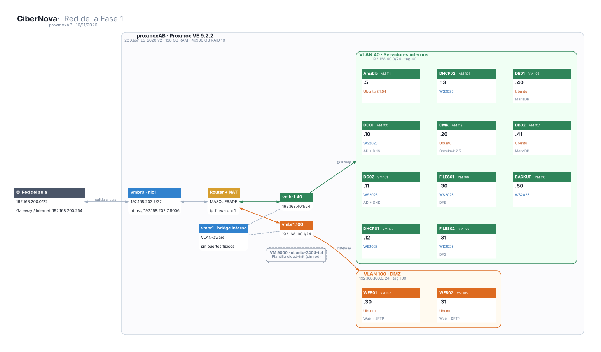

# Proyecto Intermodular · CiberNova Solutions · Grupo 7

Infraestructura virtualizada, redundante y documentada para CiberNova Solutions (89 empleados, sedes en Barcelona, Madrid y Valencia).

**Equipo:** Berta Sipek y Alex Gutiérrez (ASIR)
**Fase actual:** Fase 1 · Infraestructura (entrega interna 4/12/2026)

## Índice del repositorio

| Ruta | Contenido |
| --- | --- |
| [`docs/memoria-fase1.md`](docs/memoria-fase1.md) | Memoria de la Fase 1: calendario, bitácora, desfases, decisiones técnicas, inventario, problemas y soluciones |
| [`docs/anexo-i-usuarios-grupos-permisos.md`](docs/anexo-i-usuarios-grupos-permisos.md) | Diseño del Anexo I: OUs, grupos AGDLP y matriz de permisos |
| [`docs/img/fase1/`](docs/img/fase1/) | Capturas que se enlazan desde la memoria |
| [`docs/historico/propuesta-inicial.pdf`](docs/historico/propuesta-inicial.pdf) | Propuesta inicial de la Fase 1, superada por el diseño actual (ver sección 4 de la memoria) |
| [`ansible/`](ansible/) | Inventario, variables y playbooks de Ansible (secretos cifrados con Ansible Vault) |
| [`configs/proxmox/`](configs/proxmox/) | Configuración de red de Proxmox (bridges, VLANs y NAT) |
| `scripts/` | Scripts del Anexo I (alta de usuarios desde el CSV). *Pendiente* |

## Diagrama de red

> Fuente editable: [`docs/diagramas/red-fase1.dot`](docs/diagramas/red-fase1.dot) (Graphviz).
> Para regenerarlo: `dot -Tsvg docs/diagramas/red-fase1.dot -o docs/diagramas/red-fase1.svg`

## Estado de la Fase 1

| Bloque | Estado |
| --- | --- |
| Hipervisor Proxmox con RAID | Hecho |
| Red: VLAN 40, DMZ (VLAN 100) y NAT | Hecho (sin filtrado entre VLANs, ver memoria) |
| Plantilla Ubuntu 24.04 con cloud-init | Hecho |
| Ansible + Vault | Hecho |
| Monitorización con Checkmk (alta automática) | Hecho |
| VMs Windows Server 2025 | Creadas con Ansible, instalación en curso |
| Active Directory, DHCP, ficheros/DFS, web, SFTP, BBDD, backups | Pendiente |

## Cómo se trabaja en este repositorio

- Commit al final de cada sesión de clase, con [Conventional Commits](https://www.conventionalcommits.org/es/) (`feat:`, `fix:`, `docs:`, `chore:`).
- Ningún secreto en claro: las contraseñas van en `ansible/group_vars/all/vault.yml`, cifrado con Ansible Vault.
- Las capturas se guardan en `docs/img/fase1/` con el número de la sección de la memoria delante (`06-…`, `09-…`, `12-…`).
