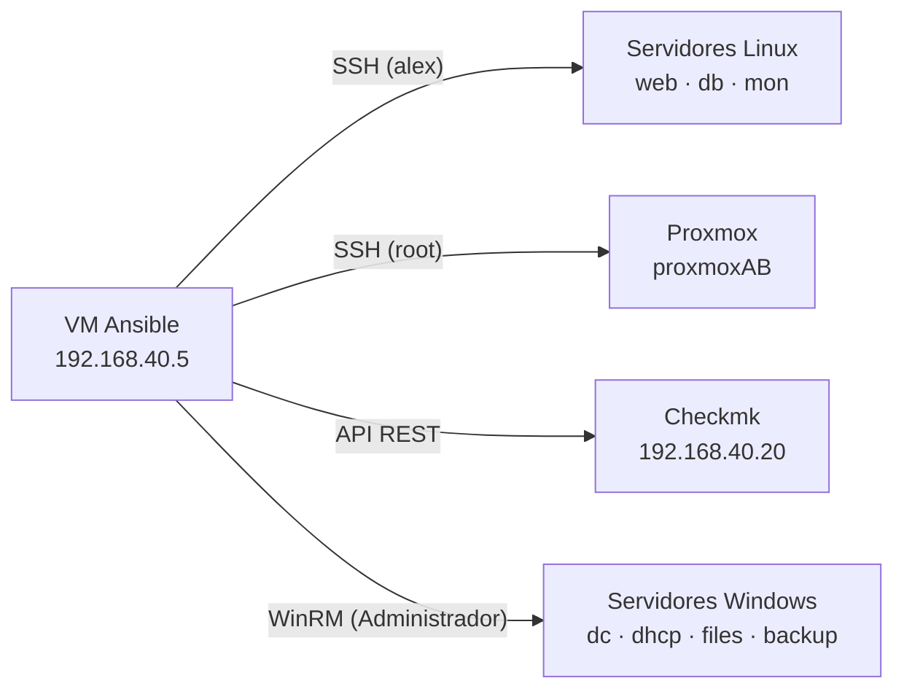

# Ansible — CiberNova Solutions

Automatización de la infraestructura de la Fase 1: monitorización con Checkmk, preparación de las VMs Windows en Proxmox y Active Directory, DNS y DHCP en Windows Server 2025.

> **Origen de esta carpeta.** Ansible se ejecuta en la **VM Ansible** (`192.168.40.5`, carpeta `~/cibernova/ansible`). Lo que hay aquí es una copia versionada de ese proyecto.
> 
> Versión: **Ansible core 2.16.3**. Playbooks de Windows copiados del paquete de Guti del **16/11/2026** (no comparados directamente con la VM).
> 
> Si se modifica algo en la VM, hay que copiarlo también aquí y actualizar esta fecha.

## Índice

1. [Cómo funciona](#1-cómo-funciona)
2. [Estructura de la carpeta](#2-estructura-de-la-carpeta)
3. [Inventario](#3-inventario)
4. [Playbooks](#4-playbooks)
5. [Cómo ejecutarlo](#5-cómo-ejecutarlo)
6. [Gestión de secretos (Ansible Vault)](#6-gestión-de-secretos-ansible-vault)
7. [Riesgos conocidos](#7-riesgos-conocidos)

---

## 1. Cómo funciona

Ansible no instala ningún programa en los servidores que gestiona: se conecta a ellos por **SSH** y ejecuta las tareas con el Python que ya trae Ubuntu. En Windows se conecta por **WinRM** (HTTP 5985 con NTLM y mensaje cifrado), sin instalar nada: basta con `Enable-PSRemoting`.



Conceptos que se usan en este documento:

| Concepto | Qué es |
| --- | --- |
| **Inventario** | Lista de máquinas que gestiona Ansible, ordenadas por grupos. |
| **Playbook** | Receta: lista de tareas que Ansible ejecuta sobre un grupo de máquinas. |
| **Colección** | Paquete de módulos extra que no vienen con Ansible (por ejemplo, para hablar con la API de Checkmk). |
| **Idempotente** | Ejecutarlo dos veces deja el sistema igual que ejecutarlo una: la segunda vez no cambia nada ni da error. |
| **Ansible Vault** | Herramienta de Ansible para cifrar ficheros con secretos y poder subirlos a Git sin que se puedan leer. |

## 2. Estructura de la carpeta

| Fichero | Para qué sirve |
| --- | --- |
| `ansible.cfg` | Configuración de Ansible para este proyecto. Indica dónde está el inventario y desactiva la comprobación de la huella SSH de los servidores (`host_key_checking = False`). Ver [riesgos](#7-riesgos-conocidos). |
| `requirements.yml` | Colecciones externas necesarias. Ahora solo `checkmk.general`, que aporta los módulos para crear hosts, descubrir servicios y activar cambios en Checkmk. Sin ella, `checkmk-agente.yml` falla. |
| `inventory/inventario.ini` | Máquinas gestionadas y sus grupos. Ver [Inventario](#3-inventario). |
| `group_vars/all/ad.yml` | Datos del dominio: nombre `cibernova.local`, NetBIOS, IPs de los DC, reenviadores DNS y NTP. |
| `group_vars/windows.yml` | Conexión WinRM con los Windows (puerto, NTLM, cuenta `Administrador`) y `become` runas para el doble salto. |
| `group_vars/dhcp.yml` | Ámbito DHCP de la VLAN 50 (propuesta) y nombre del failover. |
| `vars/ad_estructura.yml` | Árbol de OUs y directiva de contraseñas del Anexo I; lo carga `ad-03-estructura.yml`. |
| `group_vars/all/vars.yml` | Variables comunes a todas las máquinas: versión de Checkmk, nombre del sitio e IP del servidor. Si cambia la versión, solo se modifica aquí. |
| `group_vars/all/vault.yml` | Variables secretas, cifradas con Ansible Vault: secreto del usuario `automation` de Checkmk, contraseña del Administrador de Windows, DSRM y secreto del failover DHCP. **Todavía no está subido.** |
| `host_vars/` | Variables de una sola máquina, para cuando necesite un valor distinto al de su grupo. Ahora está vacía. |

> `group_vars/all/` significa "variables del grupo `all`". En Ansible, `all` incluye todas las máquinas, así que estas variables se cargan en cualquier playbook.

## 3. Inventario

| Grupo | Máquinas | Usuario | Uso |
| --- | --- | --- | --- |
| `control` | La propia VM Ansible (`localhost`) | — | Tareas que se ejecutan en la VM Ansible, como las llamadas a la API de Checkmk. |
| `web` | WEB01, WEB02 (VLAN 100, DMZ) | `alex` | Servidores web. |
| `db` | DB01, DB02 (VLAN 40) | `alex` | Bases de datos. |
| `mon` | CMK (VLAN 40) | `alex` | Servidor Checkmk. |
| `linux` | `web` + `db` + `mon` | `alex` | Todas las Linux gestionadas. Sobre este grupo se instala el agente de Checkmk. |
| `dc` | DC01 (.10), DC02 (.11) | `Administrador` (WinRM) | Controladores de dominio con DNS. |
| `dhcp` | DHCP01 (.12), DHCP02 (.13) | `Administrador` (WinRM) | DHCP con failover. |
| `files` | FILES01 (.30), FILES02 (.31) | `Administrador` (WinRM) | Servidores de ficheros. |
| `backup` | BACKUP (.50) | `Administrador` (WinRM) | Copias de seguridad. |
| `miembros` | `dhcp` + `files` + `backup` | — | Servidores que se unen al dominio sin ser DC. |
| `windows` | `dc` + `miembros` | — | Las 7 Windows. Su conexión está en `group_vars/windows.yml`. |
| `proxmox` | proxmoxAB | `root` | El hipervisor. Va **fuera** del grupo `linux` para que el playbook del agente no instale Checkmk en Proxmox. |

## 4. Playbooks

| Playbook | Fecha | Hosts | Qué hace |
|---|---|---|---|
| `checkmk-servidor.yml` | 05/11 | `mon` | Instala Checkmk 2.5.0p18 Community y crea el sitio `cibernova` (utiliza `creates` para garantizar la idempotencia). |
| `checkmk-agente.yml` | 05/11 | `linux` | En cada servidor Linux:<br><br>1. Instala el agente de Checkmk, encargado de enviar los datos del servidor.<br>2. Comprueba que el agente responde correctamente.<br>3. Desde la VM Ansible, utiliza la API REST de Checkmk para dar de alta el host, descubrir sus servicios (CPU, RAM, discos, red, etc.) y activar los cambios. |
| `proxmox-vms-windows.yml` | 12/11 | `proxmox` | 1. Comprueba que existen las ISO de Windows Server 2025 y `virtio-win` antes de realizar cualquier modificación, evitando dejar VMs a medias.<br>2. Guarda la configuración actual de cada VM en `/root/qm-antes` como copia de seguridad.<br>3. Borra y vuelve a crear las VMs Windows que no tienen la etiqueta `ws2025`, configurándolas con controladores VirtIO, red en la VLAN 40, la ISO de Windows Server 2025 y el CD de drivers `virtio-win`. |
| `win-00-comprobaciones.yml` | 16/11 | `windows`, `proxmox` | Comprueba los Windows sin cambiar nada (WinRM, IP, dominio, 10 GB libres) y hace un snapshot `pre-ad` de las 7 VMs Windows. Con `--limit` a un Windows, el play de Proxmox no se ejecuta y no hay snapshot. |
| `win-01-base.yml` | 16/11 | `windows` | IP definitiva (si se indica `ip_actual`), nombre del equipo, zona horaria y ping permitido. |
| `ad-01-dc01-bosque.yml` | 16/11 | `cn-dc01` | Bosque `cibernova.local` con DNS, reenviadores, zonas inversas (40, 50, 100), registros A/PTR de las Linux y DC01 como fuente de hora. **Ejecutado el 16/11.** |
| `ad-02-dc02-replica.yml` | 16/11 | `cn-dc02`, `dc` | Promueve DC02, cruza el DNS entre los dos DC y espera a que replique sin errores. |
| `ad-03-estructura.yml` | 16/11 | `cn-dc01` | Árbol de OUs, directiva de contraseñas del Anexo I y `redircmp`. |
| `ad-04-unir-servidores.yml` | 16/11 | `miembros` | Une DHCP01/02, FILES01/02 y BACKUP al dominio en `OU=Servidores`. |
| `dhcp-01-failover.yml` | 16/11 | `dhcp` | Rol DHCP, autorización en AD, ámbito de la VLAN 50 y failover 50/50. |
| `proxmox-vlan50-relay.yml` | 16/11 | `proxmox` | VLAN 50 de clientes y relay DHCP con dnsmasq. **Cambia la red de Proxmox: no lanzarlo hasta decidir la red de clientes.** |
| `ad-99-verificar.yml` | 16/11 | `dc`, `dhcp` | Comprobación final sin cambios (dcdiag, repadmin, DNS y DHCP). |
| `cibernova-dominio.yml` | 16/11 | todos | Lanza todos los anteriores en orden, incluido `proxmox-vlan50-relay.yml`. |

Orden de ejecución, medidas de seguridad y problemas típicos de los playbooks de Windows: [`docs/fase1-ad-dns-dhcp.md`](../docs/fase1-ad-dns-dhcp.md).

## 5. Cómo ejecutarlo

Todos los comandos se ejecutan en la **VM Ansible**, dentro de la carpeta del proyecto.

**1. Instalar las colecciones** (una sola vez, o al clonar el repositorio en otra máquina):

```bash
ansible-galaxy collection install -r requirements.yml --upgrade
```

**2. Lanzar los playbooks:**

```bash
ansible-playbook playbooks/checkmk-servidor.yml --ask-vault-pass
ansible-playbook playbooks/checkmk-agente.yml --ask-vault-pass
ansible-playbook playbooks/proxmox-vms-windows.yml --ask-vault-pass   # ver riesgos antes de lanzarlo
```

`--ask-vault-pass` pide la contraseña del vault para descifrar `vault.yml`. Como ese fichero está en `group_vars/all/`, Ansible lo carga en **todos** los playbooks, incluso en los que no usan el secreto. Por eso todos la piden.

**Resultado esperado:** en el resumen final (`PLAY RECAP`), todas las máquinas con `failed=0`. Si se relanza un playbook ya aplicado, las tareas salen como `ok` y no como `changed`.

## 6. Gestión de secretos (Ansible Vault)

- Los secretos solo se guardan en `group_vars/all/vault.yml`, cifrado con AES256.
- El fichero cifrado sí se puede subir a Git: sin la contraseña no se puede leer.
- **La contraseña del vault no se sube nunca** al repositorio ni a la documentación.

### Subir el vault (pendiente)

Antes de copiarlo de la VM Ansible al repositorio, hay que comprobar que está cifrado:

```bash
head -1 group_vars/all/vault.yml
```

| Salida | Significado | Qué hacer |
| --- | --- | --- |
| `$ANSIBLE_VAULT;1.1;AES256` | Cifrado (marca de Vault, versión del formato y algoritmo) | Se puede subir. |
| `vault_cmk_api_secret: "…"` | **En claro** | **No subirlo.** Cifrarlo antes con `ansible-vault encrypt group_vars/all/vault.yml`. |

## 7. Riesgos conocidos

| Riesgo | Por qué existe | Mitigación o mejora pendiente |
| --- | --- | --- |
| `proxmox-vms-windows.yml` borra VMs sin preguntar | Decide si borrar una VM **solo** por la etiqueta `ws2025`. Si alguien la quita de una VM ya instalada (por ejemplo DC01 con el dominio creado) y se relanza el playbook, la VM se destruye y **no se puede recuperar**. | No relanzarlo una vez instaladas las Windows. Mejora: pedir confirmación antes de borrar. |
| Snapshots de los DC | Restaurar un DC a un snapshot anterior cuando ya replica con el otro provoca un *USN rollback* y rompe el dominio. | Borrar los snapshots `pre-ad` e `instalado-limpio` de DC01 y DC02 en cuanto DC02 esté promovido. |
| WinRM por HTTP con NTLM | El contenido va cifrado, pero sin certificado no se verifica la identidad del servidor. | Aceptado en laboratorio. Fase 3: WinRM por HTTPS (5986) con certificado. |
| `host_key_checking = False` | Ansible no comprueba la huella SSH de los servidores, así que no detectaría un servidor que se hace pasar por otro. Se desactivó porque las VMs se recrean a menudo. | Aceptado en laboratorio. Fase 3: activarlo y registrar las huellas con `ssh-keyscan`. |
| Acceso root a Proxmox desde la VM Ansible | Quien controle la VM Ansible controla también el hipervisor. | Aceptado para demostrar la automatización del hipervisor. Fase 3: sustituirlo por un token de la API de Proxmox con permisos mínimos. |
