# Fase 1 — Infraestructura CiberNova (Documentación)

**Grupo 7:** Berta Sipek y Alex Gutiérrez · **Actualizado:** 22/11/2026

## Índice

1. [Introducción y alcance](#1-introducción-y-alcance)
2. [Calendario original](#2-calendario-original)
3. [Diario de trabajo (bitácora)](#3-diario-de-trabajo-bitácora)
4. [Desfases respecto al calendario](#4-desfases-respecto-al-calendario)
   - [Detalle de D2: preparación del servidor e instalación de Proxmox](#detalle-de-d2-preparación-del-servidor-e-instalación-de-proxmox)
   - [Detalle de D7: Ansible sobre las VMs Windows](#detalle-de-d7-ansible-sobre-las-vms-windows)
   - [Por qué adelantamos Checkmk (D5)](#por-qué-adelantamos-checkmk-d5)
5. [Diseño: decisiones tecnológicas](#5-diseño-decisiones-tecnológicas)
6. [Diseño de red: VLANs, IPs y diagrama](#6-diseño-de-red-vlans-ips-y-diagrama)
   - [6.1 Redes](#61-redes)
   - [6.2 Plan de direccionamiento (VLAN 40)](#62-plan-de-direccionamiento)
   - [6.3 Configuración en Proxmox](#63-configuración-en-proxmox)
7. [Hipervisor Proxmox: guía de instalación reproducible](#7-hipervisor-proxmox-guía-de-instalación-reproducible)
8. [Inventario de máquinas y servicios](#8-inventario-de-máquinas-y-servicios)
9. [Automatización con Ansible](#9-automatización-con-ansible)
   - [9.1 Plantilla cloud-init (VM 9000)](#91-plantilla-cloud-init-vm-9000)
   - [9.2 Proyecto y control de acceso](#92-proyecto-y-control-de-acceso)
   - [9.3 Inventario](#93-inventario)
   - [9.4 Playbooks](#94-playbooks)
   - [9.5 Detalle del playbook proxmox-vms-windows.yml](#95-detalle-del-playbook-proxmox-vms-windowsyml)
10. [Monitorización con Checkmk](#10-monitorización-con-checkmk)
11. [Servicios](#11-servicios)
    - [11.1 Instalación de Windows Server 2025](#111-instalación-de-windows-server-2025-en-curso)
    - [11.2 Preparación de DC01 y creación del dominio (16/11)](#112-preparación-de-dc01-y-creación-del-dominio-1611)
12. [Problemas encontrados y soluciones](#12-problemas-encontrados-y-soluciones)
13. [Redundancia y puntos únicos de fallo](#13-redundancia-y-puntos-únicos-de-fallo)
14. [Plan para lo que queda de trimestre](#14-plan-para-lo-que-queda-de-trimestre)
    - [14.1 Qué es cada tarea del plan y por qué está ahí](#141-qué-es-cada-tarea-del-plan-y-por-qué-está-ahí)
    - [14.2 Reparto y entregas semanales](#142-reparto-y-entregas-semanales)
15. [Anexos](#15-anexos)
16. [Aprendizajes, pendientes y riesgos](#16-aprendizajes-pendientes-y-riesgos)
    - [16.1 Aprendizajes](#161-aprendizajes)
    - [16.2 Pendientes para la próxima sesión](#162-pendientes-para-la-próxima-sesión)
    - [16.3 Riesgos y mejoras para las Fases 2 y 3](#163-riesgos-y-mejoras-para-las-fases-2-y-3)

## 1. Introducción y alcance

CiberNova Solutions es una consultora tecnológica ficticia de 89 empleados, con oficina central en Barcelona, delegaciones en Madrid y Valencia y clientes en sectores regulados (sanitario y financiero). Tras crecer un 300 % en tres años, Dirección pide sustituir sus servidores físicos aislados, los backups manuales y la falta de monitorización por una infraestructura virtualizada, redundante y documentada. Esta Fase 1 la monta sobre un único servidor con Proxmox: identidades y DNS (Active Directory), DHCP, web, SFTP, ficheros con DFS, base de datos, usuarios y grupos con sus permisos (Anexo I) y backups, más Ansible y Checkmk como base para las Fases 2 (IA) y 3 (seguridad y auditoría).

- **Equipo:**&#32;
  - Grupo 7, Berta Sipek y Alex Gutiérrez , servidor proxmoxAB (192.168.202.7).&#32;
  - Alex ejecuta la automatización y los servicios Linux (Ansible, Checkmk, web, BBDD y script del CSV);&#32;
  - Berta ejecuta Windows y el Anexo I (DC, DHCP, red de clientes, OU y permisos, GPO, DFS y copias).&#32;
  - En cada tarea, quien no ejecuta la documenta en la misma sesión ([sección 14.2](#142-reparto-y-entregas-semanales)).
- **Criterios de éxito:** las 15 pruebas de verificación del Anexo I y los servicios mínimos del enunciado funcionando.

## 2. Calendario original

Este es el calendario que planteamos el 22/09, organizado por los 5 hitos del enunciado. Lo dejamos sin retocar para poder compararlo con lo que pasó después ([sección 4](#4-desfases-respecto-al-calendario)).

| # | Hito | Tareas previstas | Fecha prevista inicio | Fecha prevista fin | Responsable |
| --- | --- | --- | --- | --- | --- |
| C1 | 1. Análisis y diseño | Necesidades, plan de IPs, VLANs, elección de SO | 22/09/2026 | 01/10/2026 | Berta y Alex |
| C2 | 2. Hipervisor | RAID, instalación Proxmox, red (bridges/VLANs) | 06/10/2026 | 15/10/2026 | Berta y Alex |
| C3 | 3. Servicios core | AD/DNS, DHCP, web, SFTP, BBDD, ficheros/DFS, usuarios, backups | 20/10/2026 | 29/10/2026 | Berta y Alex |
| C4 | 4. Redundancia y HA | DC02, DHCP failover, réplica BBDD, WEB02, DFS-R | 03/11/2026 | 12/11/2026 | Berta y Alex |
| C5 | 5. Documentación y demo | Memoria, manuales, pruebas de verificación | 17/11/2026 | 26/11/2026 | Berta y Alex |

**WBS (desglose del trabajo).** Cada hito del calendario se divide en las tareas que hacen falta para completarlo:

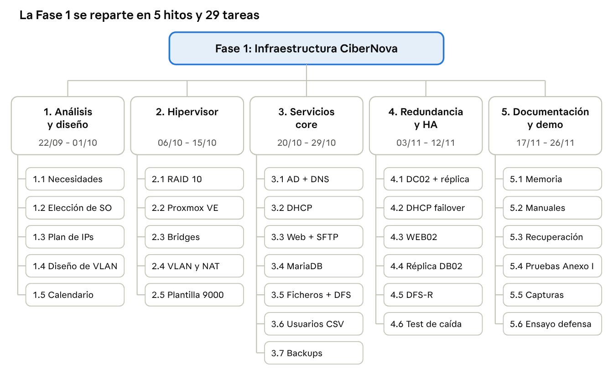

## 3. Diario de trabajo (bitácora)

Anotamos una fila por cada sesión de clase, también las que no pudimos avanzar, para poder justificar los desfases.

| # | Fecha | Trabajo realizado | Problemas / observaciones | Captura |
| --- | --- | --- | --- | --- |
| B1 | 17/09/2026 | Brainstorming: qué queremos hacer y cómo enfocarlo | — | — (no se conserva) |
| B2 | 22/09/2026 | Diseño y planificación inicial | — | Calendario original ([sección 2](#2-calendario-original)) |
| B3 | 24/09/2026 | Sin clase (festivo) | Sesión perdida | — |
| B4 | 29/09/2026 | Clases canceladas por lluvia | Sesión perdida | — |
| B5 | 06/10/2026 | Preparación del servidor  e intento de instalación de Proxmox | Errores en la instalación, máquina muy lenta | — (no se conserva; síntoma descrito en P1) |
| B6 | 08/10/2026 | Intento de solucionar la instalación | Reinicios muy lentos; se cedió la pantalla a otro grupo | — |
| B7 | 13/10/2026 | Configuración del RAID 10 (espejo + bandas) | Elegimos RAID 10 (espejo) para tener más redundancia: si falla un disco, tenemos su copia en el espejo. Como el servidor tiene bastante espacio en disco, nos pareció viable perder la mitad de la capacidad. | Configuración RAID en la BIOS/controladora |
| B8 | 15/10/2026 | Instalación completa de Proxmox y primeras pruebas | Con el RAID bien configurado el 13/10, la instalación terminó sin errores | Resumen del nodo proxmoxAB (pendiente) |
| B9 | 20/10/2026 | Creación de VMs Linux: WEB01, WEB02, DB01, DB02 | — | — (esas VMs se recrearon el 05/11; el estado actual está en la fila del 12/11) |
| B10 | 22/10/2026 | Creación de VMs Windows: DC01, DC02, DHCP, DHCP02, FILES01, FILES02, BACKUP | Discos de 0 GB en DHCP y FILES02 | Hardware de DHCP mostrando el disco |
| B11 | 27/10/2026 | Sin avance (miembros enfermos) | Sesión perdida | — |
| B12 | 29/10/2026 | Instalación de Ansible | Ansible core 2.16.3 instalado. La VM no traía configuración de red: se creó /etc/netplan/01-netcfg.yaml a mano | `ansible --version` en la VM Ansible (pendiente) |
| B13 | 03/11/2026 | Configuración de Ansible (inventario, playbooks, plantilla) | config file = None hasta crear ansible.cfg e inventario.ini; Git no guarda carpetas vacías (se añadió .gitkeep); rama renombrada a main | Salida actual (con --ask-vault-pass) de `ansible all -m ping` |
| B14 | 05/11/2026 | Instalación y configuración de Checkmk | VLAN 40/100 con NAT en Proxmox; DNS del centro sin respuesta (P5); plantilla 9000 y recreación de las 5 VMs Linux; playbook cortado al pegar (P6); usuario automation inexistente, error 401 (P7) | Panel de Checkmk con los hosts |
| B15 | 10/11/2026 | 1. Organizamos la documentación: explicamos el plan semanal (14.1), repartimos las tareas (14.2) y preparamos las guías de defensa individuales.<br>2. Decidimos usar Windows Server 2025 en las VMs Windows.<br>3. Revisamos las VMs Windows con `qm config`, sin cambiar nada, y encontramos tres fallos:<br>  • DHCP y FILES02 tienen disco, pero no está en el orden de arranque.<br>  • Ninguna Windows tiene la etiqueta de la VLAN 40 (`tag=40`).<br>  • La ISO montada es la de idiomas y características (LOF), no la del instalador.<br>4. Dejamos las correcciones para el jueves 12/11. | Nos comunican que la documentación se entregará y actualizará cada semana a partir de la próxima | qm config de las 7 Windows antes del cambio (hecha el 12/11) 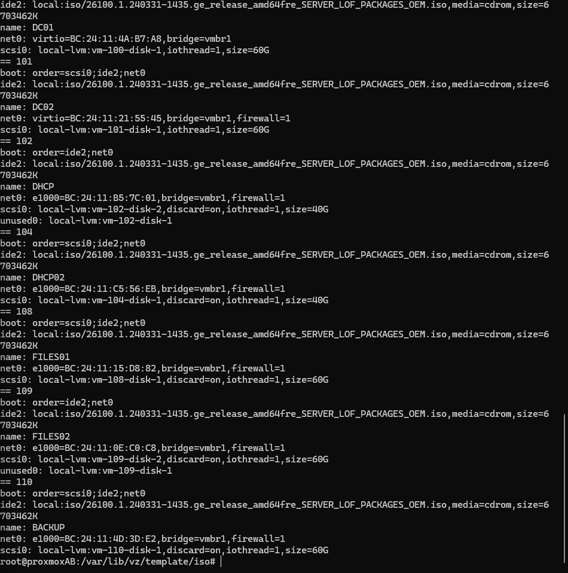 |
| B16 | 12/11/2026 | 1. Dimos a Ansible acceso por clave como root a Proxmox y añadimos el grupo `[proxmox]` al inventario.<br>2. Descargamos las ISO `WS2025_eval.iso` (es-ES) y `virtio-win.iso` 0.1.302.<br>3. Guti creó el playbook `proxmox-vms-windows.yml`, que:<br>  • comprueba que están las ISO de WS2025 y virtio-win;<br>  • guarda la configuración antigua en `/root/qm-antes`;<br>  • borra las 7 VMs Windows vacías y las vuelve a crear con VirtIO, VLAN 40, el disco en el arranque y los dos CD.<br>4. Lo ejecutamos dos veces: la segunda no cambió nada, así que es idempotente.<br>5. Hicimos el commit `feat(proxmox)` 06aff21 en local. Conectamos el repositorio a GitHub, pero el push no se completó.<br>6. Empezamos a instalar Windows Server 2025 cargando el driver vioscsi.<br>7. Decidimos el dominio `cibernova.local`, las IP de los DC y la edición con Experiencia de escritorio.<br>8. Reparto: Guti descargó las ISO e instaló Windows; Berta diseñó el Anexo I, documentó y escribió las instrucciones del playbook. | 1. Resolvimos P2: DHCP y FILES02 ya arrancan con su disco.<br>2. Apareció P10: Ansible no podía entrar como root en Proxmox porque su clave no estaba autorizada.<br>3. Apareció P11: el playbook no arrancaba por un error de sintaxis YAML (faltaban comillas en un `when:`).<br>4. Al revisar las VMs Windows vimos que tenían montada la ISO de idiomas (LOF), no llevaban la etiqueta de la VLAN y usaban tarjetas de red e1000. | Ese día hicimos capturas de: el qm list antes y después del cambio, el qm config antes del cambio, el hardware de DC01, la lista de ISOs, la segunda ejecución del playbook y el instalador cargando vioscsi. Aquí van tres de ellas:    |
| B17 | 16/11/2026 (lunes, sin clase) | 1. Guti preparó 10 playbooks de Ansible para AD, DNS y DHCP. Todos pasan `--syntax-check` y `ansible-lint` (perfil production) y llevan comprobación previa, snapshots pre-ad y `any_errors_fatal`.<br>2. Guti preparó DC01: instaló los drivers VirtIO (`virtio-win-guest-tools.exe`), puso la IP fija 192.168.40.10/24 con SConfig y comprobó WinRM con `Test-WSMan`.<br>3. Con Ansible lanzó `win-00`, `win-01` y `ad-01-dc01-bosque.yml` solo en DC01 (`--limit cn-dc01`). Así se creó el bosque `cibernova.local` (NetBIOS CIBERNOVA): nivel Windows2025Domain, DC01 con los roles FSMO, DNS con reenviadores, zonas inversas 40, 50 y 100 y registros A/PTR de las Linux.<br>4. Comprobó el dominio con `ad-99-verificar.yml`: `failed=0`.<br>5. Apagó las 13 VMs de forma ordenada con `qm shutdown`.<br>6. Berta documentó, añadió el diagrama de red al README y decidimos el lenguaje de los scripts y cómo dar de alta a los usuarios. | 1. P12: DC01 no tenía tarjeta de red hasta que instalamos los drivers VirtIO.<br>2. P13: en la consola noVNC el teclado cambiaba algunos símbolos.<br>3. P14 y P15: `dcdiag` dio dos avisos (SYSVOL y SID duplicado). Quedan pendientes de revisar el 17/11.<br>4. P16: la VM Ansible no respondió al agente QEMU al apagarla.<br>5. Los playbooks nuevos todavía no están en GitHub. | Guti hizo 23 capturas: la preparación de DC01, la creación del dominio y el apagado final. Las subimos el 17/11 a `docs/img/fase1/16-11` y las más importantes están en el [apartado 11.2](#112-preparación-de-dc01-y-creación-del-dominio-1611). |
| B18 | 17/11/2026 | 1. Guti escaneó los anuncios CARP de la red del aula y eligió el VHID 7, porque ya se usaban el 8 y el 34.<br>2. Guardó la red de Proxmox en /root/interfaces.pre-firewall, descargó OPNsense 26.7 y comprobó su SHA256.<br>3. Creó FW01 (113) y FW02 (114): 2 vCPU, 4 GB, 20 GB, arranque automático y 5 tarjetas (WAN en vmbr0 y las VLAN 40, 50, 100 y 99).<br>4. Instaló OPNsense (UFS) en los dos y configuró por consola la LAN y la WAN: FW01 con 192.168.40.2 y 192.168.202.84, FW02 con 192.168.40.3 y 192.168.202.85.<br>5. Por la web, con un túnel SSH, pasó el asistente en los dos, activó CLIENTES, DMZ y SYNC con IP fija y creó la regla SYNC. En FW01 añadió una regla flotante TEMPORAL que permite todo desde CLIENTES y DMZ.<br>6. La red de Proxmox no se tocó: Proxmox sigue siendo el gateway y los firewalls todavía no dan servicio.<br>7. El 18/11 Berta actualizó la documentación (bitácora, desfases, decisiones, red, inventario, playbooks, problemas, puntos únicos de fallo, aprendizajes, pendientes y riesgos) y organizó las 27 capturas en el repositorio. | 1. P17 a P21: modo live con la LAN en la red del aula, ISO expulsada antes de tiempo, IP de LAN de FW02 sin guardar, dhclient antiguos y URL de reglas con 404. Todos resueltos.<br>2. No estaba en el plan: el 17/11 tocaba DC02 y las 6 Windows (D9).<br>3. P14 y P15 siguen sin revisar.<br>4. La sesión web de FW01 caducó al final: hay que volver a entrar. | Guti hizo 27 capturas de la instalación y la configuración de los firewalls. Están en docs/img/fase1/17-11/04-firewalls y las más importantes en el [apartado 6.4](#64-firewalls-opnsense-en-alta-disponibilidad-1711). |
| B19 | 19/11/2026 | 1. Firewalls: HA en FW01 (estados por SYNC y configuración hacia 192.168.99.2), VIP CARP (WAN con VHID 7; LAN, CLIENTES y DMZ con VHID 40, 50 y 100) y NAT de salida híbrido hacia la VIP 192.168.202.86.<br>2. Corte de red en Proxmox con un script para aplicar y otro para volver atrás: vmbr1.40 pasa a la .4, se quitan vmbr1.100 y las reglas MASQUERADE y se añaden rutas a las VLAN 50 y 100 por la .40.1. Inventario de Ansible actualizado y relay de Proxmox comentado en cibernova-dominio.yml.<br>3. Pruebas: ping desde Proxmox a todas las redes, Internet desde la VM Ansible y failover apagando FW01 sin perder ningún paquete; al encenderlo, FW01 recupera el MASTER.<br>4. DC02: drivers, IP .11, WinRM y nombre por qm guest exec desde Proxmox; SID distinto del de DC01; promovido con Ansible y replicando con 0 errores de 5.<br>5. DHCP01 (.12) y DHCP02 (.13) preparados igual; estructura de AD con ad-03, unión al dominio con ad-04 y DHCP con failover LoadBalance 50/50 en estado Normal (ámbito de la VLAN 50, de la .20 a la .250).<br>6. Redimensionado de RAM y CPU de 9 VMs, de una en una, y proxmox-vms-windows.yml actualizado con los valores reales.<br>7. El 20/11 Berta actualizó la documentación y organizó las 24 capturas nuevas en el repositorio. | 1. P22 a P27: cookie compartida en localhost, sincronización lanzada antes de cargar la página, avisos post-down, teclado de noVNC, playbook cortado al reconectar la consola y vault pedido en comprobaciones rápidas.<br>2. Falta el relay DHCP: todavía ningún cliente ha recibido IP.<br>3. P15 resuelto (los SID son distintos); P14 sigue sin revisar. | 24 capturas nuevas en docs/img/fase1/19-11. Las más importantes están en los apartados [6.4](#64-firewalls-opnsense-en-alta-disponibilidad-1711), [8.1](#81-redimensionado-de-ram-y-cpu-1911) y [11.3](#113-dc02-estructura-de-ad-y-dhcp-con-failover-1911). |

**Cronograma: plan original frente a lo realizado.** Arriba, los 5 hitos del calendario original; abajo, lo que hicimos de verdad según la bitácora; en azul el plan original, en verde lo realizado y en rojo las sesiones perdidas.

*Cómo leer los ID que van detrás de cada barra:* **C** = hito del calendario original ([sección 2](#2-calendario-original)) y **B** = sesión de la bitácora ([sección 3](#3-diario-de-trabajo-bitácora)). Por ejemplo, B5-B8 son las sesiones del 06/10 al 15/10.

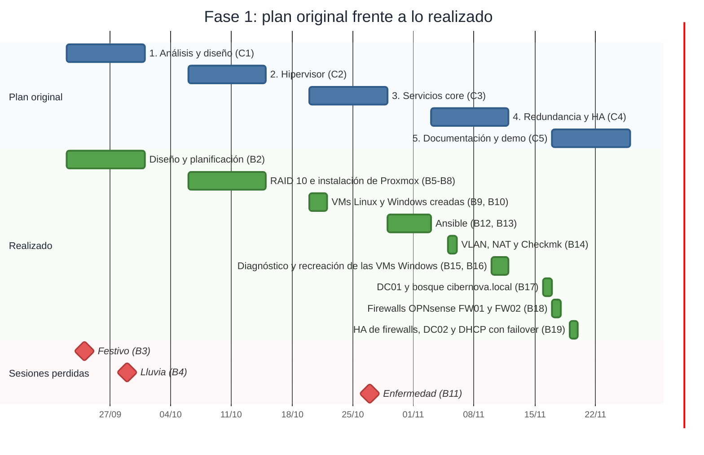

## 4. Desfases respecto al calendario

Para cada desfase anotamos qué habíamos planificado, qué pasó, por qué, qué medidas tomamos y qué impacto tuvo. Hasta ahora hemos perdido 3 sesiones por causas externas (24/09, 29/09 y 27/10) y unas 2 con la instalación de Proxmox.

**Propuesta inicial.** La primera propuesta de la Fase 1 se conserva en `historico/propuesta-inicial.pdf` como punto de partida y ha quedado superada. Planteaba 4 servidores Windows y 2 Linux sin duplicar, 10 VLAN (de la 10 a la 100) y Proxmox en 192.168.10.10 con el dominio empresa.local. El diseño actual duplica los servicios para cumplir el requisito de redundancia, solo monta las VLAN 40 y 100, más la 99 de sincronización de los firewalls desde el 17/11 (la de clientes está pendiente), usa la IP asignada al grupo (192.168.202.7) y el dominio cibernova.local, y añade Ansible y Checkmk (D5 y D6).

| # | Planificado | Qué ocurrió | Causa | Medida / replanificación | Impacto |
| --- | --- | --- | --- | --- | --- |
| D1 | Hito 1, análisis y diseño (22/09 a 01/10) | No hubo clase el 24/09 ni el 29/09 | Festivo y cancelación de las clases por lluvia | El calendario tenía margen, así que se terminó el diseño en las sesiones que quedaban sin cambiar el plan | Menos tiempo de diseño; el hipervisor empezó el 06/10, como estaba previsto |
| D2 | Hito 2, hipervisor: RAID, instalación de Proxmox y red (06/10 a 15/10) | La instalación falló el 06/10 y el 08/10; el 13/10 se configuró el RAID y el 15/10 se terminó la instalación | 1) No sabíamos entrar en la BIOS: no encontrábamos la tecla correcta y cada reinicio tardaba de 10 a 15 minutos.&#32; 2) La pantalla a la que entrábamos no era la BIOS; buscamos cómo hacerlo y cedimos la pantalla a otro grupo para ver si ellos lo sabían.&#32; 3) La instalación se reiniciaba sola por una mala configuración del RAID | Configurar el RAID en la controladora antes de reinstalar (13/10) y reinstalar (15/10). Para recuperar tiempo, buscamos agilizar la configuración de las máquinas: plantilla cloud-init y Ansible (D6) | Proxmox listo el 15/10, en la fecha prevista, pero sin la red del hito: las VLAN se configuraron el 05/11 |
| D3 | Hito 3: instalación de Ansible el 27/10 | Sin avance el 27/10 | Enfermedad de los dos miembros | Ansible se instaló el 29/10 y se priorizó la automatización (Ansible y Checkmk) para ganar tiempo en el resto de servicios | Una sesión perdida; los servicios core no se empezaron en el hito 3 (D4) |
| D4 | Hito 3: servicios Windows (AD, DHCP, ficheros) instalados entre el 20/10 y el 29/10 | VMs Windows creadas pero sin instalar a 05/11 | Se priorizaron Ansible y Checkmk | Nuevo plan semanal ([sección 14](#14-plan-para-lo-que-queda-de-trimestre)): Windows y Anexo I de la semana 1 a la 4, con el reparto de [14.1](#141-qué-es-cada-tarea-del-plan-y-por-qué-está-ahí) y [14.2](#142-reparto-y-entregas-semanales) | Retrasa AD, DHCP, ficheros y permisos del Anexo I |
| D5 | Monitorización no prevista en la Fase 1 | Se añadió Checkmk (VM 112) con agente y alta automática por Ansible el 05/11 | Cambio de alcance: la Fase 2 exige monitorización con alertas sobre datos reales | Se adelanta como base para la Fase 2 | Una sesión más dedicada a Linux; a cambio, las Windows quedarán monitorizadas al instalarlas |
| D6 | VMs Linux instaladas con ISO (creadas el 20/10) | Se borraron vacías y se recrearon desde la plantilla 9000 con el mismo ID el 05/11 | Instalar cada una con ISO costaba de 20 a 30 minutos por VM y daba IPs repetidas al clonar | Plantilla cloud-init y clones completos con su VLAN e IP | Positivo: las 5 VMs listas para Ansible en una sesión |
| D7 | Semana 1 del nuevo plan (10/11 y 12/11): DC01 y DC02 instalados y dominio promovido, con dcdiag sin errores | El 10/11 solo hubo diagnóstico; el 12/11 se recrearon las VMs Windows con Ansible y empezó la instalación | Las correcciones de las VMs Windows (P2, VLAN, ISO) se detectaron el 10/11 | Recreación automatizada con Ansible el 12/11; la promoción del dominio y dcdiag pasan al 17/11; el formateo de discos de WEB y DB (P4) pasa a la semana 5 | Retraso de 1 sesión respecto al plan de la [sección 14](#14-plan-para-lo-que-queda-de-trimestre) |
| D8 | Promoción del dominio en DC01 y DC02 y dcdiag el 17/11 (medida de D7) | El 16/11 (lunes, sin clase) Guti creó el bosque en DC01 con Ansible; DC02 y los servidores miembro siguen pendientes | Trabajo fuera del horario de clase para recuperar el retraso de D7 | El 17/11 se preparan las 6 Windows restantes y se lanza cibernova-dominio.yml (DC02, OUs, unión al dominio y DHCP con failover) | Positivo: recupera parte del retraso de D7. Riesgo: si la preparación de las 6 Windows se alarga, DC02 y DHCP pasan al 19/11 |
| D9 | 17/11 (medida de D8): preparar las 6 Windows restantes, promover DC02 y lanzar cibernova-dominio.yml | Guti instaló y dejó con la configuración base los firewalls FW01 y FW02 (OPNsense). Las 6 Windows, DC02 y el DHCP siguen sin empezar | Trabajo no planificado: firewalls en HA con el rango 192.168.202.84 a 192.168.202.87 asignado por el profesor. Por qué se hizo ese día y no después: pendiente de anotar | El 19/11 se hizo todo en una sesión: HA y corte de red de los firewalls, DC02, DHCP01, DHCP02 y DHCP con failover. FILES01, FILES02 y BACKUP pasan a la próxima sesión | Recuperado el 19/11: DC02 y el DHCP con failover quedan hechos en la semana 2, como pedía el plan, y además se adelanta la alta disponibilidad de la red. De la semana 2 faltan el relay DHCP y un cliente de prueba |

**Ruta crítica hasta el 15/12.** Es la cadena de tareas que depende una de otra (sin dominio no hay usuarios, sin usuarios no hay permisos y sin permisos no hay pruebas): cualquier retraso en ella retrasa el final. Las tareas "con holgura" pueden moverse sin afectar a la fecha final. Por eso los desfases D7 y D8, que retrasan el dominio, son los que más importan.

*Cómo leer los ID que van detrás de cada barra:*&#32;

- **S** = semana del plan semanal del apartado [sección 14](#14-plan-para-lo-que-queda-de-trimestre) (S1 es la semana del 10/11 y S6 la del 15/12) .
- &#32;**B** = sesión de la bitácora ya realizada ([sección 3](#3-diario-de-trabajo-bitácora)).&#32;
- Los desfases de la tabla de arriba usan **D**.

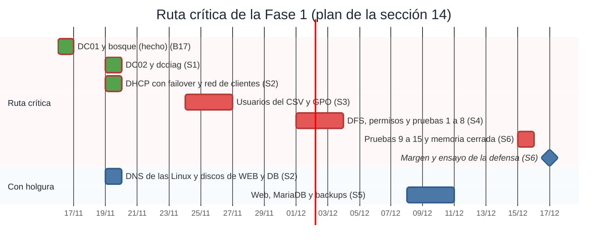

### Detalle de D2: preparación del servidor e instalación de Proxmox

Teníamos margen en el calendario, así que Proxmox quedó instalado el 15/10, en la fecha prevista. Lo que se retrasó fue la red del hito (VLANs), que se configuró el 05/11. Las complicaciones fueron:

1. Al principio entrábamos mal a la BIOS: no encontrábamos la tecla correcta y cada reinicio tardaba de 10 a 15 minutos porque el servidor es muy lento.
2. La pantalla a la que entrábamos no era la BIOS; buscamos cómo hacerlo y cedimos la pantalla a otro grupo para ver si ellos lo sabían.
3. La instalación se reiniciaba sola por una mala configuración del RAID. El 13/10 configuramos el RAID en la controladora y el 15/10 se pudo instalar Proxmox.

Para recuperar tiempo buscamos agilizar la configuración de las máquinas y añadimos Ansible al proyecto (instalado el 29/10, D3) y la plantilla cloud-init (D6).

### Detalle de D7: Ansible sobre las VMs Windows

Ansible no instala el sistema operativo: configura máquinas que ya existen. El 12/11 lo usamos desde la VM Ansible contra Proxmox para recrear las 7 VMs Windows con el playbook proxmox-vms-windows.yml ([sección 9.5](#95-detalle-del-playbook-proxmox-vms-windowsyml)): les montamos la ISO correcta de Windows Server 2025 (antes tenían la de idiomas y características, LOF), los drivers VirtIO y la VLAN 40. La instalación de Windows se hace después, a mano desde la consola ([sección 11.1](#111-instalación-de-windows-server-2025-en-curso)).

Una vez instalado el sistema operativo, Ansible se puede usar durante toda la vida del servidor para configurar redes, instalar aplicaciones, actualizar sistemas o modificar parámetros (en Windows, por WinRM).

### **Por qué adelantamos Checkmk (D5).**

Checkmk no estaba en el plan de la Fase 1 y lo añadimos el 05/11, cuando ya íbamos con retraso. Nos costó una sesión que retrasó el inicio de Windows (D4), pero lo incorporamos por cuatro motivos:

- **Responde a un problema del enunciado:** Dirección cita la falta de monitorización como uno de los problemas de la infraestructura actual.
- **Hace visible la redundancia:** si cae DC01 o WEB01, Checkmk lo avisa. En la demo de «apagar el principal y el servicio sigue» servirá de evidencia.
- **Prepara la Fase 2:** la IA tiene que trabajar con datos reales de la infraestructura. Checkmk ya acumula métricas, así que llegaremos a la Fase 2 con semanas de historial.
- **Agiliza el trabajo:** el alta es automática con Ansible, así que cada VM nueva, incluidas las 7 Windows, quedará vigilada relanzando un playbook. Riesgos como la sobreasignación del disco thin se vigilan sin revisarlos a mano.

Impacto: una sesión de retraso ahora. A cambio, las pruebas de redundancia de la semana 5 se comprobarán más rápido y la Fase 2 parte con los datos ya recogidos.

## 5. Diseño: decisiones tecnológicas

| Capa | Decisión | Elegido | Descartado | Por qué | Riesgo y mejora |
| --- | --- | --- | --- | --- | --- |
| Hardware | Almacenamiento | RAID 10 en la controladora (4 × 900 GB) | ZFS, RAID 1, RAID 5 | Aguanta la caída de un disco por espejo y rinde bien con muchas VMs | Se pierde la mitad de la capacidad (\~1,8 TB útiles); el RAID no sustituye a los backups |
| Virtualización | Hipervisor | Proxmox VE 9.2.2 | XCP-ng, VMware ESXi | Libre, interfaz web, VLAN y LVM-thin nativos, plantillas y cloud-init | — |
| Virtualización | Despliegue Linux | Plantilla cloud-init 9000 | Instalar cada VM con ISO | Clonado en minutos y configuración idéntica | — |
| Virtualización | Corrección de las VMs Windows | Borrarlas y recrearlas con el playbook (etiqueta ws2025) | Modificar cada VM con qm set | Estaban vacías; quedan las 7 iguales y el playbook es idempotente | — |
| Virtualización | Recursos de las VMs | Ajustados a la carga de cada servicio el 19/11: 36 vCPU y 78 GB asignados de 128 GB ([sección 8.1](#81-redimensionado-de-ram-y-cpu-1911)) | El mismo tamaño para todas; dejar los valores iniciales | Con 2 GB los DHCP paginaban, FILES necesita más CPU por DFS-R y SMB, y DB iba sobrada. Quedan unos 50 GB libres para la Fase 2 | Unos 1,5 vCPU por hilo: vigilar la CPU del host con Checkmk |
| Red | Router entre VLAN y NAT | Proxmox (vmbr1.40, vmbr1.100, ip\_forward y MASQUERADE), hasta el corte del 19/11 | OPNsense, pfSense | No hay firewall físico y es lo más rápido de montar | Punto único de fallo; sustituido el 19/11 por FW01 y FW02 en HA |
| Red | Firewall y router entre VLAN (desde el 19/11) | OPNsense 26.7 en dos VMs (FW01 y FW02) con CARP, pfsync y sincronización XMLRPC por una VLAN dedicada (99) | pfSense; un solo firewall; seguir con Proxmox | Libre, con interfaz web, reglas por interfaz, NAT, relay DHCP y HA nativa. Con CARP los equipos usan siempre la misma puerta de enlace (la VIP): si cae FW01, FW02 la asume en segundos | Los dos firewalls corren en el mismo Proxmox: protegen de la caída de una VM, no del host. Sincronización con root y regla TEMPORAL que lo permite todo: usuario dedicado y reglas mínimas en la Fase 3 |
| Red | Identificador del grupo CARP | VHID 7 en la WAN; en las VLAN internas, el número de la VLAN (40, 50 y 100) | VHID 8 y 34 | Con tcpdump vimos que en la red del aula ya se usan el 8 (192.168.202.38) y el 34 (192.168.202.35). Dos grupos con el mismo VHID harían chocar sus VIP. El 7 coincide con nuestro número de grupo. Las VLAN internas no salen del servidor, así que ahí usamos el número de cada VLAN, que es fácil de recordar | — |
| Red | Relay DHCP de la VLAN 50 | En OPNsense, hacia DHCP01 (.12) y DHCP02 (.13) (previsto, sin aplicar) | dnsmasq en Proxmox (proxmox-vlan50-relay.yml) | El relay lo hace quien será el gateway de esa VLAN, y no hay que cambiar la red de Proxmox | Depende de aprobar la red de clientes (pendiente) |
| Red | Opciones del asistente de OPNsense | Sin servidor DHCP en la LAN y sin bloquear las redes RFC1918 en la WAN | DHCP de OPNsense; bloqueo RFC1918 (opción por defecto) | El DHCP lo dan DHCP01 y DHCP02 con failover, como pide el enunciado. La WAN está en la red privada del aula (192.168.200.0/22): con el bloqueo no saldría nada | En producción, con una WAN pública, se activaría el bloqueo RFC1918 |
| Red | Acceso de administración | SSH con ProxyJump por Proxmox y túneles SSH | Rutas estáticas, VPN Tailscale, redirección de puertos | No requiere administrador en el PC ni abre puertos | — |
| Red | IP de los DC | Fija: DC01 .10 y DC02 .11 | IP por DHCP con reserva | Son el DNS del dominio y el DHCP depende de ellos | — |
| Red | IP del resto de Windows | Bloques por función: .12/.13, .30/.31, .50 | IPs consecutivas .12 a .16 | La IP indica la función y deja sitio para crecer | — |
| Sistemas operativos | Ecosistema | Mixto: Windows + Linux | Solo Linux con Samba AD | GPO, perfiles, ABE y DFS nativos en Windows; Linux donde es más ligero | — |
| Sistemas operativos | SO Linux | Ubuntu Server 24.04 LTS | Debian 12 | LTS, imagen cloud oficial y paquete oficial de Checkmk | — |
| Sistemas operativos | SO Windows | Windows Server 2025 (evaluación) | Windows Server 2022 | Soporte estándar hasta 2029 y extendido hasta 2034 | Evaluación de 180 días: caduca hacia el 11/05/2027; ampliable con slmgr /rearm (por comprobar) |
| Sistemas operativos | Edición | Experiencia de escritorio | Server Core | Consolas gráficas para demostrar los conceptos y hacer capturas | Más superficie de ataque y consumo; Server Core en la Fase 3 |
| Dominio y servicios | Nombre del dominio | cibernova.local (NetBIOS CIBERNOVA) | cibernova.internal, ad.cibernova.es | Nombre clásico y fácil de reconocer | .local también lo usa mDNS y puede fallar en clientes Linux (P3) |
| Dominio y servicios | Estructura de OUs | OU=CiberNova y OU Servidores; equipos nuevos a Equipos\\Puestos | Contenedor Computers por defecto | Permite aplicar GPO solo a servidores o solo a puestos | — |
| Dominio y servicios | Failover DHCP | Equilibrio de carga 50/50, MCLT de 1 h (aplicado el 19/11, estado Normal) | Espera activa; ámbito dividido 80/20 | Los dos servidores reparten IPs y comparten las concesiones | — |
| Dominio y servicios | Reenviadores DNS | 8.8.8.8 y 1.1.1.1 | DNS del centro; sugerencias de raíz | El DNS del centro no responde desde el laboratorio (P5) | Las consultas externas salen a servidores públicos; en producción, DNS corporativo |
| Automatización | Herramienta | Ansible 2.16 | Scripts Bash sueltos | Idempotencia y playbooks versionados en Git | — |
| Automatización | Configuración de las VMs en Proxmox | Ansible contra proxmoxAB por SSH como root | Bucle de bash; API de Proxmox con token | Automatiza también el hipervisor y queda versionado | Quien controle la VM Ansible controla Proxmox; en la Fase 3, token con permisos mínimos |
| Automatización | Lenguajes | PowerShell (túneles) + Ansible (despliegue) | Solo PowerShell; solo Ansible | PowerShell no necesita administrador; Ansible centraliza y es idempotente | La VM Ansible y Proxmox son puntos únicos de acceso; se reconstruyen desde GitHub |
| Automatización | Conexión con Windows | WinRM por HTTP (5985) con NTLM y become runas | HTTPS con certificado; Kerberos; OpenSSH | Funciona solo con Enable-PSRemoting; runas evita el doble salto | No verifica la identidad del servidor; HTTPS en la Fase 3 |
| Automatización | Alta de usuarios del Anexo I | Script PowerShell (scripts/alta-usuarios.ps1) lanzado por Ansible en DC01 | microsoft.ad.user; script a mano | Cmdlets nativos, se prueba por separado y se lanza siempre igual desde Git | — |
| Automatización | Configuración inicial de las Windows (IP, DNS, WinRM, nombre) | qm guest exec desde el shell de Proxmox, una vez instalado el agente QEMU (desde el 19/11) | Teclear en la consola noVNC; SConfig | El teclado de noVNC cambia símbolos (P13 y P25). Los comandos quedan escritos, se repiten igual en cada servidor y no dependen de la consola | Necesita el agente QEMU en cada VM, y root en Proxmox puede ejecutar comandos dentro de las VMs: proteger el acceso a Proxmox (Fase 3) |
| Secretos y cuentas | Gestión de secretos | Ansible Vault (AES256) | Variables en texto plano | Ningún secreto en claro en Git | — |
| Secretos y cuentas | Contraseña del vault | En /dev/shm durante la sesión | --ask-vault-pass; fichero en disco | No se escribe en cada playbook ni queda en disco | Legible mientras dura la sesión; permisos 600 y borrarla al cerrar |
| Secretos y cuentas | Cuenta para la API de Checkmk | Cuenta de servicio automation | Usar cmkadmin | Separa los cambios automáticos de los humanos | Pendiente: rol con menos permisos que Administrator |
| Monitorización | Monitorización | Checkmk 2.5 Community | Zabbix; Prometheus + Grafana | Gratis, descubrimiento automático y alta de hosts por API con Ansible | — |
| Documentación | Versión oficial | Documento en línea exportado cada jueves a Markdown en Git | memoria-fase1.md como versión oficial | Se actualiza directamente al cerrar cada sesión | Lo que se edite a mano en el .md se pierde en la siguiente exportación |

**Mapa de decisiones por capa.** Las 32 decisiones de la tabla, ordenadas desde el hardware hasta la documentación. En verde, lo elegido; en naranja, las decisiones con un riesgo aceptado que mejoraremos en la Fase 3; debajo de cada una, las alternativas descartadas. El original editable está en draw.io (`decisiones-tecnicas-fase1.drawio`).

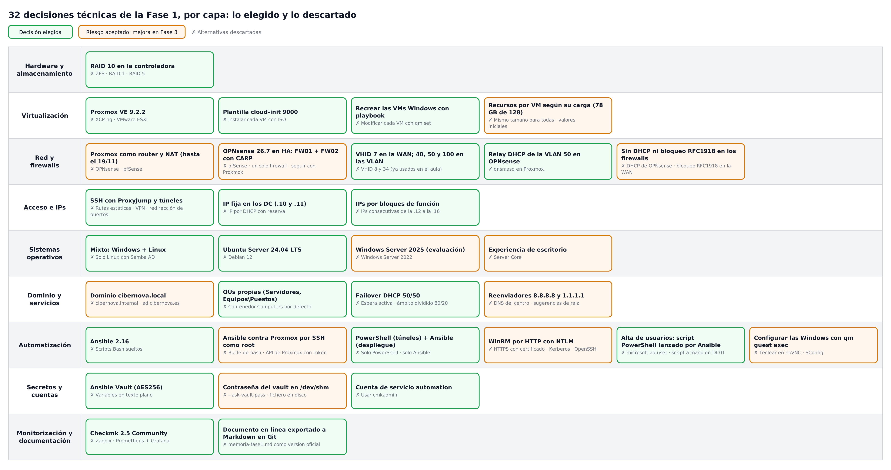

## 6. Diseño de red: VLANs, IPs y diagrama

Dividimos la red en VLAN 40 (servidores internos) y VLAN 100 (DMZ con los servidores web), con Proxmox como router y NAT hacia la red del aula. Pusimos la web en una DMZ separada para que, si alguien compromete WEB01, no tenga acceso directo a los DC ni a los ficheros. El router y el NAT son dos firewalls OPNsense en alta disponibilidad (FW01 y FW02, [apartado 6.4](#64-firewalls-opnsense-en-alta-disponibilidad-1711)); Proxmox solo conserva una IP de gestión (192.168.40.4). El tráfico entre VLANs ya pasa por los firewalls, pero de momento una regla temporal lo permite todo (ver [16.3](#163-riesgos-y-mejoras-para-las-fases-2-y-3)).

**Conceptos de red de la Fase 1.** No se vieron en clase y aparecen desde la [sección 5](#5-diseño-decisiones-tecnológicas), así que los explicamos aquí, antes del diagrama y de los apartados que los usan ([6.1](#61-redes) a [6.4](#64-firewalls-opnsense-en-alta-disponibilidad-1711)):

| Término | Qué es | En CiberNova |
| --- | --- | --- |
| OPNsense | Sistema operativo de firewall de código abierto basado en FreeBSD, que se gestiona por web. Hace de router, firewall con reglas por interfaz, NAT, relay DHCP y VPN | FW01 y FW02 son dos VMs con OPNsense 26.7 que sustituyen a Proxmox como router y NAT |
| WAN y LAN | Nombres de las interfaces de un firewall. La WAN es la que da al exterior, por donde se sale a Internet. La LAN es la que da a la red interna que protege | La WAN de FW01 y FW02 está en la red del aula (vmbr0). Su VIP, 192.168.202.86 con VHID 7, es la IP con la que salen a Internet todas las VLAN internas gracias al NAT de salida (figura 6.4.8), y sigue siendo la misma aunque caiga FW01. La LAN es la VLAN 40; además, los firewalls tienen las interfaces CLIENTES (50), DMZ (100) y SYNC (99) |
| HA (alta disponibilidad, *High Availability*) | Montar un servicio en dos (o más) máquinas para que, si una cae, la otra siga dando el servicio sin que los usuarios tengan que cambiar nada. Se consigue con una IP compartida (CARP), copiando las conexiones (pfsync) y copiando la configuración (XMLRPC) | FW01 y FW02 forman una pareja HA: si se apaga FW01, FW02 sigue haciendo de router, firewall y NAT, como se probó en el failover (figuras 6.4.10 a 6.4.12) |
| CARP (*Common Address Redundancy Protocol*) | Protocolo de redundancia de la puerta de enlace, equivalente libre a VRRP o a HSRP de Cisco. Varios equipos comparten una misma IP; el que la tiene (MASTER) envía anuncios periódicos y, si deja de enviarlos, otro (BACKUP) se queda con la IP | FW01 es MASTER y FW02 BACKUP; si FW01 cae, FW02 asume las IP en segundos |
| VIP (IP virtual) | La IP compartida por CARP. No pertenece a ninguna máquina concreta, sino al grupo | 192.168.40.1 es la puerta de enlace de los servidores aunque las IP reales de los firewalls sean la .2 y la .3 |
| VHID (*Virtual Host ID*) | Es el número que identifica a cada pareja CARP, del 1 al 255. Los dos firewalls que comparten una VIP usan el mismo número en sus anuncios, y así saben que hablan de la misma IP. El número también forma la MAC de la VIP: termina en el VHID en hexadecimal (con VHID 7, 00:00:5e:00:01:07). Si otro equipo del aula usara el mismo VHID en la misma red, sus firewalls y los nuestros se tomarían por la misma pareja y las VIP chocarían: por eso cada grupo usa un número distinto. | Tenemos cuatro VIP, cada una con su VHID. En la WAN (red del aula) usamos el 7: antes de elegirlo vimos con tcpdump que otros equipos del aula ya usaban el 8 y el 34 (figura 6.4.2), y el 7 estaba libre. En las VLAN internas (40, 50 y 100) no hay nadie más, porque no salen del servidor, así que usamos como VHID el mismo número de la VLAN para recordarlo fácilmente. |
| pfsync | Protocolo que copia de un firewall al otro la tabla de estados: las conexiones abiertas en cada momento | Al apagar FW01, el ping no se cortó porque FW02 ya conocía esa conexión |
| XMLRPC | Forma de ejecutar órdenes en otro equipo por HTTPS con mensajes en XML. OPNsense la usa para copiar la configuración | Las reglas, el NAT, los alias y las VIP se crean solo en FW01 y se copian a FW02 |

En resumen: CARP decide quién tiene la IP, pfsync copia las conexiones y XMLRPC copia la configuración. pfsync y XMLRPC viajan por la VLAN 99 (SYNC), que solo une los dos firewalls.

**Diagrama de red de la Fase 1.** Se lee de izquierda a derecha, siguiendo el camino del tráfico: red del aula → `vmbr0` → VIP de la WAN → FW01 (activo) o FW02 (relevo) → VIP internas → `vmbr1` → cada VLAN con sus VMs. `vmbr1` no tiene tarjeta física, así que para salir al aula todo pasa por los firewalls. FW01 y FW02 están uno encima del otro porque hacen lo mismo; la VLAN 99 entre ellos es solo su enlace de sincronización, no un paso del tráfico. Proxmox solo tiene `vmbr1.40` (.4) para gestión. El original está en `docs/diagramas/red-fase1.dot` del repositorio.


**Cómo leer el diagrama.** Términos de Proxmox que aparecen en él (la configuración detallada está en la [sección 6.3](#63-configuración-en-proxmox)):

| Término | Qué es | En CiberNova |
| --- | --- | --- |
| Bridge (`vmbr`) | Un switch virtual dentro de Proxmox. Las tarjetas de red de las VMs se «enchufan» a un bridge, y si este tiene una tarjeta física, sale por ella a la red real | Hay dos: `vmbr0` y `vmbr1` |
| `vmbr0` | Bridge unido a la tarjeta física `nic1` del servidor, es decir, a la red del aula | La IP de Proxmox (192.168.202.7) y la WAN de FW01 y FW02 |
| `vmbr1` | Bridge interno sin tarjeta física: lo que hay en él no sale del servidor si no pasa por los firewalls. Es VLAN-aware: separa el tráfico por VLAN | Todas las VMs internas y la LAN, CLIENTES, DMZ y SYNC de los firewalls |
| Etiqueta (`tag`) | Número de VLAN que Proxmox pone a la tarjeta de una VM en `vmbr1`. Decide en qué red está la VM | `tag=40` servidores, `tag=50` clientes, `tag=100` DMZ, `tag=99` SYNC |
| `vmbr1.40` | Subinterfaz de Proxmox en la VLAN 40: la IP con la que Proxmox está dentro de esa red | 192.168.40.4, solo para gestionarlo desde la VM Ansible |

### 6.1 Redes

| Red | VLAN | Rango | Gateway | Máquinas |
| --- | --- | --- | --- | --- |
| Servidores | 40 | 192.168.40.0/24 | 192.168.40.1 (VIP CARP de FW01 y FW02) | Ansible, CMK, DB01, DB02, Windows |
| DMZ | 100 | 192.168.100.0/24 | 192.168.100.1 (VIP CARP de FW01 y FW02) | WEB01, WEB02 |
| Aula | — | 192.168.200.0/22 | 192.168.200.254 | proxmoxAB (192.168.202.7); WAN de FW01 (.202.84) y FW02 (.202.85), VIP .202.86 y la .202.87 de reserva |
| Clientes (propuesta; ámbito DHCP creado el 19/11, falta el relay y confirmarla) | 50 | 192.168.50.0/24 | 192.168.50.1 (VIP CARP) | Equipos de usuario para las pruebas del Anexo I |
| SYNC (enlace de alta disponibilidad) | 99 | 192.168.99.0/24 | — (sin gateway) | FW01 (.1) y FW02 (.2): solo pfsync y XMLRPC |

La red de clientes es la VLAN 50 (192.168.50.0/24). Hace falta para que el DHCP tenga a quién repartir IPs y para las pruebas 9 a 11 del Anexo I, que exigen iniciar sesión en equipos cliente. Estado: la red ya existe en los firewalls (puerta de enlace .50.1) y el ámbito DHCP está creado, pero todavía no hay ningún equipo cliente ni relay DHCP, y falta confirmarla formalmente.

### 6.2 Plan de direccionamiento

Una tabla y una figura por red: qué IP tiene cada máquina y qué rangos quedan libres para crecer. La tabla de [la 6.1](#61-redes) es el resumen; aquí está el detalle.

#### 6.2.1 VLAN 40 · Servidores (192.168.40.0/24)

| Rango / IP | Uso |
| --- | --- |
| .1 | Gateway: VIP CARP de FW01 y FW02 (desde el 19/11; antes, Proxmox) |
| .2 / .3 | FW01 / FW02 (IP real de cada firewall) |
| .4 | Proxmox (vmbr1.40) solo para gestión, desde el 19/11 |
| .5 | Ansible |
| .10 / .11 | DC01 / DC02 |
| .12 / .13 | DHCP01 / DHCP02 |
| .20 | CMK |
| .30 / .31 | FILES01 / FILES02 |
| .40 / .41 | DB01 / DB02 |
| .50 | BACKUP |

Libres y reservadas para crecer dentro de cada bloque: de la .6 a la .9, de la .14 a la .19, de la .21 a la .29, de la .32 a la .39, de la .42 a la .49 y de la .51 a la .254. Poner la VIP en la .1 permitió hacer el corte sin tocar ninguna VM, porque todas ya tenían la .1 como puerta de enlace.

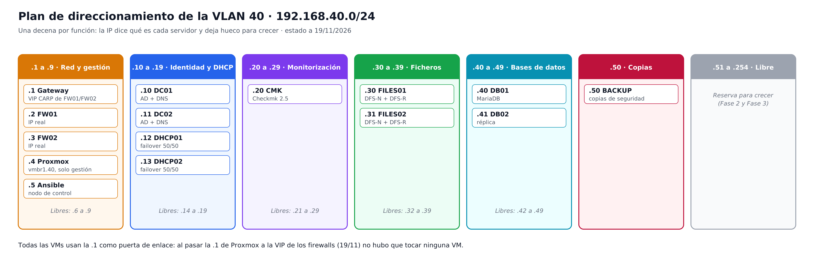

*Figura 6.2.1.* Plan de direccionamiento de la VLAN 40: una decena por función (red y gestión, identidad y DHCP, monitorización, ficheros, bases de datos y copias), con las IPs en uso y las libres de cada bloque. El original editable en diagrams.net está en `docs/diagramas/direccionamiento-vlan40-fase1.drawio`.

#### 6.2.2 VLAN 50 · Clientes (192.168.50.0/24)

| Rango / IP | Uso |
| --- | --- |
| .1 | Gateway: VIP CARP de FW01 y FW02 |
| .2 / .3 | FW01 / FW02 (IP real de cada firewall) |
| .4 a .19 | IPs fijas para equipos que las necesiten (sin uso todavía) |
| .20 a .250 | Ámbito DHCP: concesión de 8 días, servido por DHCP01 y DHCP02 en failover |
| .251 a .254 | Sin asignar |

El ámbito tiene 231 direcciones: cubre a los 89 empleados y deja margen para crecer. Pendiente: el agente de retransmisión (relay) DHCP en los firewalls, porque el broadcast de DHCP no pasa de la VLAN 50 a los servidores DHCP de la VLAN 40.

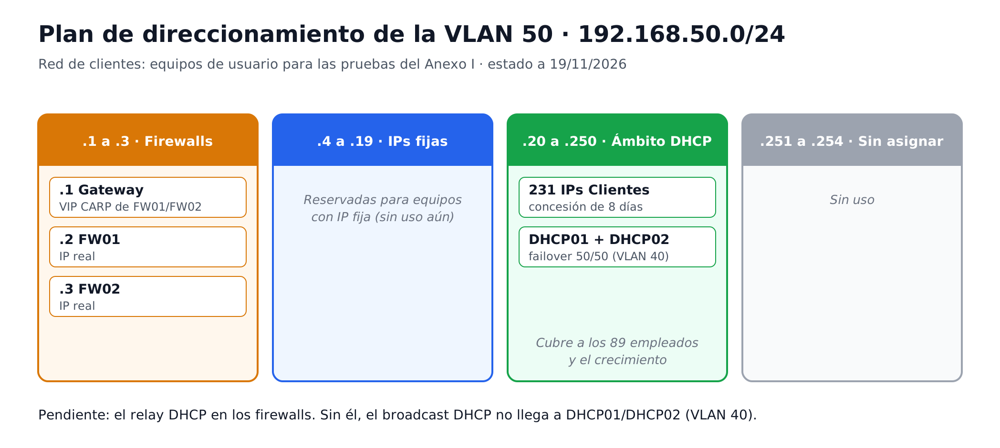

*Figura 6.2.2.* Plan de direccionamiento de la VLAN 50: firewalls, IPs fijas, ámbito DHCP y el relay pendiente. El original editable en diagrams.net está en `docs/diagramas/direccionamiento-vlan50-fase1.drawio`.

#### 6.2.3 VLAN 100 · DMZ (192.168.100.0/24)

| Rango / IP | Uso |
| --- | --- |
| .1 | Gateway: VIP CARP de FW01 y FW02 |
| .2 / .3 | FW01 / FW02 (IP real de cada firewall) |
| .30 / .31 | WEB01 / WEB02 |

Libres y reservadas para crecer: de la .4 a la .29, de la .32 a la .39 y de la .40 a la .254. Hasta el 19/11 la .1 era Proxmox (`vmbr1.100`); en el corte pasó a ser la VIP de los firewalls, y WEB01 y WEB02 no se tocaron porque ya usaban la .1 como puerta de enlace.

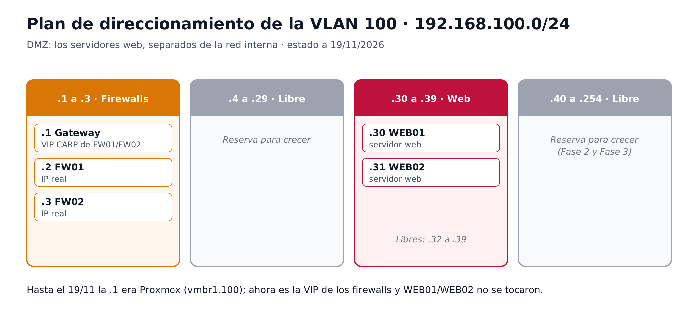

*Figura 6.2.3.* Plan de direccionamiento de la VLAN 100 (DMZ): firewalls en la .1 a .3 y servidores web en el bloque .30. El original editable en diagrams.net está en `docs/diagramas/direccionamiento-vlan100-fase1.drawio`.

### 6.3 Configuración en Proxmox

Proxmox tiene dos bridges y ya no hace de router:

- **`vmbr0`, hacia la red del aula.** Está unido a la tarjeta física `nic1` y lleva la IP de Proxmox (192.168.202.7). No se ha tocado nunca, porque si se rompe perdemos el acceso a Proxmox.
- **`vmbr1`, la red interna.** No tiene tarjeta física y es VLAN-aware: por él van todas las VLAN (40, 50, 100 y 99).
- **Qué hace Proxmox en `vmbr1`.** Desde el 19/11 solo tiene una IP, la 192.168.40.4 en `vmbr1.40`, para gestionarlo desde la VM Ansible. Para llegar a las VLAN 50 y 100 usa dos rutas estáticas que pasan por los firewalls (192.168.40.1). El enrutamiento entre VLAN y la salida a Internet los hacen FW01 y FW02.
- **VLAN 99 (SYNC).** Solo la usan FW01 (.1) y FW02 (.2) para sincronizarse (pfsync y XMLRPC, [apartado 6.4](#64-firewalls-opnsense-en-alta-disponibilidad-1711)). Proxmox no tiene IP en ella.

**Configuración actual (desde el 19/11).** Esquema de `vmbr1.40` hecho a partir de los cambios del corte. **No es el fichero real**: falta pegar aquí el `/etc/network/interfaces` actual de proxmoxAB y comprobar si se quitó `ip_forward`, que ya no hace falta porque Proxmox no enruta.

```
auto vmbr1.40
iface vmbr1.40 inet static
    address 192.168.40.4/24
    up ip route add 192.168.50.0/24 via 192.168.40.1
    up ip route add 192.168.100.0/24 via 192.168.40.1
```

**Por qué hacen falta las rutas estáticas.** La ruta por defecto de Proxmox sale por `vmbr0` hacia 192.168.200.254. Sin estas dos rutas, Proxmox enviaría a la red del aula el tráfico hacia la VLAN 50 y la DMZ, y las respuestas a quien le hable desde esas redes: la ida y la vuelta irían por caminos distintos (enrutamiento asimétrico) y las conexiones fallarían. Con ellas, todo pasa por los firewalls.

**Cómo estaba la red antes del 19/11.** Hasta el corte, Proxmox hacía de router: era la puerta de enlace (.1) de la VLAN 40 y de la DMZ, y les daba salida a Internet con NAT. Este era el trozo de `vmbr1` de su `/etc/network/interfaces`. Las líneas que empiezan por `#` las hemos añadido para explicar cada parte; en el fichero real no están.

```
# vmbr1: bridge interno
auto vmbr1
iface vmbr1 inet manual
    # sin tarjeta física: este bridge no sale del servidor
    bridge-ports none
    bridge-stp off
    bridge-fd 0
    # VLAN-aware: separa el tráfico por VLAN (se admiten de la 2 a la 4094)
    bridge-vlan-aware yes
    bridge-vids 2-4094

# vmbr1.40: Proxmox dentro de la VLAN 40, como puerta de enlace
auto vmbr1.40
iface vmbr1.40 inet static
    address 192.168.40.1/24
    # activa el reenvío de paquetes: Proxmox pasa tráfico de una red a otra
    post-up echo 1 > /proc/sys/net/ipv4/ip_forward
    # NAT: lo que sale de la VLAN 40 hacia el aula (vmbr0) lleva la IP de Proxmox
    post-up iptables -t nat -A POSTROUTING -s 192.168.40.0/24 -o vmbr0 -j MASQUERADE
    # al apagar la interfaz se borra esa regla
    post-down iptables -t nat -D POSTROUTING -s 192.168.40.0/24 -o vmbr0 -j MASQUERADE

# vmbr1.100: lo mismo para la DMZ
auto vmbr1.100
iface vmbr1.100 inet static
    address 192.168.100.1/24
    post-up iptables -t nat -A POSTROUTING -s 192.168.100.0/24 -o vmbr0 -j MASQUERADE
    post-down iptables -t nat -D POSTROUTING -s 192.168.100.0/24 -o vmbr0 -j MASQUERADE
```

En resumen, el fichero hacía tres cosas:

- **Un switch virtual por VLAN:** `vmbr1` lleva todas las VLAN por dentro del servidor.
- **Proxmox como gateway:** `vmbr1.40` y `vmbr1.100` le dan la .1 de cada red, y `ip_forward` le deja enrutar entre ellas.
- **Salida a Internet:** las reglas `MASQUERADE` cambian la IP de origen por la de Proxmox al salir por `vmbr0`.

Cada VM lleva la etiqueta de su VLAN en la tarjeta de red (`tag=40` o `tag=100`). Si no la lleva, no llega a su gateway, porque `vmbr1.40` y `vmbr1.100` solo atienden tramas etiquetadas con su VLAN.

**Qué cambió con los firewalls.**

1. **17/11, se crean FW01 y FW02.** Cada uno tiene `net0` en `vmbr0` (WAN) y de `net1` a `net4` en `vmbr1`, con las etiquetas 40, 50, 100 y 99. Proxmox sigue siendo el router.
2. **19/11, corte.** La puerta de enlace y el NAT pasan de Proxmox a los firewalls: `vmbr1.40` pasa de la .1 a la .4, se quita la IP de `vmbr1.100` y se borran las reglas `MASQUERADE`.

**Cómo se hizo el corte (19/11).** Antes de tocar nada se prepararon tres ficheros en Proxmox:

- `/root/interfaces.nuevo-firewall`: la configuración nueva, comparada con la actual con `diff`.
- `/root/corte-firewall.sh`: el script que la aplica.
- `/root/volver-red.sh`: el script para volver a la configuración anterior si algo fallaba.

Después, por este orden:

1. **FW01:** se guardaron las VIP de LAN, CLIENTES y DMZ sin aplicarlas, porque habrían chocado con las IP que todavía tenía Proxmox.
2. **Proxmox:** el script pasó `vmbr1.40` a la .4, quitó `vmbr1.100` y las reglas `MASQUERADE`, y añadió las rutas estáticas a 192.168.50.0/24 y 192.168.100.0/24 por la 192.168.40.1.
3. **FW01:** se aplicaron las VIP y se sincronizó con FW02.

Resultado: las VMs internas estuvieron unos segundos sin red y el acceso a Proxmox por `vmbr0` no se tocó.

**Copias de la configuración de red de Proxmox.** Antes de cada cambio grande se guardó una copia de `/etc/network/interfaces`, para poder volver atrás:

| Copia | Fecha | Qué guarda |
| --- | --- | --- |
| `/root/interfaces.bak` | 05/11 | La red original, antes de crear las VLAN |
| `/root/interfaces.pre-firewall` | 17/11 | La red antes de crear los firewalls |
| `/root/interfaces.pre-corte-1911` | 19/11 | La red justo antes del corte |

Pendiente: pegar en esta sección el fichero real actual y subirlo al repositorio en `configs/proxmox/interfaces`.

### 6.4 Firewalls OPNsense en alta disponibilidad (17/11)

FW01 y FW02 dan servicio: HA, VIP CARP y NAT de salida configurados, corte de la red de Proxmox hecho y failover probado sin perder paquetes. Las capturas de la instalación (17/11) están en `docs/img/fase1/17-11/04-firewalls`; las de la HA, el corte de red y el failover (19/11), en `docs/img/fase1/19-11/04-firewalls`. Lo que muestra cada una está en `docs/img/fase1/README.md`, y abajo, en la figura 6.4.13, se ve el resultado final: FW01 como MASTER de la VIP de la WAN.

Los conceptos que usa este apartado (OPNsense, WAN y LAN, HA, CARP, VIP, VHID, pfsync y XMLRPC) están explicados en la tabla del principio de la [sección 6](#6-diseño-de-red-vlans-ips-y-diagrama).

**Por qué dos firewalls con CARP.** CARP comparte una IP virtual (VIP) entre los dos: FW01 es el MASTER y responde en la VIP; si cae, FW02 (BACKUP) la asume en segundos. Los equipos usan siempre la VIP como puerta de enlace, nunca la IP real de un firewall. pfsync copia el estado de las conexiones y XMLRPC copia la configuración de FW01 a FW02. Elegimos el VHID 7 para la WAN porque en el aula ya se usaban el 8 y el 34; en las VLAN internas el VHID es el número de la VLAN.

| Red | Interfaz | FW01 (real) | FW02 (real) | VIP CARP |
| --- | --- | --- | --- | --- |
| WAN (aula, vmbr0) | vtnet0 | 192.168.202.84/22 | 192.168.202.85/22 | 192.168.202.86 |
| LAN servidores (VLAN 40) | vtnet1 | 192.168.40.2 | 192.168.40.3 | 192.168.40.1 |
| CLIENTES (VLAN 50) | vtnet2 | 192.168.50.2 | 192.168.50.3 | 192.168.50.1 |
| DMZ (VLAN 100) | vtnet3 | 192.168.100.2 | 192.168.100.3 | 192.168.100.1 |
| SYNC (VLAN 99) | vtnet4 | 192.168.99.1 | 192.168.99.2 | — (enlace dedicado) |

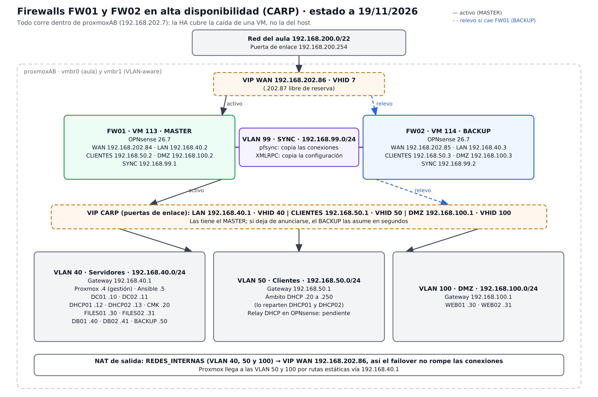

*Figura 6.4.0.* Los firewalls en alta disponibilidad: la red del aula entra por la VIP de la WAN; FW01 (MASTER) tiene las VIP y FW02 (BACKUP) las asume si cae FW01; los dos se sincronizan por la VLAN 99, y debajo están las tres redes internas con su puerta de enlace. El original editable en diagrams.net está en `docs/diagramas/firewalls-ha-fase1.drawio`.

La puerta de enlace de la WAN es 192.168.200.254 y la 192.168.202.87 queda de reserva. Las VIP se crearon el 19/11 con los VHID 7 (WAN), 40 (LAN), 50 (CLIENTES) y 100 (DMZ). FW01 anuncia con advskew 0 (MASTER) y FW02 con advskew 100 (BACKUP); todas comparten una contraseña CARP guardada fuera del repositorio.

**Máquinas.** VM 113 (FW01) y VM 114 (FW02): 2 vCPU, 4 GB de RAM, disco de 20 GB, arranque automático y etiqueta `firewall`, con cinco tarjetas VirtIO.

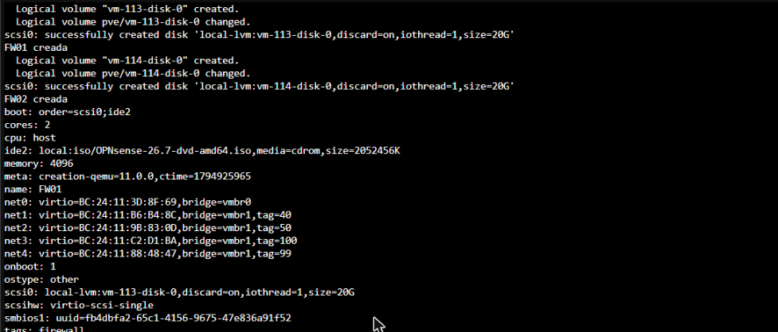

*Figura 6.4.1.* Creación de las VMs 113 y 114 y qm config de FW01: 2 núcleos, 4 GB, disco de 20 GB, ISO de OPNsense, arranque automático y cinco tarjetas VirtIO. Archivo: [`04-proxmox-vms-fw01-fw02-creadas.png`](https://github.com/bertasipekmenendez-asix/Proyecto-Intermodular-Berta-Sipek-Alex-Gutierrez/blob/main/docs/img/fase1/17-11/04-firewalls/04-proxmox-vms-fw01-fw02-creadas.png)

**Qué se hizo, en orden:**

1. **Proxmox:** escaneo de los anuncios CARP del aula con `tcpdump`, copia de la red y descarga de la ISO de OPNsense 26.7 con su SHA256 comprobado.
2. **Proxmox:** creación de las dos VMs. Durante la instalación, la WAN con `link_down=1` (P17).
3. **Consola de cada firewall:** instalación UFS, contraseña de root (la puso Guti y no está en la documentación), asignación de interfaces, IPs de LAN y WAN y ping a Internet.
4. **Proxmox:** ping y web (HTTP 200) a los dos firewalls.
5. **Web, por túnel SSH:**
   - Túnel desde el PC del aula: `ssh -L 8441:192.168.40.2:443 -L 8442:192.168.40.3:443 root@192.168.202.7`.
   - FW01 se abre en `https://localhost:8441` y FW02 en `https://localhost:8442`.
   - Asistente inicial: hostname `fw01` / `fw02`, dominio `cibernova.local` y zona Europe/Madrid.
   - DNS 8.8.8.8 y 1.1.1.1; puerta de enlace de la WAN 192.168.200.254.
   - Sin bloqueo RFC1918 en la WAN, porque la WAN es la red privada del aula.
   - Sin DHCP en la LAN, porque lo dan DHCP01 y DHCP02.
   - Interfaces CLIENTES, DMZ y SYNC activadas con IP fija.
   - Regla SYNC: permite todo entre FW01 y FW02 por la red de sincronización.
6. **Solo en FW01:** regla flotante TEMPORAL que permite todo desde CLIENTES y DMZ, para no cortar nada mientras se monta. Llegará a FW02 al sincronizar y se restringe en la Fase 3.

**La WAN y los VHID 7, 8 y 34, paso a paso.**

1. **Qué es la WAN aquí.** Cada firewall tiene una interfaz en la red del aula (192.168.200.0/22), que es por donde sale a Internet: es su WAN. Esa red no es solo nuestra; la comparten todos los equipos del aula.
2. **Qué hace CARP en la WAN.** Para que la salida a Internet no dependa de un solo firewall, FW01 y FW02 comparten la VIP 192.168.202.86. El MASTER (FW01) envía cada segundo, más o menos, un anuncio a la dirección multicast 224.0.0.18 que viene a decir «la IP del VHID 7 la tengo yo». Al ser multicast, el anuncio llega a todos los equipos de la red del aula, no solo a FW02.
3. **Qué es el VHID y de dónde sale.** No se genera solo: lo elige el administrador al crear la VIP en OPNsense (Interfaces > Virtual IPs > Settings), entre 1 y 255. Sirve para distinguir una pareja CARP de otra en la misma red. FW01 y FW02 usan el mismo, el 7, porque son la misma pareja.
4. **Por qué no vale cualquier número.** Si otro equipo del aula usara también el 7, nuestros firewalls tomarían sus anuncios por los de nuestra pareja y las VIP chocarían: podría haber dos MASTER a la vez o una VIP que salta de un servidor a otro.
5. **De dónde salen el 8 y el 34.** Son los VHID que ya usaban otros equipos del aula. Los vimos el 17/11 escuchando la red con `tcpdump` en proxmoxAB (figura 6.4.2, justo debajo): llegaban anuncios con VHID 8 desde 192.168.202.38 y con VHID 34 desde 192.168.202.35. Como el 7 no aparecía, lo elegimos.
6. **Y en las VLAN internas.** Las VLAN 40, 50 y 100 solo existen dentro de nuestro servidor, así que ahí no puede chocar nadie. Usamos como VHID el número de la VLAN para recordarlo fácilmente.

**Escaneo de VHID en el aula.** Con `tcpdump` en proxmoxAB se ven los anuncios de los grupos 8 (192.168.202.38) y 34 (192.168.202.35) («grupo» aquí es un grupo CARP, es decir, el VHID 8 y el VHID 34 que usan otros equipos del aula; no son los números de grupo de clase); nosotros usamos el 7. Se ve en la figura 6.4.2, justo debajo: tcpdump muestra «vrid 8» desde 192.168.202.38 y «vrid 34» desde 192.168.202.35 (en la captura sale como vrid porque tcpdump lee los anuncios CARP con el formato de VRRP).

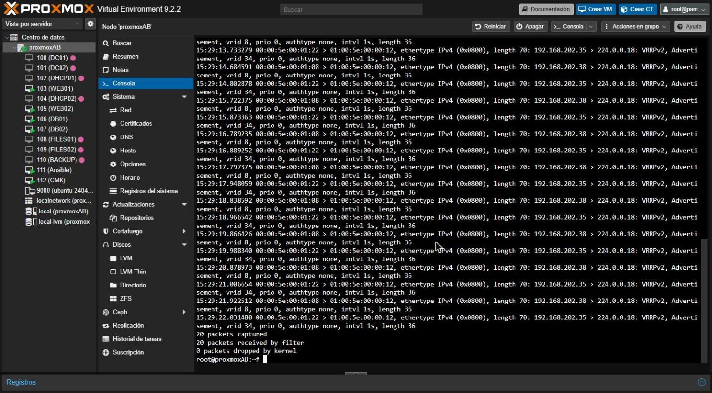

*Figura 6.4.2.* tcpdump en proxmoxAB: anuncios VRRP/CARP con VHID 8 y 34, de otros equipos del aula. Archivo: [`01-proxmox-escaneo-vhid-carp-aula.jpg`](https://github.com/bertasipekmenendez-asix/Proyecto-Intermodular-Berta-Sipek-Alex-Gutierrez/blob/main/docs/img/fase1/17-11/04-firewalls/01-proxmox-escaneo-vhid-carp-aula.jpg)

**Riesgo del modo live (P17).** Por defecto el modo live pone la LAN en vtnet0, que es la red del aula; por eso la WAN estuvo con `link_down=1` durante la instalación.

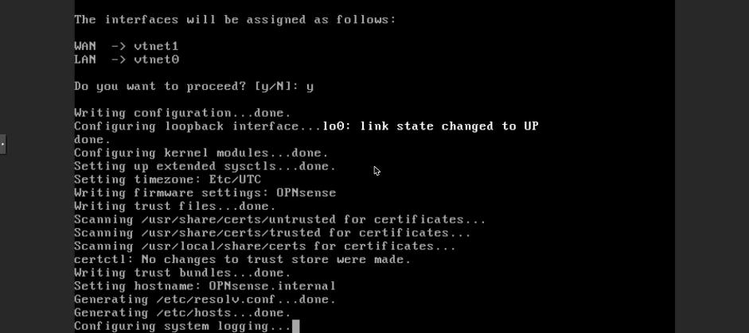

*Figura 6.4.3.* Modo live de OPNsense en FW01: por defecto asigna la LAN a vtnet0, la red del aula (P17). Archivo: [`05-fw01-modo-live-lan-en-vtnet0-riesgo-dhcp.jpg`](https://github.com/bertasipekmenendez-asix/Proyecto-Intermodular-Berta-Sipek-Alex-Gutierrez/blob/main/docs/img/fase1/17-11/04-firewalls/05-fw01-modo-live-lan-en-vtnet0-riesgo-dhcp.jpg)

**Reglas de FW01.** Regla flotante TEMPORAL que permite todo desde CLIENTES y DMZ, reglas por defecto de la LAN y regla SYNC entre los dos firewalls.

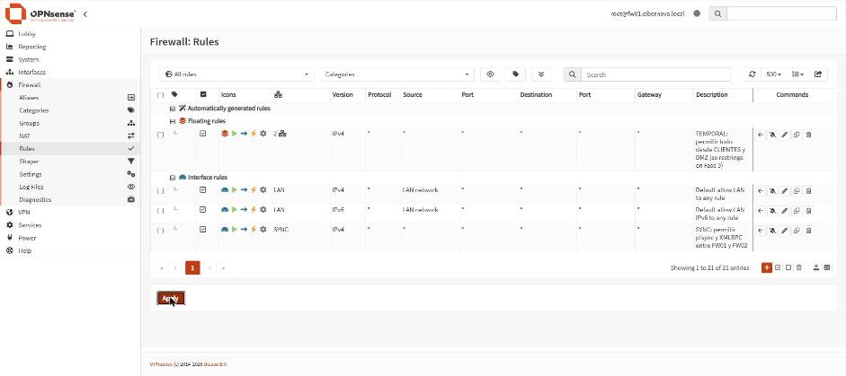

*Figura 6.4.4.* Firewall: Rules de FW01: regla flotante TEMPORAL, reglas por defecto de la LAN y regla SYNC. Archivo: [`23-fw01-reglas-sync-clientes-dmz.jpg`](https://github.com/bertasipekmenendez-asix/Proyecto-Intermodular-Berta-Sipek-Alex-Gutierrez/blob/main/docs/img/fase1/17-11/04-firewalls/23-fw01-reglas-sync-clientes-dmz.jpg)

**Por qué hace falta la regla SYNC.** OPNsense bloquea por defecto todo el tráfico que entra por una interfaz nueva, y la interfaz SYNC (VLAN 99) también. Sin una regla que lo permita, FW01 y FW02 no podrían intercambiar ni el estado de las conexiones (pfsync) ni la configuración (XMLRPC), y la alta disponibilidad no funcionaría. Por eso la regla se crea a mano en los dos firewalls: FW02 la necesita antes de la primera sincronización, porque el resto de reglas (como la TEMPORAL) le llegan desde FW01 precisamente por esa red. Ahora permite todo el tráfico entre los dos; la mejora prevista es limitarla a pfsync y HTTPS ([sección 16.3](#163-riesgos-y-mejoras-para-las-fases-2-y-3)).

**Interfaces de FW02.** Las cinco interfaces con su IP real: WAN .202.85, LAN .40.3, CLIENTES .50.3, DMZ .100.3 y SYNC .99.2.

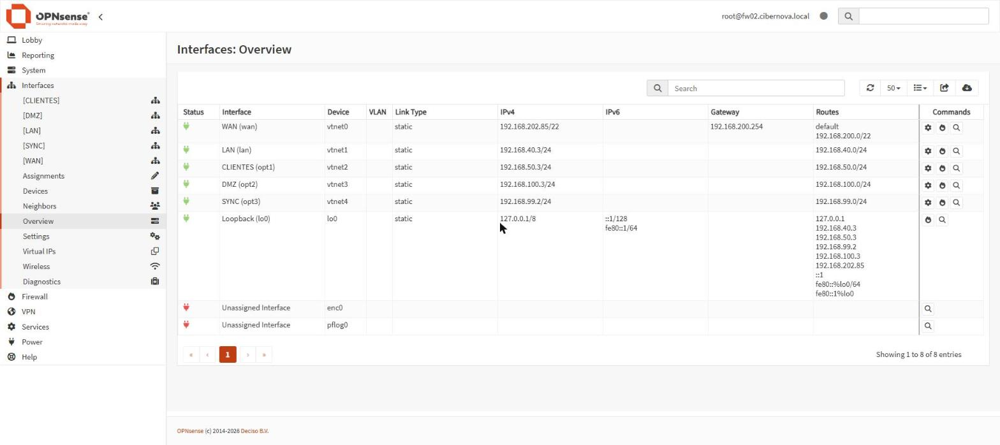

*Figura 6.4.5.* Interfaces: Overview de FW02 con las cinco interfaces y su IP real. Archivo: [`26-fw02-interfaces-configuradas.jpg`](https://github.com/bertasipekmenendez-asix/Proyecto-Intermodular-Berta-Sipek-Alex-Gutierrez/blob/main/docs/img/fase1/17-11/04-firewalls/26-fw02-interfaces-configuradas.jpg)

**19/11: alta disponibilidad, NAT, corte y pruebas.** La configuración se hace solo en FW01 y FW02 la recibe por XMLRPC. Para tener abiertas las dos webs a la vez, FW01 se abre en `https://127.0.0.1:8441` y FW02 en `https://localhost:8442` (P22).

| Ajuste en FW01 (System → High Availability → Settings) | Valor |
| --- | --- |
| Synchronize all states via | SYNC (vtnet4) |
| Synchronize Peer IP (pfsync) | 192.168.99.2 |
| Synchronize Config to (XMLRPC) | 192.168.99.2 |
| Remote System Username | root (la contraseña no se documenta) |
| Services to synchronize | Todos |

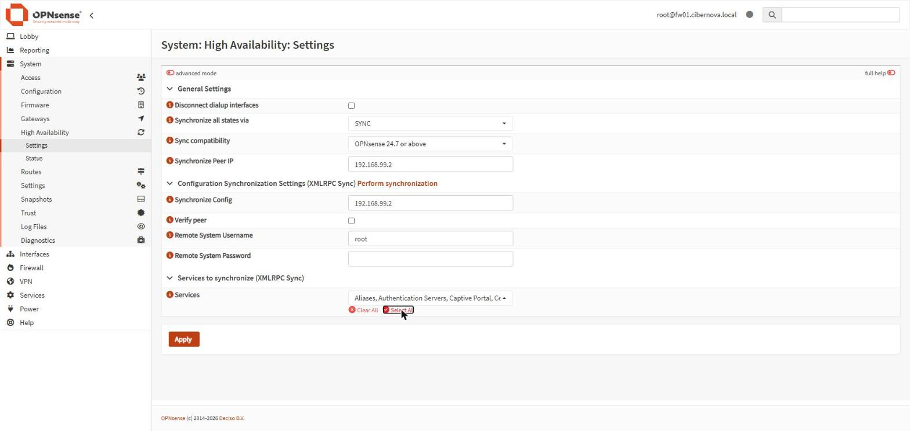

*Figura 6.4.6.* System: High Availability: Settings en FW01: estados por SYNC, pfsync y XMLRPC hacia 192.168.99.2, usuario root y todos los servicios seleccionados. Archivo: [`28-fw01-ha-ajustes.jpg`](https://github.com/bertasipekmenendez-asix/Proyecto-Intermodular-Berta-Sipek-Alex-Gutierrez/blob/main/docs/img/fase1/19-11/04-firewalls/28-fw01-ha-ajustes.jpg)

Para comprobar que la sincronización funciona, en *System: High Availability: Status* FW01 tiene que poder leer los datos de FW02. Si los muestra, la conexión por XMLRPC está bien. Desde esa misma página se lanza *Synchronize and reconfigure all*, que copia la configuración de FW01 a FW02 (la primera vez no se lanzó bien, P23).

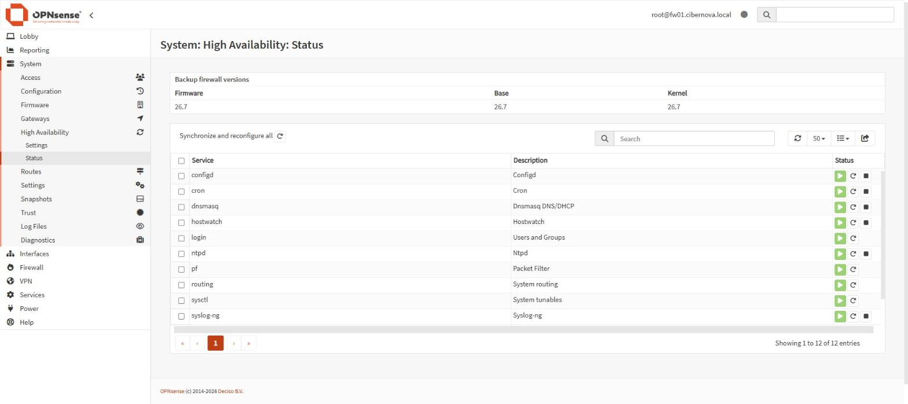

*Figura 6.4.7.* System: High Availability: Status en FW01: arriba, las versiones de FW02 (firmware, base y kernel 26.7), que FW01 consigue leer por XMLRPC; debajo, los servicios que se sincronizan y el botón *Synchronize and reconfigure all*. Archivo: [`29-fw01-ha-conectado-con-fw02.jpg`](https://github.com/bertasipekmenendez-asix/Proyecto-Intermodular-Berta-Sipek-Alex-Gutierrez/blob/main/docs/img/fase1/19-11/04-firewalls/29-fw01-ha-conectado-con-fw02.jpg)

**NAT de salida.** Firewall → NAT → Source NAT en modo híbrido, con el alias `REDES_INTERNAS` (VLAN 40, 50 y 100) traducido a la VIP `192.168.202.86`. Así, si cae FW01, las conexiones salen por FW02 con la misma IP del aula.

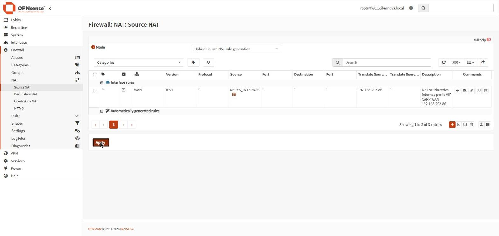

*Figura 6.4.8.* Firewall: NAT: Source NAT en modo Hybrid: regla en la WAN que traduce `REDES_INTERNAS` a la VIP 192.168.202.86. Archivo: [`32-fw01-nat-salida-vip.jpg`](https://github.com/bertasipekmenendez-asix/Proyecto-Intermodular-Berta-Sipek-Alex-Gutierrez/blob/main/docs/img/fase1/19-11/04-firewalls/32-fw01-nat-salida-vip.jpg)

**Corte de red.** Está descrito paso a paso en la [sección 6.3](#63-configuración-en-proxmox).

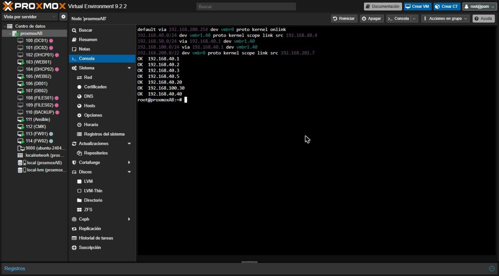

*Figura 6.4.9.* proxmoxAB tras el corte: rutas a 192.168.50.0/24 y 192.168.100.0/24 por la 192.168.40.1 y ping correcto a .40.1, .40.2, .40.3, Ansible, CMK, WEB01 y DB01. Archivo: [`35-proxmox-tras-corte-rutas-y-pings-ok.jpg`](https://github.com/bertasipekmenendez-asix/Proyecto-Intermodular-Berta-Sipek-Alex-Gutierrez/blob/main/docs/img/fase1/19-11/04-firewalls/35-proxmox-tras-corte-rutas-y-pings-ok.jpg)

| Prueba | Resultado |
| --- | --- |
| Ping desde Proxmox a .40.1, .40.2, .40.3, Ansible, CMK, DB01 y WEB01 (DMZ) | Correcto |
| Internet desde la VM Ansible (8.8.8.8 y google.com) | Correcto, sale por los firewalls |
| Failover: `qm shutdown 113` (FW01) con un ping continuo en marcha | FW02 pasa a MASTER en las cuatro VIP sin perder ningún paquete |
| Failback: `qm start 113` | FW01 recupera el MASTER y FW02 vuelve a BACKUP |


*Figura 6.4.10.* Virtual IPs: Status en FW02 antes de la prueba: las cuatro VIP (VHID 7, 40, 50 y 100) en BACKUP. Archivo: [`34-fw02-todas-vip-backup.jpg`](https://github.com/bertasipekmenendez-asix/Proyecto-Intermodular-Berta-Sipek-Alex-Gutierrez/blob/main/docs/img/fase1/19-11/04-firewalls/34-fw02-todas-vip-backup.jpg)

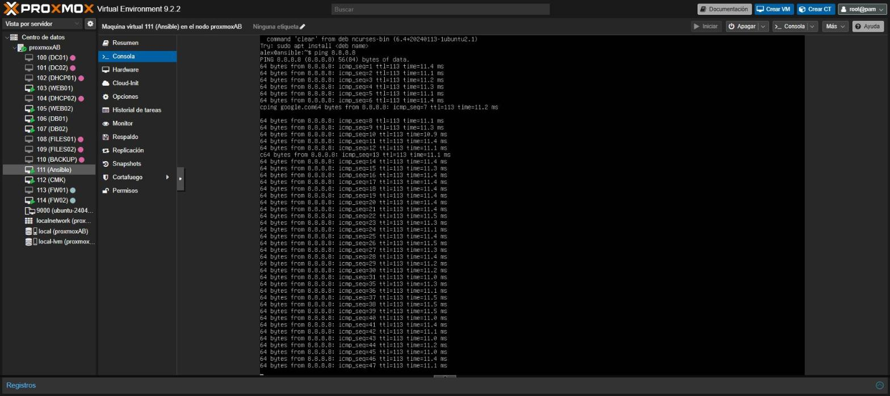

*Figura 6.4.11.* Ping continuo a 8.8.8.8 desde la VM Ansible mientras se apaga FW01: las respuestas siguen sin saltos en `icmp_seq`. Archivo: [`37-failover-ping-sin-cortes-fw01-apagado.jpg`](https://github.com/bertasipekmenendez-asix/Proyecto-Intermodular-Berta-Sipek-Alex-Gutierrez/blob/main/docs/img/fase1/19-11/04-firewalls/37-failover-ping-sin-cortes-fw01-apagado.jpg)

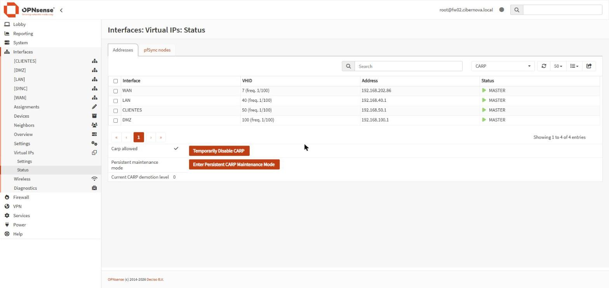

*Figura 6.4.12.* Virtual IPs: Status en FW02 con FW01 apagado: las cuatro VIP pasan a MASTER. Archivo: [`38-failover-fw02-master.jpg`](https://github.com/bertasipekmenendez-asix/Proyecto-Intermodular-Berta-Sipek-Alex-Gutierrez/blob/main/docs/img/fase1/19-11/04-firewalls/38-failover-fw02-master.jpg)

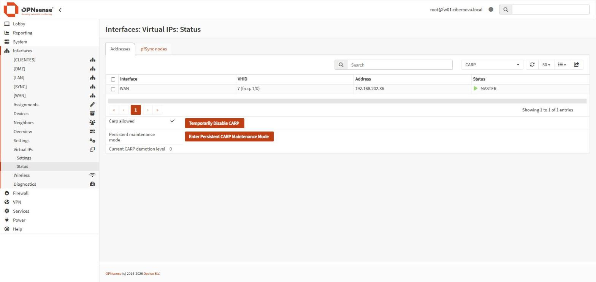

*Figura 6.4.13.* Virtual IPs: Status en FW01 en el estado normal: la VIP de la WAN 192.168.202.86 con VHID 7 en MASTER. Es el estado normal, antes de la prueba; todavía falta una captura del failback (FW01 recuperando el MASTER al volver a encenderse). Archivo: [`30-fw01-carp-wan-master.jpg`](https://github.com/bertasipekmenendez-asix/Proyecto-Intermodular-Berta-Sipek-Alex-Gutierrez/blob/main/docs/img/fase1/19-11/04-firewalls/30-fw01-carp-wan-master.jpg)

**Lo que falta**: el relay DHCP de la VLAN 50 con un cliente de prueba y, en la Fase 3, reglas restrictivas en lugar de la TEMPORAL ([sección 16.2](#162-pendientes-para-la-próxima-sesión)).

## 7. Hipervisor Proxmox: guía de instalación reproducible

Hemos escrito esta guía para que cualquiera pueda reinstalar proxmoxAB siguiendo los pasos, con los valores exactos que usamos.

1. **Hardware de partida:** 2 Xeon E5-2620 v2, 128 GB de RAM y 4 discos de 900 GB. Número de interfaces de red: pendiente de anotar.
2. **RAID:** RAID 10 en la controladora sobre los 4 discos de 900 GB, unos 1,8 TB útiles. El pool de datos pve/data tiene 1,49 TiB.
3. **Arranque del instalador:** pendiente de anotar (versión de la ISO, cómo creamos el USB, BIOS o UEFI).
4. **Instalación:** hostname `proxmoxAB`, IP 192.168.202.7/22, gateway 192.168.200.254. Disco de destino y sistema de ficheros: pendiente de anotar.
5. **DNS:** 8.8.8.8, 1.1.1.1 y 192.168.200.254, en `/etc/resolv.conf` y en Sistema → DNS (ver P5).
6. **Red:** bridges y VLANs según la [sección 6.3](#63-configuración-en-proxmox).
7. **Almacenamiento:** ISOs en `local` (`/var/lib/vz/template/iso/`); discos de VM en `local-lvm` (LVM-thin).
8. **Comprobación final:** acceso web por `https://192.168.202.7:8006`.

ISOs disponibles en Proxmox el 12/11:

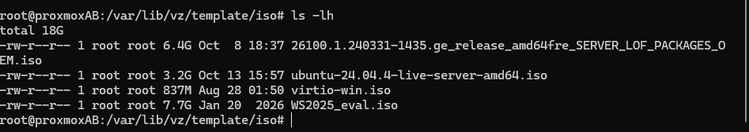

## 8. Inventario de máquinas y servicios

Estado a 19/11/2026: 6 VMs Linux desplegadas, 7 VMs Windows recreadas con el playbook proxmox-vms-windows.yml (VirtIO, VLAN 40, WS2025 y virtio-win montados, etiqueta ws2025), DC01 operativo como controlador del dominio cibernova.local, DC02 replicando con DC01, DHCP01 y DHCP02 en el dominio con failover, dos firewalls OPNsense (FW01 y FW02) en alta disponibilidad y una plantilla.

| ID | Nombre | SO | vCPU | RAM | Discos | VLAN | IP | Función | Estado |
| --- | --- | --- | --- | --- | --- | --- | --- | --- | --- |
| 111 | Ansible | Ubuntu 24.04 (ISO, UEFI) | 2 | 4 GB | 30 GB | 40 | 192.168.40.5 | Nodo de control Ansible + repo Git | Operativa |
| 112 | CMK | Ubuntu 24.04 (plantilla) | 4 | 6 GB | 40 GB | 40 | 192.168.40.20 | Checkmk 2.5.0p18, sitio `cibernova` | Operativa |
| 103 | WEB01 | Ubuntu 24.04 (plantilla) | 2 | 2 GB | 30 + 50 GB (el segundo, sin formatear: P4) | 100 | 192.168.100.30 | Web + SFTP | Sin servicios |
| 105 | WEB02 | Ubuntu 24.04 (plantilla) | 2 | 2 GB | 30 + 50 GB (el segundo, sin formatear: P4) | 100 | 192.168.100.31 | Web redundante | Sin servicios |
| 106 | DB01 | Ubuntu 24.04 (plantilla) | 2 | 4 GB | 40 + 60 GB (el segundo, sin formatear: P4) | 40 | 192.168.40.40 | MariaDB principal | Sin servicios |
| 107 | DB02 | Ubuntu 24.04 (plantilla) | 2 | 4 GB | 40 + 60 GB (el segundo, sin formatear: P4) | 40 | 192.168.40.41 | Réplica MariaDB | Sin servicios |
| 100 | DC01 | Windows Server 2025 (evaluación, Experiencia de escritorio) | 2 | 8 GB | 60 GB | 40 | 192.168.40.10 | AD + DNS | Operativa: primer DC del bosque cibernova.local (16/11) con DNS y los roles FSMO; desde el 19/11 replica con DC02; snapshot pre-dc02 |
| 101 | DC02 | Windows Server 2025 (evaluación, Experiencia de escritorio) | 2 | 8 GB | 60 GB | 40 | 192.168.40.11 | AD + DNS redundante | Operativa (19/11): segundo DC con DNS, replicando con DC01 sin errores; snapshot pre-promocion |
| 102 | DHCP01 | Windows Server 2025 (evaluación, Experiencia de escritorio) | 2 | 4 GB | 40 GB | 40 | 192.168.40.12 | DHCP | Operativa (19/11): en el dominio (OU=Servidores), DHCP autorizado con failover en estado Normal; snapshot pre-dominio |
| 104 | DHCP02 | Windows Server 2025 (evaluación, Experiencia de escritorio) | 2 | 4 GB | 40 GB | 40 | 192.168.40.13 | DHCP failover | Operativa (19/11): en el dominio (OU=Servidores), socio del failover con el ámbito replicado; snapshot pre-dominio |
| 108 | FILES01 | Windows Server 2025 (evaluación, Experiencia de escritorio) | 4 | 8 GB | 60 GB | 40 | 192.168.40.30 (por asignar) | Ficheros + DFS | Apagada; pendiente de preparar (drivers, IP fija, nombre, WinRM y dominio) |
| 109 | FILES02 | Windows Server 2025 (evaluación, Experiencia de escritorio) | 4 | 8 GB | 60 GB | 40 | 192.168.40.31 (por asignar) | Ficheros redundante | Apagada; pendiente de preparar (drivers, IP fija, nombre, WinRM y dominio) |
| 110 | BACKUP | Windows Server 2025 (evaluación, Experiencia de escritorio) | 2 | 8 GB | 60 GB | 40 | 192.168.40.50 (por asignar) | Copias de seguridad | Apagada; pendiente de preparar (drivers, IP fija, nombre, WinRM y dominio) |
| 113 | FW01 | OPNsense 26.7 (FreeBSD) | 2 | 4 GB | 20 GB | WAN + 40, 50, 100 y 99 | 192.168.202.84 (WAN), 192.168.40.2, 192.168.50.2, 192.168.100.2 y 192.168.99.1 (SYNC). VIP compartidas: .202.86, .40.1, .50.1 y .100.1 | Firewall principal (CARP MASTER) | En servicio (19/11): HA con FW02, MASTER en las cuatro VIP y NAT de salida |
| 114 | FW02 | OPNsense 26.7 (FreeBSD) | 2 | 4 GB | 20 GB | WAN + 40, 50, 100 y 99 | 192.168.202.85 (WAN), 192.168.40.3, 192.168.50.3, 192.168.100.3 y 192.168.99.2 (SYNC). VIP compartidas: .202.86, .40.1, .50.1 y .100.1 | Firewall secundario (CARP BACKUP) | En servicio (19/11): BACKUP en las cuatro VIP; failover probado |
| 9000 | ubuntu-2404-tpl | Ubuntu 24.04 cloud image | — | — | — | — | — | Plantilla cloud-init | Plantilla |

Las VMs Linux siguen con el DNS 8.8.8.8 de la plantilla: apuntarlas a DC01 y DC02 está pendiente (P3). Arranque automático (`onboot`): activo en FW01 y FW02; en las Linux sigue pendiente desde el 12/11 ([sección 16.2](#162-pendientes-para-la-próxima-sesión)), y en el resto falta comprobarlo con `qm config <id> | grep onboot` en Proxmox.

Decidido el 13/11: la VM 102 se renombra de DHCP a DHCP01, con la misma convención que el resto (DC01, FILES01). Ya aplicado en Proxmox y en el playbook proxmox-vms-windows.yml.

El diseño de usuarios, grupos y permisos del Anexo I (borrador del 12/11) está en un documento aparte: [Anexo I — Usuarios, grupos y permisos (Grupo 7)](anexo-i-usuarios-grupos-permisos.md).

### 8.1 Redimensionado de RAM y CPU (19/11)

El 19/11 se ajustó cada VM a la carga de su servicio. El host tiene 2 Xeon E5-2620 v2 (24 hilos) y 128 GB: quedan asignados 36 vCPU y 78 GB, unos 1,5 vCPU por hilo, y el uso real tras el cambio es de unos 43 GB.

| VM | Antes | Ahora | Motivo |
| --- | --- | --- | --- |
| 102/104 DHCP01-02 | 2 vCPU / 2 GB | 2 vCPU / 4 GB | Windows Server 2025 con escritorio paginaba continuamente con 2 GB |
| 108/109 FILES01-02 | 2 vCPU / 8 GB | 4 vCPU / 8 GB | DFS-R, ABE y SMB tiran más de CPU que de RAM |
| 110 BACKUP | 2 vCPU / 4 GB | 2 vCPU / 8 GB | Caché para copias y restauraciones |
| 106/107 DB01-02 | 4 vCPU / 8 GB | 2 vCPU / 4 GB | MariaDB con pocos datos: estaban sobredimensionadas |
| 112 CMK | 2 vCPU / 4 GB | 4 vCPU / 6 GB | Monitoriza unos 15 hosts y crecerá en la Fase 2 |
| 111 Ansible | 2 vCPU / 2 GB | 2 vCPU / 4 GB | WinRM en paralelo contra todas las Windows |
| 100/101 DC01-02 | 2 vCPU / 8 GB | Sin cambios | Ya tenían 8 GB; no se reinicia el dominio sin necesidad |
| 103/105 WEB01-02 y 113/114 FW01-02 | — | Sin cambios | Van sobrados |

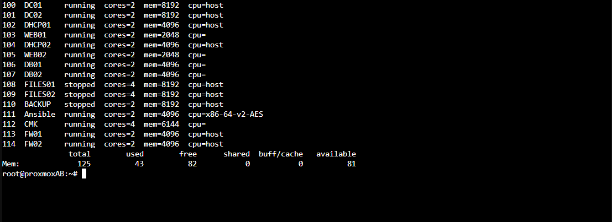

*Figura 8.1.1.* Núcleos, memoria y tipo de CPU de cada VM tras el cambio y memoria del host: 125 GB en total y 43 GB usados. Archivo: [`01-proxmox-recursos-vms-tras-cambio.png`](https://github.com/bertasipekmenendez-asix/Proyecto-Intermodular-Berta-Sipek-Alex-Gutierrez/blob/main/docs/img/fase1/19-11/09-redimensionado/01-proxmox-recursos-vms-tras-cambio.png)

En la tabla de inventario figuraban 4 GB para DC01 y DC02; el 19/11 se comprobó en Proxmox que tienen 8 GB y se ha corregido.

**Procedimiento.** Los cambios de RAM y CPU solo se aplican apagando y encendiendo la VM desde Proxmox, así que se hizo de una en una:

1. **DHCP02 y después DHCP01:** mientras uno se reiniciaba, el otro seguía dando servicio por el failover. Tras cada arranque, el servicio DHCPServer en marcha y el ámbito activo.
2. **DB01 y DB02:** sin servicio que cortar, porque MariaDB aún no está instalado.
3. **CMK:** tras el arranque, 4 vCPU, unos 6 GB y la web responde (HTTP 200).
4. **Ansible:** la última, porque cierra la sesión SSH.
5. **FILES01, FILES02 y BACKUP:** estaban apagadas; el cambio se aplica al encenderlas.

`proxmox-vms-windows.yml` se actualizó con estos valores (y el nombre DHCP01) y pasa `--syntax-check`.

## 9. Automatización con Ansible

Ansible core 2.16.3 corre en la VM 111 y despliega las VMs Linux desde la plantilla 9000 con el usuario `alex` y acceso SSH por clave. Ansible no instala sistemas: necesita una máquina con SO, red, SSH y su clave autorizada, que es lo que aporta la plantilla cloud-init.

### 9.1 Plantilla cloud-init (VM 9000)

Creada en la consola de proxmoxAB a partir de la imagen cloud oficial de Ubuntu 24.04:

```bash
wget https://cloud-images.ubuntu.com/noble/current/noble-server-cloudimg-amd64.img
qm create 9000 --name ubuntu-2404-tpl --memory 2048 --cores 2 \
  --net0 virtio,bridge=vmbr1,firewall=1 --scsihw virtio-scsi-single --ostype l26
qm set 9000 --scsi0 local-lvm:0,import-from=/root/noble-server-cloudimg-amd64.img,iothread=1,discard=on
qm set 9000 --ide2 local-lvm:cloudinit
qm set 9000 --boot order=scsi0
qm set 9000 --serial0 socket --vga serial0
qm set 9000 --ciuser alex --sshkeys /root/ansible.pub
qm set 9000 --nameserver 8.8.8.8
qm template 9000
```

Cada VM Linux se crea como clon completo (`qm clone 9000 <id> --full`) y recibe su VLAN e IP con `qm set --net0 … tag=<vlan> --ipconfig0 ip=…,gw=…`. Los clones completos no dependen de la plantilla.

### 9.2 Proyecto y control de acceso

- Proyecto en `~/cibernova/ansible`: `ansible.cfg`, `inventario.ini`, `playbooks/`, `group_vars/` y `roles/`, versionado con Git en la rama `main`.
- Clave SSH ed25519 en `~/.ssh/id_ed25519`; la pública está en la plantilla, así que cada clon nace con ella.
- Variables comunes en `group_vars/all/vars.yml` (versión de Checkmk, sitio y servidor); secretos en `group_vars/all/vault.yml`, cifrado con Ansible Vault.

Commit del playbook que crea las VMs Windows (12/11):

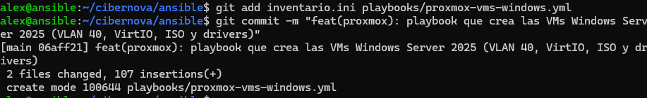

### 9.3 Inventario

| Grupo | Hosts | Para qué |
| --- | --- | --- |
| `control` | localhost | La propia VM de Ansible |
| `web` | cn-web01 (192.168.100.30), cn-web02 (192.168.100.31) | Servidores de la DMZ |
| `db` | cn-db01 (192.168.40.40), cn-db02 (192.168.40.41) | Bases de datos |
| `mon` | cn-cmk (192.168.40.20) | Servidor Checkmk |
| `linux` | web + db + mon | Todo lo Linux, con `ansible_user=alex` |
| `proxmox` | proxmoxab (192.168.40.4 desde el 19/11, antes la .40.1; usuario root) | Configuración de las VMs en el hipervisor |
| dc | cn-dc01 (192.168.40.10), cn-dc02 (192.168.40.11) | Controladores de dominio con DNS |
| dhcp | cn-dhcp01 (192.168.40.12), cn-dhcp02 (192.168.40.13) | DHCP con failover |
| files | cn-files01 (192.168.40.30), cn-files02 (192.168.40.31) | Servidores de ficheros (DFS) |
| backup | cn-backup (192.168.40.50) | Copias de seguridad |
| miembros | dhcp + files + backup | Servidores que se unen al dominio sin ser DC |
| windows | dc + miembros | Las 7 Windows, por WinRM con la cuenta Administrador (group\_vars/windows.yml) |

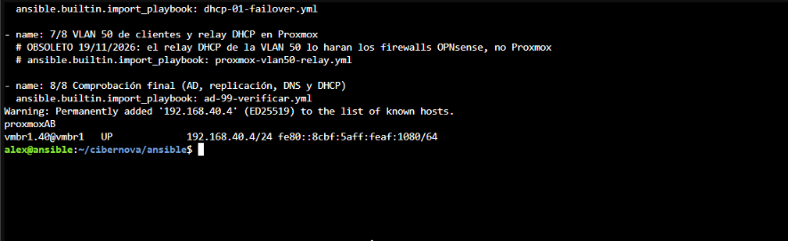

*Figura 9.3.1.* VM Ansible el 19/11: `cibernova-dominio.yml` con el paso 7 (`proxmox-vlan50-relay.yml`) comentado como obsoleto, y conexión a proxmoxAB por la 192.168.40.4 (`vmbr1.40` con 192.168.40.4/24). Desde el 19/11 la .40.1 es la VIP de los firewalls, así que con la IP antigua Ansible intentaría entrar por SSH en un firewall. Archivo: [`40-ansible-inventario-proxmox-40-4.png`](https://github.com/bertasipekmenendez-asix/Proyecto-Intermodular-Berta-Sipek-Alex-Gutierrez/blob/main/docs/img/fase1/19-11/04-firewalls/40-ansible-inventario-proxmox-40-4.png)

### 9.4 Playbooks

| Playbook | Qué hace | Hosts |
| --- | --- | --- |
| `checkmk-servidor.yml` | Descarga e instala Checkmk 2.5.0p18 Community, crea el sitio `cibernova` si no existe y lo arranca | `mon` |
| `checkmk-agente.yml` | Instala el agente desde el servidor Checkmk, da de alta cada host por la API REST (`checkmk.general`), descubre sus servicios y activa los cambios | `linux` |
| `proxmox-vms-windows.yml` | Recrea las 7 VMs Windows (detalle en [9.5](#95-detalle-del-playbook-proxmox-vms-windowsyml)) | `proxmox` |
| win-00-comprobaciones.yml | Comprueba los Windows sin cambiar nada (WinRM, IP, dominio, 10 GB libres) y hace un snapshot pre-ad de las 7 VMs Windows y una copia de la red de Proxmox | windows, proxmox |
| win-01-base.yml | IP definitiva (si se indica ip\_actual), nombre del equipo, zona horaria y ping permitido | windows |
| ad-01-dc01-bosque.yml | Crea el bosque cibernova.local en DC01 con DNS, reenviadores, zonas inversas (40, 50, 100), registros A/PTR de las Linux y DC01 como fuente de hora. Ejecutado el 16/11 | cn-dc01 |
| ad-02-dc02-replica.yml | Ejecutado el 19/11. Promueve DC02 como segundo DC con DNS, cruza el DNS entre los dos DC y espera a que replique sin errores | cn-dc02, dc |
| ad-03-estructura.yml | Ejecutado el 19/11. Árbol de OUs (vars/ad\_estructura.yml), directiva de contraseñas del Anexo I y redircmp a Equipos\\Puestos | cn-dc01 |
| ad-04-unir-servidores.yml | Ejecutado el 19/11, solo en DHCP01 y DHCP02. Pone los DC como DNS y une DHCP01/02, FILES01/02 y BACKUP al dominio en OU=Servidores; comprueba el canal seguro | miembros |
| dhcp-01-failover.yml | Ejecutado el 19/11. Rol DHCP, autorización en AD, ámbito de la VLAN 50 y failover 50/50 | dhcp, cn-dhcp01 |
| proxmox-vlan50-relay.yml | VLAN 50 de clientes (vmbr1.50 con NAT) y relay DHCP con dnsmasq hacia DHCP01 y DHCP02. Obsoleto: el 19/11 se comentó este paso en cibernova-dominio.yml, porque volvería a crear la .50.1 en Proxmox y chocaría con la VIP. El relay irá en OPNsense | proxmox |
| ad-99-verificar.yml | Comprobación final sin cambios: dominio, FSMO, dcdiag, repadmin, DNS y ámbitos DHCP | dc, dhcp |
| cibernova-dominio.yml | Lanza todos los anteriores en orden con un solo comando (unos 30-40 minutos) | Todos |

Los playbooks son idempotentes: en una segunda ejecución las tareas salen en `ok` o `skipping` y no en `changed`.

Desde el 19/11 los playbooks largos se lanzan dentro de `tmux` en la VM Ansible, para que no se corten si se reconecta la consola web de Proxmox (P26). Los logs quedan en `~/cibernova/ansible/logs/`.

### 9.5 Detalle del playbook proxmox-vms-windows.yml


El playbook `proxmox-vms-windows.yml` se ejecuta desde la VM Ansible contra Proxmox (grupo `proxmox`) y recrea las 7 VMs Windows con la misma configuración. En `vars` se definen el almacenamiento (`local-lvm`), el bridge `vmbr1` con la VLAN 40, las dos ISO (Windows Server 2025 y los drivers VirtIO) y la lista de VMs con su ID, nombre, CPU, RAM y disco. Las tareas, en orden: comprueba que las dos ISO están descargadas y, si falta alguna, se detiene antes de borrar nada; mira qué VMs existen ya con `qm config`; guarda su configuración antigua en `/root/qm-antes` como copia de seguridad; y después borra las VMs vacías y las vuelve a crear con disco y red VirtIO, VLAN 40, disco en el arranque y las dos ISO montadas. La etiqueta `ws2025` marca las VMs que crea el propio playbook, así que en una segunda ejecución no vuelve a tocarlas: eso lo hace idempotente.

Primera y segunda ejecución. La segunda no cambia nada, lo que demuestra la idempotencia:


## 10. Monitorización con Checkmk

Checkmk 2.5.0p18 Community está instalado en CMK (192.168.40.20) con el sitio `cibernova`, y el agente ya está en las cinco VMs clonadas. Esta sección también sirve de base para el Anexo de necesidades de IA (Fase 2), porque aquí se ven las métricas que genera la infraestructura.

- **Acceso web:** por túnel SSH a través de Proxmox, porque el PC del aula no llega a la VLAN 40.
- **Alta de hosts:** automática; cualquier VM que se añada al inventario queda monitorizada relanzando `checkmk-agente.yml`, sin tocar la web.
- **Cuenta de la API:** `automation`, creada a mano porque en esta versión no existe por defecto (P8); su secreto está en Ansible Vault.
- **Qué se monitoriza:** CPU, RAM, disco y servicios descubiertos automáticamente. Las Windows se añadirán cuando estén instaladas.
- **Alertas:** pendientes; serán la base de la Fase 2.

## 11. Servicios

Para cada servicio indicamos dónde corre, cómo es redundante y con qué evidencia comprobaremos que funciona. A 19/11 funcionan Active Directory con DNS (DC01 y DC02), el DHCP con failover (sin relay todavía) y los firewalls en alta disponibilidad; el resto de servicios están pendientes.

| Servicio | Máquinas | Redundancia | Evidencia prevista |
| --- | --- | --- | --- |
| Active Directory + DNS | DC01, DC02 | Dos DC replicando | Usuarios y equipos de AD con la estructura de OU; consola DNS con la zona |
| DHCP | DHCP01, DHCP02 | Failover DHCP | Consola DHCP con el ámbito y el failover configurado |
| Ficheros + DFS | FILES01, FILES02 | DFS-N + DFS-R | Consola de administración DFS con el espacio `\\<dominio>\empresa` y la replicación |
| Usuarios, grupos y permisos | DC01 + FILES01 | — | Salida del script de alta leyendo el CSV; pestaña Seguridad de una carpeta con los grupos DL\_ |
| Web | WEB01, WEB02 | Por decidir (balanceo o IP flotante con keepalived) | Navegador mostrando la web; prueba apagando WEB01 |
| SFTP | WEB01 (y WEB02) | Por decidir | Conexión con FileZilla o `sftp` |
| Base de datos | DB01, DB02 | Replicación MariaDB | `SHOW REPLICA STATUS` en DB02 |
| Backups | BACKUP | Por decidir (copia fuera del propio host) | Tarea de backup completada y una restauración de prueba |
| Router, firewall y NAT | FW01, FW02 | CARP + pfsync + XMLRPC | Failover probado el 19/11: FW01 apagado y ping continuo sin pérdidas ([apartado 6.4](#64-firewalls-opnsense-en-alta-disponibilidad-1711)) |

Para demostrar la redundancia en la demo, apagaremos el nodo principal de cada servicio y enseñaremos que el servicio sigue funcionando, con captura del antes y el después.

### 11.1 Instalación de Windows Server 2025 (en curso)

El 12/11 Guti empezó a instalar Windows Server 2025 con Experiencia de escritorio, probablemente en las 7 VMs Windows (sin confirmar en cuáles ni hasta qué paso).

Para que el instalador vea el disco hay que cargar el driver VirtIO SCSI. El controlador **vioscsi** (*VirtIO SCSI*) es el driver paravirtualizado que permite a Windows Server reconocer y comunicarse a máxima velocidad con los discos duros virtuales creados en hipervisores basados en **KVM/QEMU** (como Proxmox VE, OpenStack o Red Hat Virtualization).

Si no está instalado en la máquina virtual o no se carga durante el arranque, **Windows Server no detectará ningún disco duro para instalar el sistema operativo, o bien sufrirá un pantallazo azul (`INACCESSIBLE_BOOT_DEVICE`)** si ya estaba instalado y se cambia el tipo de controladora en el hipervisor.


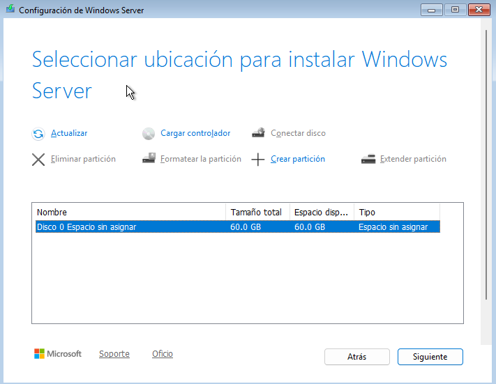

### 11.2 Preparación de DC01 y creación del dominio (16/11)

El 16/11 (lunes, sin clase) Guti dejó DC01 operativo como primer controlador del dominio `cibernova.local`. Estos son los pasos, con sus capturas en `docs/img/fase1/16-11/`.

**1. Drivers VirtIO.** Después de instalar Windows, SConfig no mostraba ningún adaptador de red (P12): Windows no trae el driver de la tarjeta VirtIO. Se instaló `virtio-win-guest-tools` desde el CD `virtio-win-0.1.302`, que añade los drivers de red, disco, memoria y el resto de dispositivos VirtIO.

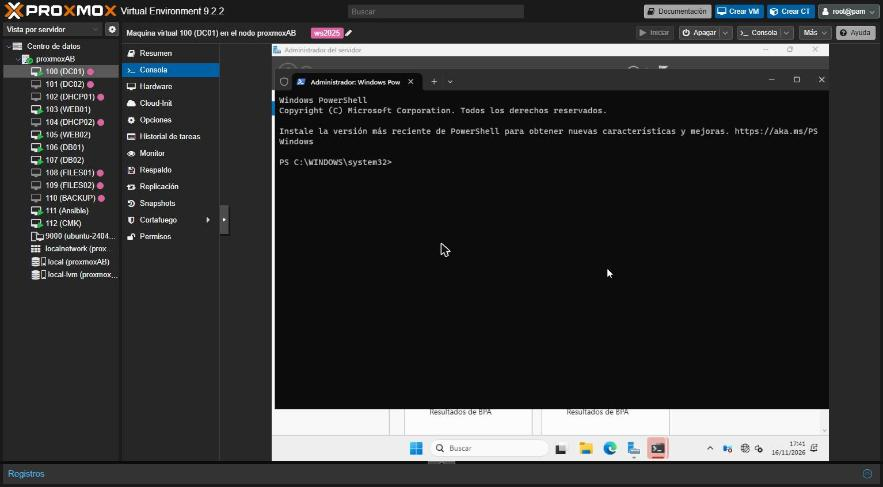

*Figura 11.2.1.* Consola noVNC de DC01 con Windows PowerShell abierto como administrador sobre el Administrador del servidor. Archivo: [`01-dc01-powershell-inicial.jpg`](https://github.com/bertasipekmenendez-asix/Proyecto-Intermodular-Berta-Sipek-Alex-Gutierrez/blob/main/docs/img/fase1/16-11/01-dc01-preparacion/01-dc01-powershell-inicial.jpg)

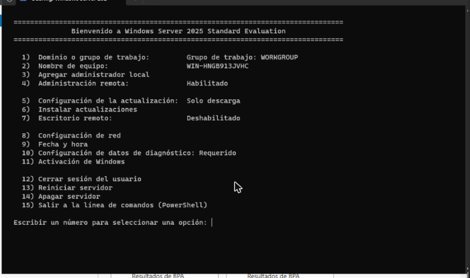

*Figura 11.2.2.* Menú de SConfig: grupo de trabajo WORKGROUP, nombre provisional WIN-HNGB913JVHC y administración remota habilitada. Archivo: [`03-dc01-sconfig-menu-winrm-habilitado.png`](https://github.com/bertasipekmenendez-asix/Proyecto-Intermodular-Berta-Sipek-Alex-Gutierrez/blob/main/docs/img/fase1/16-11/01-dc01-preparacion/03-dc01-sconfig-menu-winrm-habilitado.png)

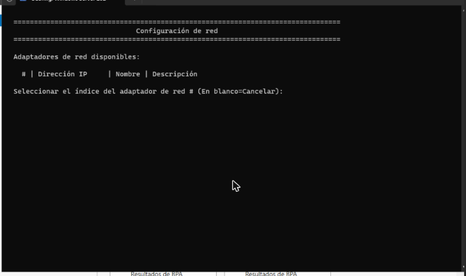

*Figura 11.2.3.* SConfig → Configuración de red: la lista de adaptadores sale vacía porque Windows aún no tiene el driver VirtIO (P12). Archivo: [`04-dc01-sin-adaptadores-de-red.png`](https://github.com/bertasipekmenendez-asix/Proyecto-Intermodular-Berta-Sipek-Alex-Gutierrez/blob/main/docs/img/fase1/16-11/01-dc01-preparacion/04-dc01-sin-adaptadores-de-red.png)

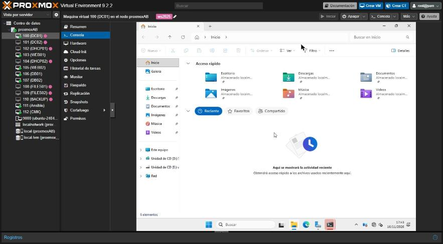

*Figura 11.2.4.* Explorador de archivos con las dos unidades de CD: D: (instalador de WS2025) y E: (virtio-win). Archivo: [`05-dc01-explorador-unidades-cd.jpg`](https://github.com/bertasipekmenendez-asix/Proyecto-Intermodular-Berta-Sipek-Alex-Gutierrez/blob/main/docs/img/fase1/16-11/01-dc01-preparacion/05-dc01-explorador-unidades-cd.jpg)

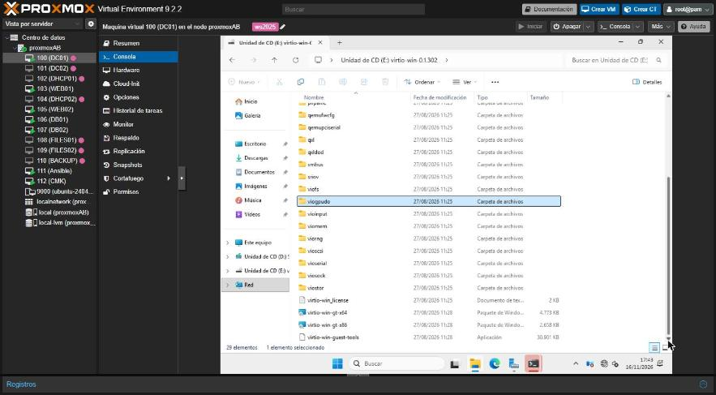

*Figura 11.2.5.* Contenido de E: (virtio-win-0.1.302): carpetas de drivers y el instalador virtio-win-guest-tools. Archivo: [`06-dc01-cd-virtio-guest-tools.jpg`](https://github.com/bertasipekmenendez-asix/Proyecto-Intermodular-Berta-Sipek-Alex-Gutierrez/blob/main/docs/img/fase1/16-11/01-dc01-preparacion/06-dc01-cd-virtio-guest-tools.jpg)

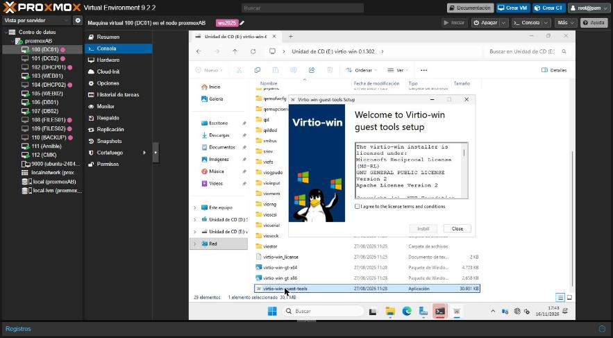

*Figura 11.2.6.* Pantalla de bienvenida del instalador Virtio-win guest tools. Archivo: [`07-dc01-instalador-guest-tools.jpg`](https://github.com/bertasipekmenendez-asix/Proyecto-Intermodular-Berta-Sipek-Alex-Gutierrez/blob/main/docs/img/fase1/16-11/01-dc01-preparacion/07-dc01-instalador-guest-tools.jpg)

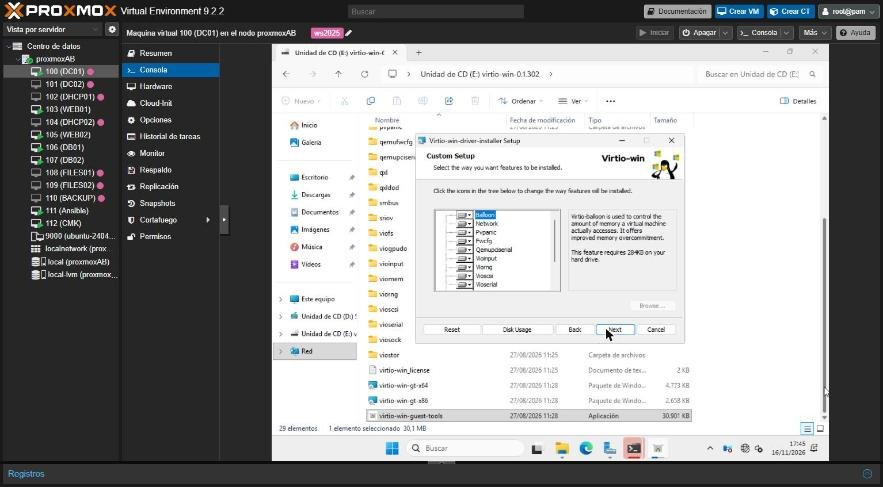

*Figura 11.2.7.* Custom Setup: drivers que se instalan (Balloon, Network, Vioscsi, Vioserial, entre otros). Archivo: [`08-dc01-componentes-drivers.jpg`](https://github.com/bertasipekmenendez-asix/Proyecto-Intermodular-Berta-Sipek-Alex-Gutierrez/blob/main/docs/img/fase1/16-11/01-dc01-preparacion/08-dc01-componentes-drivers.jpg)

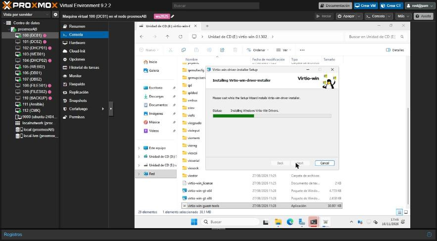

*Figura 11.2.8.* Progreso de la instalación de los drivers VirtIO. Archivo: [`09-dc01-instalando-drivers.jpg`](https://github.com/bertasipekmenendez-asix/Proyecto-Intermodular-Berta-Sipek-Alex-Gutierrez/blob/main/docs/img/fase1/16-11/01-dc01-preparacion/09-dc01-instalando-drivers.jpg)

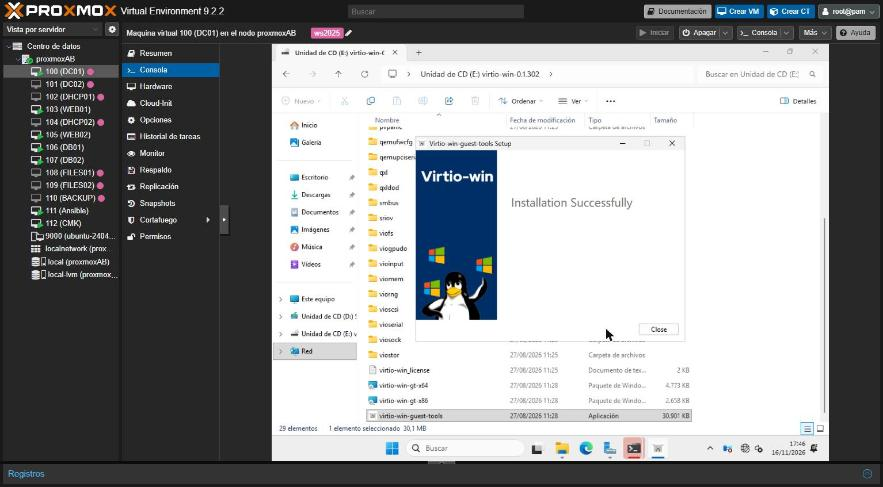

*Figura 11.2.9.* Fin del instalador: Installation Successfully. Archivo: [`10-dc01-guest-tools-instaladas.jpg`](https://github.com/bertasipekmenendez-asix/Proyecto-Intermodular-Berta-Sipek-Alex-Gutierrez/blob/main/docs/img/fase1/16-11/01-dc01-preparacion/10-dc01-guest-tools-instaladas.jpg)

**2. IP fija con SConfig.** Con el driver instalado ya aparece el adaptador *Red Hat VirtIO Ethernet Adapter*, con una IP automática `169.254.80.124` porque en la VLAN 40 todavía no hay DHCP. Se fijó `192.168.40.10/24` con puerta de enlace `192.168.40.1` y, antes de crear el dominio, los DNS `8.8.8.8` y `1.1.1.1`. Se usó SConfig, que solo pide números, porque en la consola noVNC el teclado cambiaba los símbolos (P13).

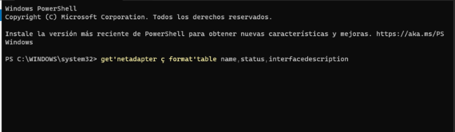

*Figura 11.2.10.* Incidencia de teclado en noVNC: Get-NetAdapter | Format-Table sale como get'netadapter ç format'table (P13). Archivo: [`02-dc01-incidencia-teclado-novnc.png`](https://github.com/bertasipekmenendez-asix/Proyecto-Intermodular-Berta-Sipek-Alex-Gutierrez/blob/main/docs/img/fase1/16-11/01-dc01-preparacion/02-dc01-incidencia-teclado-novnc.png)

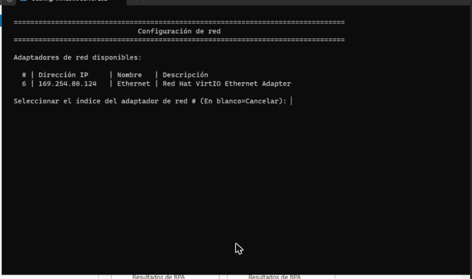

*Figura 11.2.11.* SConfig ya muestra el adaptador Red Hat VirtIO Ethernet Adapter, con la IP automática 169.254.80.124. Archivo: [`11-dc01-adaptador-virtio-detectado.png`](https://github.com/bertasipekmenendez-asix/Proyecto-Intermodular-Berta-Sipek-Alex-Gutierrez/blob/main/docs/img/fase1/16-11/01-dc01-preparacion/11-dc01-adaptador-virtio-detectado.png)

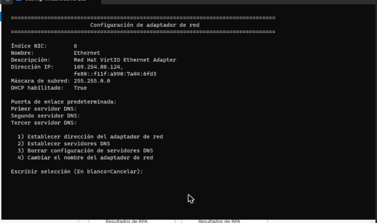

*Figura 11.2.12.* Adaptador antes de configurarlo: IP 169.254.80.124/16, DHCP habilitado y sin puerta de enlace ni DNS. Archivo: [`12-dc01-config-adaptador-antes.png`](https://github.com/bertasipekmenendez-asix/Proyecto-Intermodular-Berta-Sipek-Alex-Gutierrez/blob/main/docs/img/fase1/16-11/01-dc01-preparacion/12-dc01-config-adaptador-antes.png)

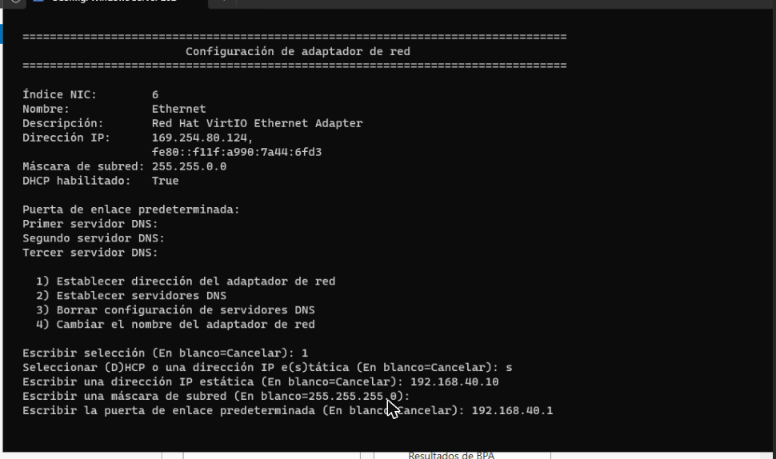

*Figura 11.2.13.* Introducción de la IP 192.168.40.10, la máscara 255.255.255.0 y la puerta de enlace 192.168.40.1. Archivo: [`13-dc01-ip-estatica-datos.png`](https://github.com/bertasipekmenendez-asix/Proyecto-Intermodular-Berta-Sipek-Alex-Gutierrez/blob/main/docs/img/fase1/16-11/01-dc01-preparacion/13-dc01-ip-estatica-datos.png)

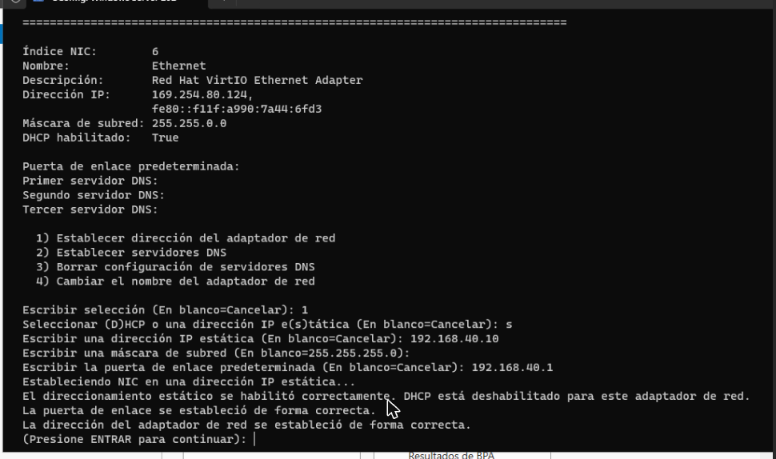

*Figura 11.2.14.* Confirmación: DHCP deshabilitado y la IP y la puerta de enlace aplicadas. Archivo: [`14-dc01-ip-estatica-aplicada.png`](https://github.com/bertasipekmenendez-asix/Proyecto-Intermodular-Berta-Sipek-Alex-Gutierrez/blob/main/docs/img/fase1/16-11/01-dc01-preparacion/14-dc01-ip-estatica-aplicada.png)

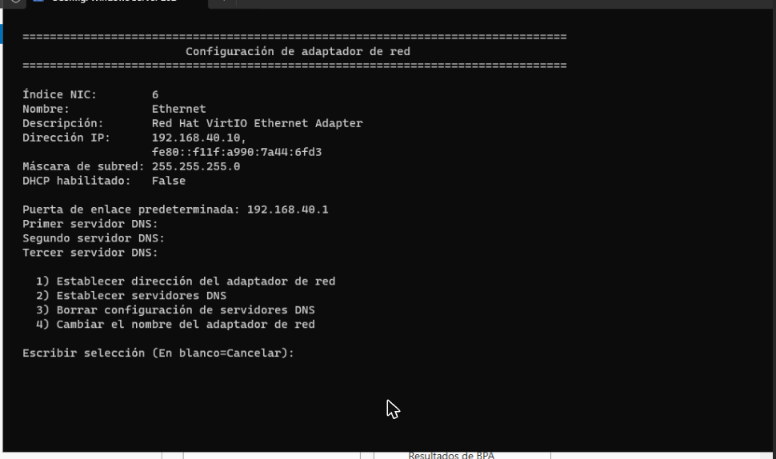

*Figura 11.2.15.* Adaptador después del cambio: 192.168.40.10/24, DHCP False, puerta de enlace 192.168.40.1 y todavía sin DNS. Archivo: [`15-dc01-adaptador-con-ip-fija.png`](https://github.com/bertasipekmenendez-asix/Proyecto-Intermodular-Berta-Sipek-Alex-Gutierrez/blob/main/docs/img/fase1/16-11/01-dc01-preparacion/15-dc01-adaptador-con-ip-fija.png)

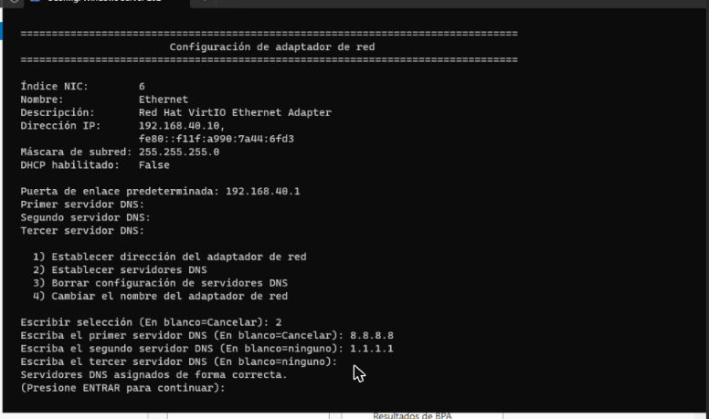

*Figura 11.2.16.* Servidores DNS 8.8.8.8 y 1.1.1.1 asignados antes de crear el dominio. Archivo: [`16-dc01-dns-asignados.png`](https://github.com/bertasipekmenendez-asix/Proyecto-Intermodular-Berta-Sipek-Alex-Gutierrez/blob/main/docs/img/fase1/16-11/01-dc01-preparacion/16-dc01-dns-asignados.png)

**3. Conectividad y WinRM.** El `ping` a la VM Ansible (192.168.40.5) y a Internet (8.8.8.8) responde, lo que confirma la VLAN 40 y el NAT de Proxmox. Después se activó WinRM con `Enable-PSRemoting` y `Test-WSMan localhost` respondió: desde ese momento Ansible puede gestionar DC01.

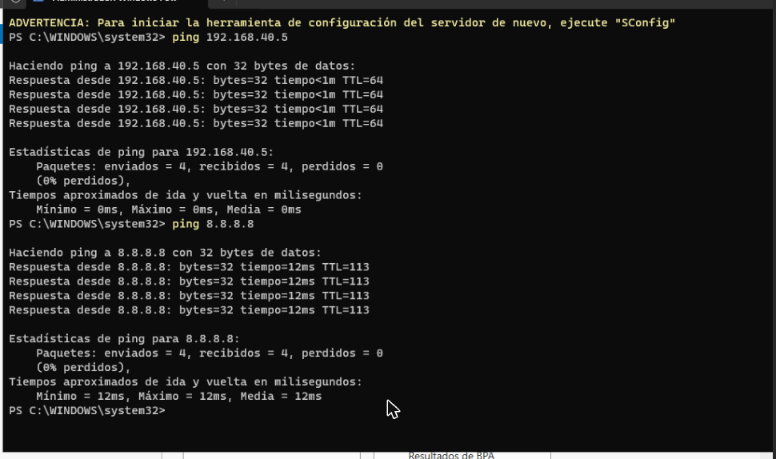

*Figura 11.2.17.* Ping a la VM Ansible (192.168.40.5) y a 8.8.8.8 sin pérdidas: la VLAN 40 y el NAT de Proxmox funcionan. Archivo: [`17-dc01-ping-ansible-e-internet.png`](https://github.com/bertasipekmenendez-asix/Proyecto-Intermodular-Berta-Sipek-Alex-Gutierrez/blob/main/docs/img/fase1/16-11/01-dc01-preparacion/17-dc01-ping-ansible-e-internet.png)

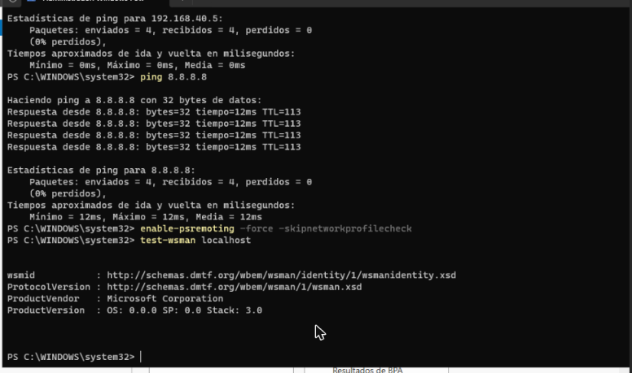

*Figura 11.2.18.* Enable-PSRemoting y Test-WSMan localhost con respuesta correcta: WinRM listo para Ansible. Archivo: [`18-dc01-winrm-test-wsman-ok.png`](https://github.com/bertasipekmenendez-asix/Proyecto-Intermodular-Berta-Sipek-Alex-Gutierrez/blob/main/docs/img/fase1/16-11/01-dc01-preparacion/18-dc01-winrm-test-wsman-ok.png)

**4. Bosque cibernova.local con Ansible.** Desde la VM Ansible se lanzaron `win-00`, `win-01` y `ad-01-dc01-bosque.yml` con `--limit cn-dc01`, y después `ad-99-verificar.yml`. Resultado: dominio `cibernova.local` (NetBIOS `CIBERNOVA`) con nivel `Windows2025Domain`, DC01 como único DC con los roles FSMO y `failed=0`. `dcdiag` no supera las pruebas DFSREvent (P14) y SystemLog (P15). `dc02` aún no resuelve, lo esperado mientras DC02 no esté promovido.

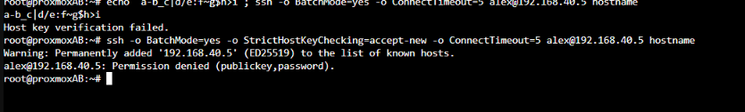

*Figura 11.2.19.* Shell de proxmoxAB: los caracteres especiales salen bien, pero el ssh a alex@192.168.40.5 da Permission denied (publickey,password). Archivo: [`00-shell-proxmox-teclado-ok.png`](https://github.com/bertasipekmenendez-asix/Proyecto-Intermodular-Berta-Sipek-Alex-Gutierrez/blob/main/docs/img/fase1/16-11/02-dc01-dominio/00-shell-proxmox-teclado-ok.png)

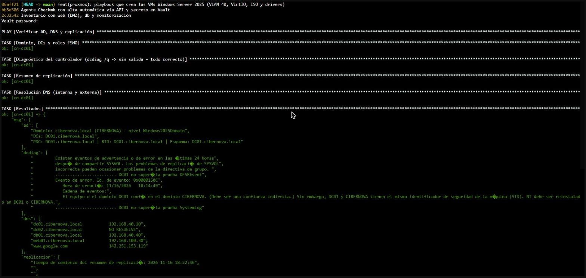

*Figura 11.2.20.* ad-99-verificar.yml sobre cn-dc01: dominio cibernova.local con nivel Windows2025Domain, DC01 con los roles FSMO y dcdiag sin superar DFSREvent ni SystemLog (P14 y P15). Archivo: [`01-dc01-verificacion-dominio-fsmo-dcdiag.jpg`](https://github.com/bertasipekmenendez-asix/Proyecto-Intermodular-Berta-Sipek-Alex-Gutierrez/blob/main/docs/img/fase1/16-11/02-dc01-dominio/01-dc01-verificacion-dominio-fsmo-dcdiag.jpg)

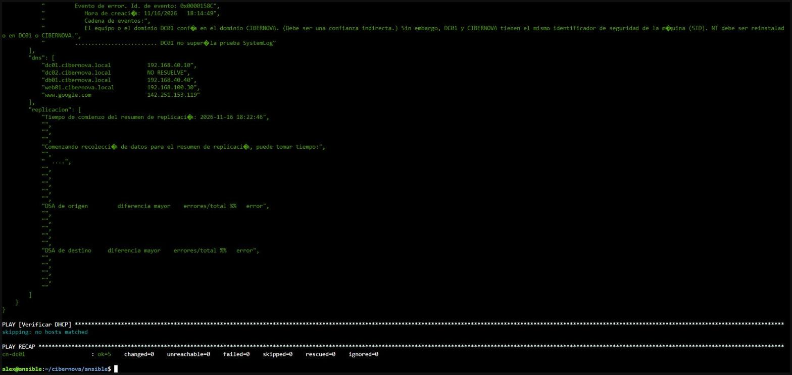

*Figura 11.2.21.* Continuación: el DNS resuelve dc01, db01, web01 y www.google.com (dc02 todavía no) y el PLAY RECAP da ok=5, changed=0 y failed=0. Archivo: [`02-dc01-verificacion-dns-recap.jpg`](https://github.com/bertasipekmenendez-asix/Proyecto-Intermodular-Berta-Sipek-Alex-Gutierrez/blob/main/docs/img/fase1/16-11/02-dc01-dominio/02-dc01-verificacion-dns-recap.jpg)

**5. Apagado ordenado.** Al terminar se apagaron las 13 VMs con `qm shutdown` (300 s de margen cada una). Todas quedaron paradas; la VM Ansible no respondió al agente QEMU (P16).

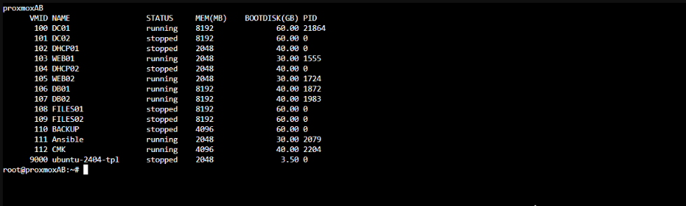

*Figura 11.2.22.* qm list antes de apagar: DC01, WEB01, WEB02, DB01, DB02, Ansible y CMK en marcha. Archivo: [`01-proxmox-vms-antes-de-apagar.png`](https://github.com/bertasipekmenendez-asix/Proyecto-Intermodular-Berta-Sipek-Alex-Gutierrez/blob/main/docs/img/fase1/16-11/03-cierre/01-proxmox-vms-antes-de-apagar.png)

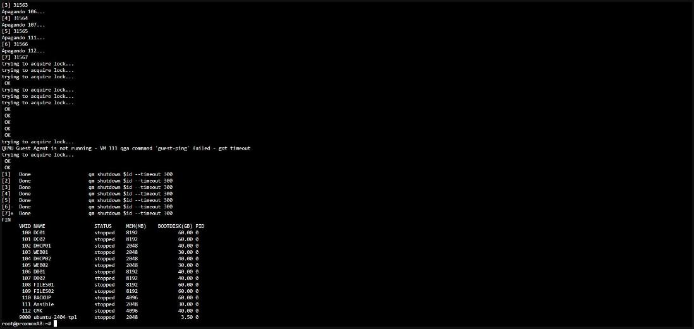

*Figura 11.2.23.* qm shutdown con 300 s de margen por VM y qm list final con todas paradas; aviso del agente QEMU en la 111 (P16). Archivo: [`02-proxmox-todas-las-vms-apagadas.jpg`](https://github.com/bertasipekmenendez-asix/Proyecto-Intermodular-Berta-Sipek-Alex-Gutierrez/blob/main/docs/img/fase1/16-11/03-cierre/02-proxmox-todas-las-vms-apagadas.jpg)

### 11.3 DC02, estructura de AD y DHCP con failover (19/11)

El 19/11 DC02 quedó como segundo controlador de dominio, se creó la estructura de OUs y DHCP01 y DHCP02 dan servicio con failover. Las capturas están en `docs/img/fase1/19-11/`.

**1. DC02 sin teclear en noVNC.** Tras instalar las guest tools de VirtIO, que incluyen el agente QEMU, todo se configuró desde el shell de Proxmox con `qm guest exec <vmid> -- powershell -Command "..."`: IP 192.168.40.11/24, puerta de enlace .40.1, DNS 192.168.40.10, WinRM, regla ICMP, zona horaria de Madrid, perfil de red privado y nombre DC02. Se comprobó la conexión LDAP con DC01 (puerto 389) y el registro SRV del dominio. Antes de promover se compararon los SID de máquina: DC01 `S-1-5-21-3903391704-…` y DC02 `S-1-5-21-654049888-…` son distintos, lo que cierra P15. Snapshots: DC02 `pre-promocion` y DC01 `pre-dc02`.

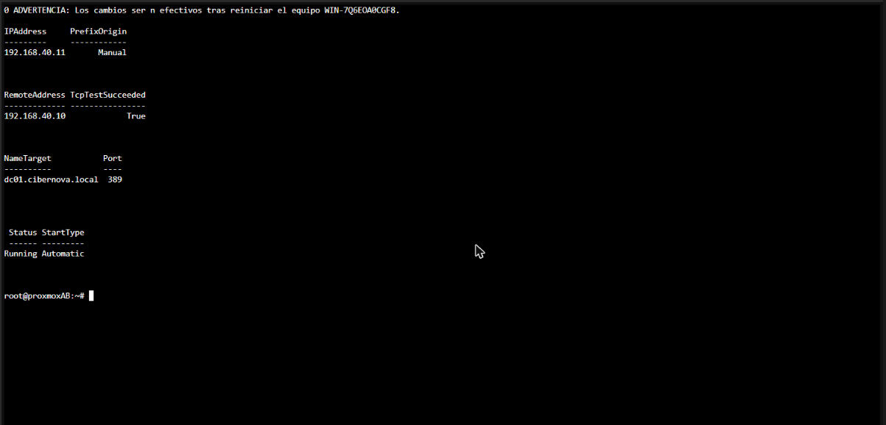

*Figura 11.3.1.* Salida de `qm guest exec` en proxmoxAB: IP 192.168.40.11 manual, conexión con DC01 correcta, SRV que devuelve dc01.cibernova.local en el puerto 389 y WinRM en marcha. Archivo: [`03-dc02-ip-dns-winrm-por-agente.png`](https://github.com/bertasipekmenendez-asix/Proyecto-Intermodular-Berta-Sipek-Alex-Gutierrez/blob/main/docs/img/fase1/19-11/05-dc02/03-dc02-ip-dns-winrm-por-agente.png)


*Figura 11.3.2.* SID de máquina de DC01 (`S-1-5-21-3903391704-…`) y de DC02 (`S-1-5-21-654049888-…`): son distintos (P15). Archivo: [`04-dc02-renombrado-sid-distinto.png`](https://github.com/bertasipekmenendez-asix/Proyecto-Intermodular-Berta-Sipek-Alex-Gutierrez/blob/main/docs/img/fase1/19-11/05-dc02/04-dc02-renombrado-sid-distinto.png)

**2. Promoción con Ansible.** En la VM Ansible: `ansible-playbook playbooks/win-00-comprobaciones.yml playbooks/win-01-base.yml playbooks/ad-02-dc02-replica.yml -l cn-dc01,cn-dc02,proxmoxab --ask-vault-pass`, con `failed=0`. DC02 se reinició al promoverse y quedó como DC (`DomainRole = 4`, servicios NTDS y DNS en marcha).

| Comprobación en DC02 | Resultado |
| --- | --- |
| `repadmin /replsummary` | DC01 ↔ DC02: 0 errores de 5 en los dos sentidos |
| `repadmin /showrepl DC02` | Las 5 particiones (dominio, Configuration, Schema, DomainDnsZones y ForestDnsZones) replicadas |
| SYSVOL | Existe `C:\Windows\SYSVOL\domain\Policies` y están publicados SYSVOL y NETLOGON |
| DNS | `_ldap._tcp.dc._msdcs.cibernova.local` devuelve dc01 y dc02 |


*Figura 11.3.3.* `repadmin /replsummary` con 0 errores de 5 en los dos sentidos, las 5 particiones replicadas, SYSVOL y NETLOGON publicados y el SRV con dc01 y dc02. Archivo: [`05-dc02-replicacion-ok.jpg`](https://github.com/bertasipekmenendez-asix/Proyecto-Intermodular-Berta-Sipek-Alex-Gutierrez/blob/main/docs/img/fase1/19-11/05-dc02/05-dc02-replicacion-ok.jpg)

**3. DHCP01 y DHCP02.** Mismo método que DC02. En DHCP01 hubo que cambiar el CD de la VM, que tenía la ISO de Windows, por `virtio-win.iso`. IPs .12 y .13, puerta de enlace .40.1, DNS DC01 y DC02, perfil privado y WinRM. Sus SID son distintos entre sí y del dominio. Nombres DHCP01 y DHCP02 y snapshots `pre-dominio`.

**4. Estructura de AD, unión al dominio y DHCP con Ansible.** `ansible-playbook playbooks/ad-03-estructura.yml playbooks/ad-04-unir-servidores.yml playbooks/dhcp-01-failover.yml -l 'cn-dc01,dhcp' --ask-vault-pass`, limitado para no tocar FILES01, FILES02 y BACKUP, que estaban apagadas.

- **ad-03** (DC01, `ok=5 changed=5 failed=0`): OU raíz CiberNova con Usuarios, Cuentas\_Admin, Cuentas\_Servicio, Cuentas\_Especiales, Bajas, Grupos, Equipos y Servidores; OUs de los 10 departamentos, Grupos/Globales y DominioLocal y Equipos/Puestos y Recepcion; directiva de contraseñas y bloqueo; `redircmp` a OU=Puestos.
- **ad-04** (`failed=0`): DHCP01 y DHCP02 en `OU=Servidores,OU=CiberNova`, con el canal seguro comprobado.
- **dhcp-01-failover** (`failed=0`): rol DHCP, autorización en AD, ámbito VLAN50-Clientes (192.168.50.0/24, de la .20 a la .250, concesión de 8 días, puerta de enlace .50.1, DNS DC01 y DC02 y dominio) y failover CN-DHCP01-DHCP02 en LoadBalance 50/50, estado Normal. La primera vez se cortó a mitad (P26) y se relanzó dentro de `tmux`.


*Figura 11.3.4.* `ad-03-estructura.yml` en cn-dc01: OUs de primer nivel e hijas, directiva de contraseñas y bloqueo, `redircmp` a OU=Puestos y `ok=5 changed=5 failed=0`. Archivo: [`01-ad03-ous-directiva.png`](https://github.com/bertasipekmenendez-asix/Proyecto-Intermodular-Berta-Sipek-Alex-Gutierrez/blob/main/docs/img/fase1/19-11/08-ad-estructura-dhcp/01-ad03-ous-directiva.png)


*Figura 11.3.5.* `ad-04-unir-servidores.yml`: DNS a DC01 y DC02, unión al dominio en OU=Servidores, canal seguro correcto y `failed=0`. Archivo: [`02-ad04-dhcp-unidas-dominio.png`](https://github.com/bertasipekmenendez-asix/Proyecto-Intermodular-Berta-Sipek-Alex-Gutierrez/blob/main/docs/img/fase1/19-11/08-ad-estructura-dhcp/02-ad04-dhcp-unidas-dominio.png)


*Figura 11.3.6.* `dhcp-01-failover.yml`: autorización en AD, ámbito y opciones y failover CN-DHCP01-DHCP02 en LoadBalance 50 % con estado Normal. Archivo: [`03-dhcp-ambito-failover-ok.png`](https://github.com/bertasipekmenendez-asix/Proyecto-Intermodular-Berta-Sipek-Alex-Gutierrez/blob/main/docs/img/fase1/19-11/08-ad-estructura-dhcp/03-dhcp-ambito-failover-ok.png)

**Aislamiento respecto a la red del aula.** Antes de crear el ámbito se comprobó que este DHCP no puede repartir IPs en el aula:

1. `vmbr0` es el único bridge con tarjeta física (`nic1`), y en él solo están las WAN de los firewalls y la gestión de Proxmox.
2. `vmbr1` (VLAN 40, 50, 99 y 100) no tiene ninguna tarjeta física.
3. DHCP01 y DHCP02 solo tienen una interfaz, en la VLAN 40.
4. El broadcast DHCP no cruza routers: solo llegará a la VLAN 50 a través del relay de OPNsense, y en la WAN no hay ni habrá relay.

También se actualizaron los comentarios de `group_vars/dhcp.yml`, que todavía hablaban de la puerta de enlace y del relay de Proxmox.

## 12. Problemas encontrados y soluciones

Para cada problema anotamos el síntoma, la causa, la solución y cómo comprobamos que quedó resuelto.

| # | Fecha | Síntoma | Causa | Solución | Estado |
| --- | --- | --- | --- | --- | --- |
| P1 | 06/10 – 15/10 | Instalación de Proxmox fallida y servidor muy lento, reinicios eternos | El RAID estaba mal configurado y la instalación se reiniciaba sola; además no sabíamos entrar en la BIOS y cada reinicio tardaba de 10 a 15 minutos | Configuramos el RAID 10 en la controladora el 13/10 y reinstalamos Proxmox el 15/10 | Resuelto |
| P2 | 22/10 | VMs DHCP y FILES02 creadas con disco de 0 GB | El disco existe (scsi0 de 40 y 60 GB), pero scsi0 no está en el orden de arranque (boot: order=ide2;net0); queda además un disco antiguo como unused0 | VMs recreadas con proxmox-vms-windows.yml el 12/11, con el disco en el orden de arranque. Verificado con qm list: 102 muestra 40 GB y 109, 60 GB | Resuelto |
| P3 | — | Plantilla con DNS 8.8.8.8: las VMs Linux no resolverán el dominio interno cuando exista AD | Valor fijo en cloud-init | Cambiar el DNS a DC01/DC02 vía Ansible cuando estén operativos | Pendiente |
| P4 | — | Segundo disco de WEB y DB sin formatear | — | Particionar y montar (p. ej. `/var/www`, `/var/lib/mysql`) con un rol de Ansible | Pendiente |
| P5 | 05/11 | wget en Proxmox: Temporary failure in name resolution | El DNS del centro (192.168.200.254) no respondía; había Internet (ping a 8.8.8.8 correcto) | DNS 8.8.8.8, 1.1.1.1 y 192.168.200.254 en /etc/resolv.conf y en Sistema → DNS. Verificado con ping a cloud-images.ubuntu.com | Resuelto |
| P6 | 05/11 | La VM de Ansible se queda sin red tras ifreload -a | La IP 192.168.40.1 pasó a vmbr1.40 y la VM iba sin etiqueta VLAN | qm set 111 con tag=40 conservando la MAC. Verificado con ping a 192.168.40.1, 192.168.100.1 y 8.8.8.8 | Resuelto |
| P7 | 05/11 | Playbook checkmk-agente.yml incompleto y con líneas mezcladas | El heredoc (cat > … << 'EOF') se cortó al pegarlo por SSH | Ficheros largos con nano. Verificado con tail del fichero | Resuelto |
| P8 | 05/11 | No se puede leer automation.secret y la API de Checkmk responde 401 Wrong credentials | En Checkmk 2.5.0p18 el usuario automation no existe por defecto (solo agent\_registration y cmkadmin) | Crear automation con secreto de automatización y rol Administrator, activar cambios y guardar el secreto en Vault. Verificado con curl a /api/1.0/version | Resuelto |
| P9 | 05/11 | New-NetRoute: Acceso denegado en el PC del aula | No tenemos permisos de administrador en el PC | SSH con ProxyJump por Proxmox y túneles SSH para Checkmk y RDP. Verificado entrando en DB01 sin contraseña de alex | Resuelto con alternativa |
| P10 | 12/11 | ssh root@192.168.40.1 desde la VM Ansible: Permission denied | La clave de Ansible solo estaba en /root/ansible.pub (para la plantilla cloud-init), no en authorized\_keys de root | ssh-copy-id -i \~/.ssh/id\_ed25519.pub root@192.168.40.1. Verificado con ssh -o BatchMode=yes root@192.168.40.1 hostname (proxmoxAB) y ansible proxmox -m ping (pong) | Resuelto |
| P11 | 12/11 | proxmox-vms-windows.yml no arranca: error de sintaxis YAML en la línea 95 | Un when: con «: » dentro de la expresión y sin comillas; YAML lo interpreta como otra clave | Poner la expresión entre comillas dobles. Verificado al ejecutar el playbook completo | Resuelto |
| P12 | 16/11 | DC01 sin ninguna tarjeta de red después de instalar Windows | Faltaban los drivers VirtIO: la VM usa tarjeta de red VirtIO y Windows no trae ese driver | Instalar virtio-win-guest-tools.exe desde el CD virtio-win-0.1.302 en cada Windows. Verificado con ping a la VM Ansible (192.168.40.5) y a 8.8.8.8 | Resuelto en DC01; falta en las otras 6 |
| P13 | 16/11 | En la consola noVNC los símbolos salen cambiados (- sale como ', \| como ç) y no salen mayúsculas | El navegador envía la distribución de teclado inglesa y la VM la interpreta como española | Usar SConfig (solo números); en PowerShell, la tecla / escribe -. Para Ansible, usar la Shell del nodo Proxmox (xterm.js), que no tiene el problema | Resuelto con alternativa |
| P14 | 16/11 | dcdiag: aviso DFSREvent sobre SYSVOL en DC01 | Según Guti, avisos normales de las primeras horas tras compartir SYSVOL en un DC nuevo (sin confirmar) | Ninguna por ahora: repetir ad-99-verificar.yml --limit cn-dc01 el 17/11 y comprobar que ha desaparecido | Pendiente |
| P15 | 16/11 | dcdiag: evento 5516 (0x158C) "DC01 y CIBERNOVA tienen el mismo SID", a las 18:14:49 | Se registró durante la promoción. En el primer DC de un bosque, el SID del dominio se crea a partir del SID de la máquina | 19/11: el SID de máquina de DC02 es distinto del de DC01, y DC02 se promovió y replica sin errores ([apartado 11.3](#113-dc02-estructura-de-ad-y-dhcp-con-failover-1911)) | Resuelto |
| P16 | 16/11 | El agente QEMU de la VM 111 (Ansible) no responde al apagarla desde Proxmox | qemu-guest-agent no está instalado en la VM, aunque el agente esté activado en Proxmox | Instalarlo en la VM Ansible: sudo apt install qemu-guest-agent | Pendiente |
| P17 | 17/11 | El modo live de OPNsense asignó la LAN a vtnet0, que es la red del aula, con un DHCP que habría repartido IPs a otros equipos del aula | Asignación de interfaces por defecto del modo live | link\_down=1 en la WAN (net0) de las VMs 113 y 114 mientras se instalaba; se reconectó al pasar la LAN a vtnet1. Verificado en la consola: WAN → vtnet0 y LAN → vtnet1 | Resuelto |
| P18 | 17/11 | FW01 dio errores de lectura después de expulsar la ISO | Se expulsó la ISO antes de reiniciar, con el sistema live aún en marcha | qm stop y qm start de la VM 113: arrancó desde el disco. En FW02 se comprobó antes con df -h / que ya corría desde el disco | Resuelto |
| P19 | 17/11 | La IP de LAN de FW02 no se guardó | Con la WAN estática, la consola cambia el orden de las preguntas | Se repitió la configuración paso a paso. Verificado en el menú de consola: LAN 192.168.40.3/24 | Resuelto |
| P20 | 17/11 | FW02 cogió una IP del DHCP del aula (192.168.200.67) | Seguían vivos procesos dhclient antiguos en vtnet0 y vtnet1 | Reinicio limpio de los dos firewalls. Verificado en la consola: FW01 con 192.168.40.2 y 192.168.202.84, FW02 con 192.168.40.3 y 192.168.202.85 | Resuelto |
| P21 | 17/11 | La URL clásica de reglas (firewall\_rules.php) da error 404 | OPNsense 26.x usa la nueva interfaz MVC | Usar Firewall → Rules de la nueva interfaz. Verificado con las reglas SYNC y TEMPORAL aplicadas | Resuelto con alternativa |
| P22 | 19/11 | Al entrar en la web de FW02 se cerraba la sesión de FW01 | Los dos se abrían como localhost y el navegador comparte la cookie de sesión: las cookies van por nombre de host, no por puerto | FW01 por https://127.0.0.1:8441 y FW02 por https://localhost:8442. Verificado con las dos sesiones abiertas a la vez | Resuelto con alternativa |
| P23 | 19/11 | La sincronización a FW02 no se lanzó a la primera | Se pulsó el botón antes de que cargara la página | Repetir «Synchronize and reconfigure all» y comprobar los cambios en FW02 | Resuelto |
| P24 | 19/11 | Avisos post-down … No chain/target/match al aplicar la red nueva en Proxmox | Las reglas MASQUERADE ya se habían borrado y el post-down intentaba borrarlas otra vez | Ninguna: son inofensivos. Verificado con vmbr1.40 en la .4 y POSTROUTING sin reglas | Sin impacto |
| P25 | 19/11 | En noVNC el punto y coma sale como ñ y Ctrl+C no llega | Mapa de teclado de la consola (el mismo origen que P13) | Configurar las Windows con qm guest exec desde el shell de Proxmox y entrar en las Linux por SSH desde ese shell | Resuelto con alternativa |
| P26 | 19/11 | dhcp-01-failover.yml se cortó a mitad: rol DHCP instalado, pero sin ámbitos | La consola web de Proxmox se reconectó y cerró la sesión SSH con el ansible-playbook dentro | Relanzar solo ese playbook (es idempotente) dentro de tmux en la VM Ansible. Verificado con el failover en estado Normal. Desde entonces, los playbooks largos se lanzan en tmux | Resuelto |
| P27 | 19/11 | ansible \<host> -m shell pedía el vault para una simple comprobación | group\_vars/all/vault.yml se carga siempre, para todos los hosts | Para comprobaciones rápidas en las Linux se usa ssh con la clave del usuario alex | Resuelto con alternativa |

**P2 — antes del cambio (12/11/2026).** `qm list` en proxmoxAB: DHCP (102) y FILES02 (109) muestran BOOTDISK 0.00 GB porque scsi0 no está en el orden de arranque. En `/var/lib/vz/template/iso/` solo están la ISO de idiomas y características (LOF) y la de Ubuntu 24.04; falta la ISO de instalación de Windows Server 2025. Fichero: `docs/img/fase1/12-p2-qm-list-antes.png`.


Aquí se ve la configuración antes de volver a pasar el playbook con las nuevas actualizaciones, las máquinas con Windows Server tenían la configuración mal hecha y su ISO hacía referencia a la ISO de idiomas y características (LOF) que es una **imagen de disco oficial distribuida por **[**Microsoft**](https://learn.microsoft.com/en-us/azure/virtual-desktop/windows-11-language-packs)** que contiene todos los paquetes de idioma y funciones adicionales de Windows 10, Windows 11 o Windows Server en un único archivo para instalarlos sin conexión a internet**. \[[1](https://learn.microsoft.com/en-us/windows-hardware/manufacture/desktop/features-on-demand-v2--capabilities?view=windows-11), [2](https://learn.microsoft.com/en-us/windows-hardware/manufacture/desktop/languages-overview?view=windows-11), [3](https://www.youtube.com/watch?v=svF4lrOVKt8)\]


Después de ejecutar el playbook, ya no queda ninguna máquina con el disco de arranque a 0 GB.

## 13. Redundancia y puntos únicos de fallo

El enunciado pide que no haya puntos únicos de fallo, pero con un solo servidor físico el propio hipervisor lo es. Lo reconocemos y explicamos cómo lo mitigamos.

| Componente | ¿Es punto único de fallo? | Mitigación actual | Mitigación ideal en producción |
| --- | --- | --- | --- |
| Discos | No | RAID 10 | — |
| Servidor físico / Proxmox | Sí | Backups de VMs | Clúster Proxmox de 3 nodos con HA |
| Red del aula / NAT | Sí | — | Dos enlaces y router redundante |
| Router y firewall entre VLAN | No ante la caída de una VM (failover probado el 19/11 sin perder paquetes); sí ante la del host | FW01 + FW02 con CARP, pfsync y XMLRPC, en servicio desde el 19/11 | Firewalls en hosts físicos distintos o appliances dedicados |
| Identidades | No | DC01 + DC02 replicando sin errores (19/11) | — |
| DHCP | No | Failover 50/50 en estado Normal (19/11); probado en el redimensionado, reiniciando uno y después el otro | — |
| Web | No (cuando esté) | WEB01 + WEB02 | — |
| Base de datos | No (cuando esté) | Réplica DB01 → DB02 | — |
| Ficheros | No (cuando esté) | DFS-R FILES01 ↔ FILES02 | — |
| Backups | Sí si se guardan en el mismo host | Por decidir | Copia externa (regla 3-2-1) |
| Ansible / Checkmk | Sí, pero no afectan al servicio | Configuración en Git, se reconstruyen | — |

## 14. Plan para lo que queda de trimestre

Nuestro objetivo es tenerlo todo terminado el 15/12 y dejar el 17/12 y el 18/12 (último día de clase) como margen y ensayo de la defensa. Rehicimos el plan el 10/11, con clase los martes y jueves: es la replanificación que justifica el desfase D4, y lo ajustamos el 12/11 (D7).

| # | Semana | Sesiones | Objetivo | Hecho cuando |
| --- | --- | --- | --- | --- |
| S1 | 1 | 10/11, 12/11 | Corregir discos de DHCP y FILES02; instalar Windows Server en DC01 y DC02; promover el dominio | `dcdiag` sin errores en ambos DC |
| S2 | 2 | 17/11, 19/11 | DHCP con failover; red de clientes; DNS de las Linux apuntando a los DC; formatear discos de WEB/DB | Un cliente recibe IP y une al dominio |
| S3 | 3 | 24/11, 26/11 | Script de alta desde el CSV (OU, grupos, usuarios, carpetas personales); GPO de contraseñas y perfiles | 89 usuarios creados; segunda ejecución sin duplicados |
| S4 | 4 | 01/12, 03/12 | FILES01/02 con DFS-N y DFS-R; carpetas, permisos NTFS y ABE según P-01 a P-44 | Pruebas 1 a 8 del Anexo I correctas |
| S5 | 5 | 08/12, 10/12 | Web + SFTP con redundancia; MariaDB con réplica; backups con restauración de prueba | Apagar el principal y el servicio sigue |
| S6 | 6 | 15/12, 17/12 | 15/12: pruebas 9 a 15, últimas capturas y memoria cerrada. 17/12: solo margen y ensayo de la defensa | Documento completo y demo ensayada |

Mientras uno instala, el otro documenta esa misma sesión: así la memoria no se queda para el final. En cada sesión actualizamos la bitácora y el inventario.

**Estado a 19/11.** S1: DC02 promovido y replicando con DC01; falta repetir `dcdiag` en los dos DC (P14). S2: DHCP con failover funcionando; faltan el relay DHCP, un cliente que reciba IP y se una al dominio, el DNS de las Linux hacia los DC (P3) y los discos de WEB y DB (P4). Además se adelantaron los firewalls en alta disponibilidad (D9).

### 14.1 Qué es cada tarea del plan y por qué está ahí

Cada tarea está en ese orden porque depende de la anterior: sin dominio no hay usuarios, sin usuarios no hay permisos y sin permisos no se pueden hacer las pruebas del Anexo I.

**Semana 1 (10/11, 12/11)**

- *Corregir los discos de DHCP y FILES02.* Las dos VMs aparecen con disco de arranque de 0 GB (problema P2). Sin disco no se puede instalar Windows en ellas.
- *Windows Server en DC01 y DC02 y promover el dominio.* Active Directory es la base de todo el Anexo I: usuarios, grupos, GPO y permisos. Se montan dos DC para que la autenticación y el DNS no sean un punto único de fallo.
- *Hecho cuando `dcdiag` no da errores.* `dcdiag` comprueba la salud del dominio, incluidos el DNS y la replicación entre los dos DC. Es la prueba objetiva de que el dominio funciona.

**Semana 2 (17/11, 19/11)**

- *DHCP con failover.* Dos servidores DHCP que comparten las concesiones, para que si cae uno los equipos sigan recibiendo IP sin repetir direcciones.
- *Red de clientes.* Hace falta para probar el DHCP, unir un equipo al dominio y hacer las pruebas del Anexo I con usuarios reales. Su VLAN y su rango están pendientes de decidir.
- *DNS de las Linux hacia los DC.* La plantilla usa 8.8.8.8 (problema P3). Con el dominio en marcha, las Linux tienen que resolver los nombres internos, así que se cambia con Ansible.
- *Formatear los discos de datos de WEB y DB* (problema P4). Separa los datos del sistema: se puede ampliar, copiar o restaurar el disco de datos sin tocar el sistema operativo.

**Semana 3 (24/11, 26/11)**

- *Script de alta desde el CSV.* Es obligatorio en el Anexo I: crea OU, grupos, los 89 usuarios y sus carpetas personales, y tiene que poder relanzarse sin duplicados (idempotente).
- *GPO de contraseñas y perfiles.* El Anexo I pide 12 caracteres en general y 15 para Dirección, Sistemas y cuentas adm. Como un dominio solo tiene una directiva general, los 15 caracteres se hacen con directivas específicas (PSO) por grupo. Los perfiles son móviles para Dirección y Comercial, locales con redirección para el resto y obligatorio para recepcion.bcn.

**Semana 4 (01/12, 03/12)**

- *FILES01/02 con DFS-N y DFS-R.* DFS-N da el espacio de nombres único `\\<dominio>\empresa` que exige el Anexo I; DFS-R replica los datos entre los dos servidores para que no haya un solo servidor de ficheros.
- *Permisos NTFS y ABE según P-01 a P-44.* Traducen los requisitos de negocio a grupos DL\_ en las ACL. ABE hace que nadie vea las carpetas a las que no tiene acceso.
- *Hecho cuando pasan las pruebas 1 a 8 del Anexo I,* que son las que comprueban permisos de carpetas.

**Semana 5 (08/12, 10/12)**

- *Web + SFTP con redundancia y MariaDB con réplica.* Cubren los servicios web y de base de datos del enunciado, duplicados en dos máquinas cada uno.
- *Copias con restauración de prueba.* Una copia que no se ha restaurado nunca no demuestra nada; la restauración es la evidencia.
- *Hecho cuando se apaga el servidor principal y el servicio sigue.* Es la forma de demostrar que no hay punto único de fallo en ese servicio.

**Semana 6 (15/12, 17/12)**

- *Pruebas 9 a 15, capturas y memoria cerrada el 15/12.* Son las pruebas de perfiles, horarios, cuotas y auditoría, que dependen de todo lo anterior.
- *17/12 solo para margen y ensayo.* Si algo se retrasa, se recorta aquí y no en la memoria.

### 14.2 Reparto y entregas semanales

Alex ejecuta la automatización y los servicios Linux (discos, WinRM, DNS de las Linux, script del CSV, agente de Checkmk en Windows, web y BBDD). Berta ejecuta Windows y el Anexo I (DC, DHCP, red de clientes, OU y matriz de permisos, GPO, DFS y copias). En cada tarea, quien no ejecuta documenta esa misma sesión.

A partir de la semana del 16/11 la documentación se entrega y actualiza cada semana: los jueves, al final de la sesión, se revisan bitácora, problemas, desfases e inventario y se hace el commit `docs: bitácora semana N`.

## 15. Anexos

Documentos que el enunciado pide como entregables propios (todos pendientes, salvo el diseño del Anexo I):

- **Manual de operación y plan de recuperación:** cómo arrancar y parar la infraestructura en orden (DC antes que el resto), y cómo restaurar una VM desde backup.
- **Inventario de usuarios y grupos (Anexo I):** diagrama de OU y de anidamiento AGDLP, matriz de permisos (carpetas en filas, grupos en columnas), script de alta y movimientos de personal, evidencias de las 15 pruebas.
- **Anexo de necesidades de IA:** métricas que genera Checkmk, tareas repetitivas detectadas e ideas para la Fase 2.
- **Referencias:** documentación oficial consultada (Proxmox, Ansible, Checkmk, Microsoft).

## 16. Aprendizajes, pendientes y riesgos

### 16.1 Aprendizajes

- Ansible no instala sistemas: necesita una máquina con SO, red, SSH, Python y su clave autorizada. La plantilla cloud-init resuelve todo eso de una vez.
- Cambiar la red de Proxmox afecta a las VMs al instante: hay que copiar la configuración antes (`/root/interfaces.bak`) y aplicar la etiqueta VLAN justo después.
- Los ficheros largos se escriben con `nano`, no con heredoc: pegados por SSH se cortan.
- Ante un error de API, primero probamos la credencial a mano (`curl`) para separar si falla la herramienta o la cuenta.
- Haríamos distinto: documentar cada sesión el mismo día; algunas filas de la bitácora se nos quedaron con poco detalle.
- Copiar la clave pública a un fichero no da acceso: para entrar por SSH tiene que estar en authorized\_keys (ssh-copy-id). BatchMode=yes lo comprueba sin pedir contraseña.
- Como group\_vars/all/vault.yml se carga para todos los hosts, cualquier comando de Ansible necesita --ask-vault-pass, incluso contra Proxmox.
- En YAML, una expresión con «: » dentro de un when: va entre comillas.
- Drivers VirtIO: con disco y red VirtIO, Windows no ve la tarjeta de red hasta instalar las guest tools de virtio-win (P12).
- El primer DC de un bosque recibe todos los roles FSMO (PDC, RID, Esquema...) y actúa como fuente de hora del dominio; por eso DC01 se sincroniza con NTP externo.
- Doble salto de NTLM: desde un servidor no se pueden usar las credenciales para tocar otro equipo (autorizar el DHCP en AD, crear el failover). Se resuelve con become runas y la cuenta del dominio.
- USN rollback: restaurar un snapshot de un DC que ya replica con otro rompe el dominio. Los snapshots de los DC solo sirven antes de la replicación.
- --limit se aplica a todos los plays de un playbook: los plays cuyos hosts no están en el límite no se ejecutan.
- En los scripts de win\_powershell, la idempotencia se consigue comprobando el estado antes de cambiarlo y poniendo $Ansible.Changed = $false cuando no hay nada que hacer.
- CARP: dos firewalls comparten una IP virtual (VIP). El MASTER la anuncia y, si deja de hacerlo, el BACKUP la asume. El VHID identifica el grupo y no puede repetirse en la misma red: por eso escaneamos el aula antes de elegir el 7.
- pfsync sincroniza el estado de las conexiones (no se cortan al cambiar de firewall) y XMLRPC sincroniza la configuración. Los dos van por una red dedicada (VLAN 99).
- El modo live de un firewall puede levantar un DHCP en la interfaz equivocada. Con link\_down=1 en Proxmox se desconecta el cable virtual sin quitar la tarjeta (P17).
- No hay que expulsar la ISO de un sistema live antes de reiniciar: el sistema en marcha sigue leyendo de ella (P18).
- Bloquear las redes RFC1918 en la WAN solo tiene sentido si la WAN es pública; en el aula la WAN es una red privada.
- Las cookies van por nombre de host, no por puerto: dos webs en localhost con puertos distintos comparten la sesión (P22).
- Con el agente QEMU instalado, qm guest exec configura una Windows desde el shell de Proxmox sin depender del teclado de la consola.
- Un playbook lanzado desde una consola web muere si la consola se reconecta; dentro de tmux sigue en marcha (P26).
- En un corte de red conviene guardar sin aplicar lo que chocaría (las VIP) y tener listo el script de vuelta atrás: el corte se queda en unos segundos.
- Los cambios de RAM y CPU de una VM solo se aplican apagándola y encendiéndola; con servicios redundantes se hace de uno en uno sin cortar el servicio.
- El broadcast DHCP no cruza routers: un servidor DHCP solo reparte IPs fuera de su VLAN a través de un relay.

### 16.2 Pendientes para la próxima sesión

- [x] Versión decidida: Windows Server 2025. Falta anotar cuándo caduca la evaluación y las alternativas valoradas ([sección 5](#5-diseño-decisiones-tecnológicas)).
- [x] Decidir el 16/11 el lenguaje del script del Anexo I: decidido un script de PowerShell (scripts/alta-usuarios.ps1) lanzado en DC01 desde Ansible ([sección 5](#5-diseño-decisiones-tecnológicas)).
- [ ] Decidir la red de clientes (sigue sin aprobar; FW01 y FW02 ya tienen la interfaz CLIENTES en 192.168.50.0/24): propuesta VLAN 50, 192.168.50.0/24 ([sección 6.1](#61-redes)). Antes de decidir repasaremos las ventajas e inconvenientes de añadirla.
- [x] Promover DC02 y comprobar con dcdiag y repadmin (hecho el 19/11 con repadmin; falta repetir dcdiag, P14) (D7, D8). DC01 ya es controlador del dominio cibernova.local desde el 16/11.
- [x] Firewalls, paso 1 (FW01, System → High Availability → Settings): sincronización por SYNC, pfsync con 192.168.99.2 y configuración hacia 192.168.99.2 (reglas, NAT, alias y VIP). La contraseña la escribe Guti y no se documenta.
- [x] Firewalls, paso 2 (FW01): VIP CARP con el VHID 7 en la WAN y 40, 50 y 100 en las VLAN (WAN 192.168.202.86/22, LAN 192.168.40.1/24, CLIENTES 192.168.50.1/24 y DMZ 192.168.100.1/24) y comprobar FW01 = MASTER y FW02 = BACKUP. La contraseña CARP la escribe Guti.
- [x] Firewalls, paso 3 (FW01): NAT saliente híbrido de las redes 40, 50 y 100 hacia la VIP de la WAN (192.168.202.86).
- [x] Firewalls, paso 4 (Proxmox, con la copia /root/interfaces.pre-firewall): corte de red. vmbr1.40 pasa de .1 a .4, se quita la IP de vmbr1.100 y las reglas MASQUERADE. Cambiar proxmoxab a 192.168.40.4 en el inventario de Ansible y en los comandos SSH que usen la 192.168.40.1.
- [x] Firewalls, paso 5: probar Internet desde las VMs por las VIP y el failover: apagar FW01 y comprobar que todo sigue funcionando por FW02.
- [ ] Firewalls, paso 6: relay DHCP de la VLAN 50 en OPNsense hacia 192.168.40.12 y 192.168.40.13 y probar con un cliente que reciba IP y se una al dominio (cibernova-dominio.yml ya está ajustado).
- [ ] Guardar las contraseñas de root de FW01 y FW02 y la de CARP en el vault, nunca en claro.
- [ ] Exportar la configuración de FW01 y FW02 (System → Configuration → Backups) y guardarla fuera de proxmoxAB, sin subirla a Git en claro.
- [ ] Después del corte, actualizar el diagrama de red con FW01, FW02 y las VLAN 50 y 99.
- [ ] Valorar si añadir FW01 y FW02 a Checkmk.
- [ ] Anotar en D9 por qué se montaron los firewalls el 17/11 en lugar de DC02.
- [x] Subir a GitHub, en una rama aparte, las capturas del 17/11 y del 19/11, el mapa de decisiones actualizado y la documentación.
- [ ] Repetir el failback (encender FW01 después de la prueba) y capturar *Virtual IPs: Status* en FW01 con las cuatro VIP en MASTER y en FW02 otra vez en BACKUP. La captura 39 del 19/11 se borró porque era idéntica a la 34.
- [ ] Preparar FILES01, FILES02 y BACKUP con qm guest exec (drivers, IP fija .30, .31 y .50, nombre, WinRM y snapshot) y unirlos al dominio con ad-04-unir-servidores.yml.
- [ ] Hacer commit de los playbooks cambiados el 19/11 en la VM Ansible (inventario, cibernova-dominio.yml, proxmox-vms-windows.yml y group\_vars/dhcp.yml), comprobando antes que el vault está cifrado.
- [ ] Confirmar quién hizo cada tarea del 19/11 para completar la bitácora (B19).
- [x] Confirmar el nivel de RAID en la controladora y completar la decisión de almacenamiento.
- [x] Anotar los datos que faltan de la instalación de Proxmox (interfaces de red, ISO, USB, BIOS/UEFI, disco y sistema de ficheros).
- [x] Cambiar el secreto del usuario automation y actualizar el vault.
- [x] Fila del 10/11 de la bitácora completada: hubo diagnóstico, sin cambios aplicados.
- [ ] Preparar las 6 Windows que faltan (DC02 .11, DHCP01 .12, DHCP02 .13, FILES01 .30, FILES02 .31, BACKUP .50) igual que DC01: guest tools, IP fija con SConfig, puerta de enlace .1 y WinRM. DC01 hecha el 16/11; DC02, DHCP01 y DHCP02 el 19/11 con qm guest exec. Faltan FILES01, FILES02 y BACKUP.
- [x] Repetir el push a GitHub (el remoto se añadió el 12/11, pero feat(proxmox) no llegó), comprobando antes que vault.yml está cifrado, y hacer el commit docs: bitácora 12/11.
- [x] Renombrar la VM 102 de DHCP a DHCP01, en Proxmox y en las variables del playbook proxmox-vms-windows.yml, para que una nueva ejecución no la deje con el nombre antiguo.
- [ ] Cada jueves: exportar la documentación final a Markdown (docs/memoria-fase1.md) y subirla a Git con docs: bitácora semana N. No editar el .md a mano.
- [ ] Baja prioridad: activar el arranque automático (onboot) de las VMs Linux; no se hizo el 12/11. Comprobar también el de las Windows con qm config \<id> | grep onboot.
- [ ] Guardar en el vault la contraseña de Administrador y la DSRM.
- [ ] Checkmk: revisar el CRIT/WARN de las Linux y repetir el service discovery (solo 2-3 servicios por host).
- [ ] Próxima sesión: aplicar las IPs fijas que faltan (FILES01 .30, FILES02 .31 y BACKUP .50) con win-01-base.yml, ya preparado por Guti el 16/11, y repartir lo que hace cada uno.
- [ ] Próxima sesión: encender primero DC01 (100), esperar unos 2 minutos y después la VM Ansible (111) y el resto.
- [ ] Repetir ad-99-verificar.yml en DC01 y DC02 para revisar P14 (P15 y el SID de DC02 se comprobaron el 19/11).
- [ ] Comprobar en Proxmox si existe el snapshot pre-ad de DC01 (qm listsnapshot 100): win-00 se lanzó con --limit cn-dc01 y, con ese límite, el play que hace los snapshots en Proxmox no se ejecuta.
- [ ] Cuando el dominio lleve unos días estable, borrar los snapshots pre-ad e instalado-limpio y los del 19/11 (pre-dc02 de DC01, pre-promocion de DC02 y pre-dominio de DHCP01 y DHCP02) (riesgo de USN rollback).
- [x] Decidir la red de clientes antes de lanzar cibernova-dominio.yml: incluye proxmox-vlan50-relay.yml, que cambia la red de Proxmox. Como el relay irá en OPNsense, hay que quitar ese paso de cibernova-dominio.yml antes de lanzarlo.
- [ ] Sincronizar el repositorio de la VM Ansible con GitHub antes de hacer push: el commit 06aff21 solo existe en la VM y GitHub tiene otro historial.
- [ ] Confirmar que los valores del vault no son los de ejemplo del fichero vault-nuevas-variables.txt; si lo son, cambiarlos (la DSRM de DC01 ya está aplicada).
- [ ] Instalar qemu-guest-agent en la VM Ansible (P16).
- [x] Subir al repositorio las 23 capturas del 16/11.
- [x] No se aplicó: el paso proxmox-vlan50-relay.yml se comentó el 19/11 y la VLAN 50 la da OPNsense. Antes: comprobar si la VLAN 50 se había aplicado en Proxmox y añadirla a la [sección 6.3](#63-configuración-en-proxmox).
- [ ] Pegar en [la 6.3](#63-configuración-en-proxmox) el /etc/network/interfaces actual de proxmoxAB en lugar del esquema, comprobar si sigue activo ip\_forward (sysctl net.ipv4.ip\_forward) y subir la copia a configs/proxmox/interfaces ([sección 6.3](#63-configuración-en-proxmox)).

**Capturas que nos faltan** (se guardan en `docs/img/fase1/`):

- [ ] Proxmox: controladora RAID con el volumen RAID 10, Datacenter > Almacenamiento, resumen del nodo (CPU, RAM y versión 9.2.2) y vista de árbol con todas las VMs y la plantilla.
- [x] Red: diagrama (Draw.io o Mermaid) con el hipervisor, los bridges, las dos VLANs con cada VM y su IP y la salida al aula; nodo > Sistema > Red con los bridges y las VLANs; Hardware de WEB01 con tag 100.
- [x] Ansible: `ansible --version`, `tree` del directorio `ansible/`, `ansible all -m ping` con todos los hosts en verde y el PLAY RECAP de la primera y segunda ejecución de un playbook Linux.
- [x] Checkmk: panel del sitio `cibernova`, lista de hosts con su estado y servicios de DB01.
- [ ]
- [ ] Problemas: el mensaje de error de cada uno, cuando lo tengamos, y la misma pantalla funcionando.
- [ ] Anexo I: las 15 pruebas de verificación con el usuario conectado visible (cuando estén hechas).

### 16.3 Riesgos y mejoras para las Fases 2 y 3

- Tráfico entre VLAN 40 y DMZ sin filtrar: limitar la DMZ a DB01/DB02 en el puerto de la base de datos.
- `host_key_checking = False` en Ansible y clave SSH sin contraseña: aceptados en laboratorio, a revisar en la Fase 3.
- El secreto de automation se compartió fuera del entorno durante una sesión de ayuda: rotarlo.
- Comprobar si el agente de Checkmk funciona sin TLS (`cmk-agent-ctl status`) y, si es así, registrarlo.
- Sobreasignación del almacenamiento thin (unos 1,6 TiB asignados sobre 1,49 TiB): vigilar el uso real con Checkmk.
- Fase 2: Checkmk ya genera métricas de todos los hosts Linux, base para las alertas predictivas.
- proxmox-vms-windows.yml borra las VMs Windows sin la etiqueta ws2025: si alguien quita la etiqueta a una VM ya instalada, el playbook la destruiría. Mejora: pedir una variable de confirmación antes de borrar.
- El repositorio de Ansible solo existe en la VM Ansible (el remoto de GitHub está añadido, pero el push aún no se ha completado): si se pierde la VM, se pierden los playbooks.
- Resuelto el 19/11: DC02 replica con DC01, así que DC01 ya no es un punto único de fallo para la autenticación ni el DNS interno.
- Snapshots de los DC: restaurarlos después de la replicación provoca un USN rollback. Mitigación: borrarlos tras promover DC02 y usar el servidor BACKUP para las copias de AD.
- WinRM por HTTP con NTLM: el contenido va cifrado, pero no se verifica la identidad del servidor. Fase 3: WinRM por HTTPS con certificado.
- Contraseña del vault en /dev/shm: legible por quien acceda a la VM Ansible con ese usuario o con root mientras dura la sesión. Mitigación: permisos 600 y borrarla al terminar.
- cibernova-dominio.yml cambia la red de Proxmox (VLAN 50) aunque la red de clientes aún no está decidida, y la zona inversa 50 ya se creó en DC01. Resuelto el 19/11: ese paso está comentado y el relay irá en OPNsense.
- La sincronización XMLRPC tiene «Verify peer» desactivado: FW01 no comprueba el certificado de FW02. Va por la VLAN 99 dedicada; Fase 3: certificados propios y verificación activada.
- Proxmox llega a las VLAN 50 y 100 por rutas estáticas hacia la VIP 192.168.40.1: si caen los dos firewalls, pierde esas redes, aunque conserva su acceso por vmbr0.
- FW01 y FW02 corren en el mismo Proxmox: la HA cubre la caída de una VM o de OPNsense, no la del host ([sección 13](#13-redundancia-y-puntos-únicos-de-fallo)).
- Regla flotante TEMPORAL que permite todo desde CLIENTES y DMZ: cuando los firewalls den servicio, la DMZ podrá llegar a los servidores. Fase 3: reglas mínimas por servicio y origen.
- La regla SYNC permite todo entre FW01 y FW02 y la sincronización XMLRPC usa la cuenta root. Mejora: limitar la regla a pfsync y HTTPS y usar un usuario dedicado a la sincronización.
- La web de OPNsense se administra por la LAN de servidores con un certificado autofirmado. Fase 3: limitar el acceso a la web a la máquina de administración.
