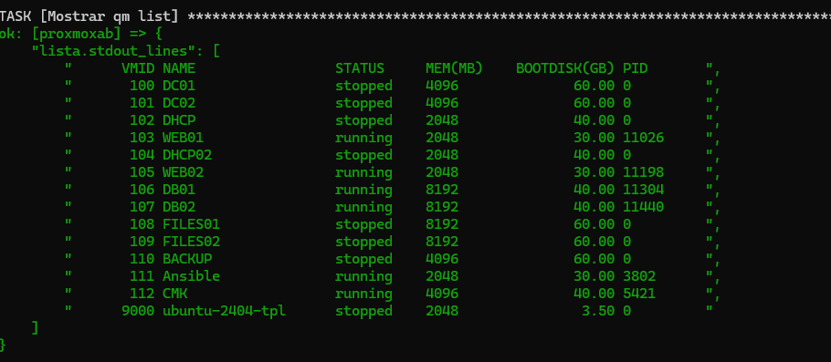
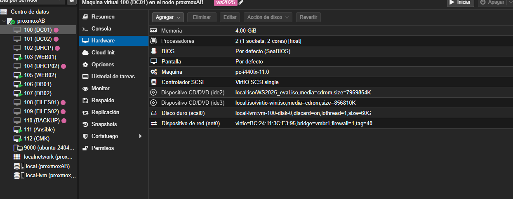
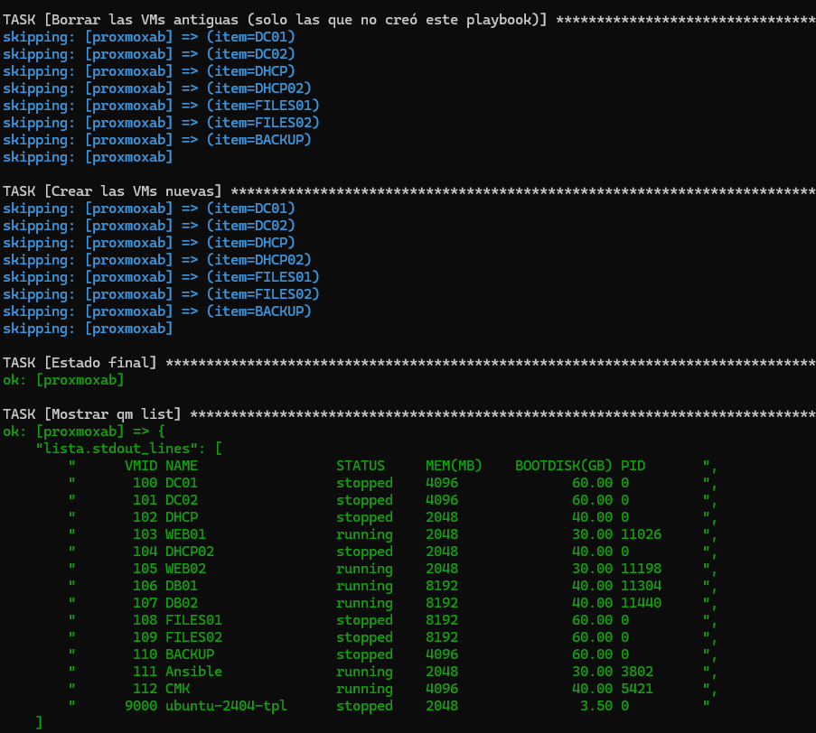
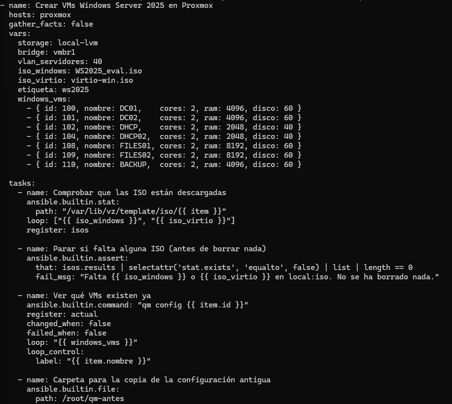
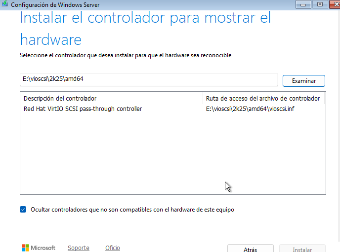

# Fase 1 — Infraestructura CiberNova (Documentación)

**Grupo 7:** Berta Sipek y Alex Gutiérrez · **Actualizado:** 13/11/2026

## 1. Introducción y alcance

CiberNova Solutions es una consultora tecnológica ficticia de 89 empleados, con oficina central en Barcelona, delegaciones en Madrid y Valencia y clientes en sectores regulados (sanitario y financiero). Tras crecer un 300 % en tres años, Dirección pide sustituir sus servidores físicos aislados, los backups manuales y la falta de monitorización por una infraestructura virtualizada, redundante y documentada. Esta Fase 1 la monta sobre un único servidor con Proxmox: identidades y DNS (Active Directory), DHCP, web, SFTP, ficheros con DFS, base de datos, usuarios y grupos con sus permisos (Anexo I) y backups, más Ansible y Checkmk como base para las Fases 2 (IA) y 3 (seguridad y auditoría).

- **Equipo:** 
  - Grupo 7, Berta Sipek y Alex Gutiérrez , servidor proxmoxAB (192.168.202.7). 
  - Alex ejecuta la automatización y los servicios Linux (Ansible, Checkmk, web, BBDD y script del CSV); 
  - Berta ejecuta Windows y el Anexo I (DC, DHCP, red de clientes, OU y permisos, GPO, DFS y copias). 
  - En cada tarea, quien no ejecuta la documenta en la misma sesión (sección 14.2).
- **Repositorio:** https://github.com/alex-gutierrezz/Proyecto-Intermodular-Berta-Sipek-Alex-Gutierrez (el 12/11 se conectó el repositorio de Ansible de la VM Ansible a este remoto, pero el push no se completó), con las carpetas (`docs/`, `ansible/`, `scripts/`, `configs/`).
- **Criterios de éxito:** las 15 pruebas de verificación del Anexo I y los servicios mínimos del enunciado funcionando.

## 2. Calendario original

Este es el calendario que planteamos el 22/09, organizado por los 5 hitos del enunciado. Lo dejamos sin retocar para poder compararlo con lo que pasó después (sección 4).

| Hito | Tareas previstas | Fecha prevista inicio | Fecha prevista fin | Responsable |
| --- | --- | --- | --- | --- |
| 1. Análisis y diseño | Necesidades, plan de IPs, VLANs, elección de SO | 22/09/2026 | 01/10/2026 | Berta y Alex |
| 2. Hipervisor | RAID, instalación Proxmox, red (bridges/VLANs) | 06/10/2026 | 15/10/2026 | Berta y Alex |
| 3. Servicios core | AD/DNS, DHCP, web, SFTP, BBDD, ficheros/DFS, usuarios, backups | 20/10/2026 | 29/10/2026 | Berta y Alex |
| 4. Redundancia y HA | DC02, DHCP failover, réplica BBDD, WEB02, DFS-R | 03/11/2026 | 12/11/2026 | Berta y Alex |
| 5. Documentación y demo | Memoria, manuales, pruebas de verificación | 17/11/2026 | 26/11/2026 | Berta y Alex |

<!-- Imagen pendiente de subir a docs/img/fase1/ -->

## 3. Diario de trabajo (bitácora)

Anotamos una fila por cada sesión de clase, también las que no pudimos avanzar, para poder justificar los desfases.

| Fecha | Trabajo realizado | Problemas / observaciones | Captura |
| --- | --- | --- | --- |
| 17/09/2026 | Brainstorming: qué queremos hacer y cómo enfocarlo | — | — (no se conserva) |
| 22/09/2026 | Diseño y planificación inicial | — | Calendario original (sección 2) |
| 24/09/2026 | Sin clase (festivo) | Sesión perdida | — |
| 29/09/2026 | Clases canceladas por lluvia | Sesión perdida | — |
| 06/10/2026 | Preparación del servidor  e intento de instalación de Proxmox | Errores en la instalación, máquina muy lenta | — (no se conserva; síntoma descrito en P1) |
| 08/10/2026 | Intento de solucionar la instalación | Reinicios muy lentos; se cedió la pantalla a otro grupo | — |
| 13/10/2026 | Configuración del RAID 10 (espejo + bandas) | Elegimos RAID 10 (espejo) para tener más redundancia: si falla un disco, tenemos su copia en el espejo. Como el servidor tiene bastante espacio en disco, nos pareció viable perder la mitad de la capacidad. | Configuración RAID en la BIOS/controladora <!-- Imagen pendiente de subir a docs/img/fase1/ --> |
| 15/10/2026 | Instalación completa de Proxmox y primeras pruebas | Con el RAID bien configurado el 13/10, la instalación terminó sin errores | Resumen del nodo proxmoxAB (pendiente) |
| 20/10/2026 | Creación de VMs Linux: WEB01, WEB02, DB01, DB02 | — | — (esas VMs se recrearon el 05/11; el estado actual está en la fila del 12/11) |
| 22/10/2026 | Creación de VMs Windows: DC01, DC02, DHCP, DHCP02, FILES01, FILES02, BACKUP | Discos de 0 GB en DHCP y FILES02 | Hardware de DHCP mostrando el disco <!-- Imagen pendiente de subir a docs/img/fase1/ --> |
| 27/10/2026 | Sin avance (miembros enfermos) | Sesión perdida | — |
| 29/10/2026 | Instalación de Ansible | Ansible core 2.16.3 instalado. La VM no traía configuración de red: se creó /etc/netplan/01-netcfg.yaml a mano | `ansible --version` en la VM Ansible (pendiente) |
| 03/11/2026 | Configuración de Ansible (inventario, playbooks, plantilla) | config file = None hasta crear ansible.cfg e inventario.ini; Git no guarda carpetas vacías (se añadió .gitkeep); rama renombrada a main | Salida actual (con --ask-vault-pass) de `ansible all -m ping` |
| 05/11/2026 | Instalación y configuración de Checkmk | VLAN 40/100 con NAT en Proxmox; DNS del centro sin respuesta (P5); plantilla 9000 y recreación de las 5 VMs Linux; playbook cortado al pegar (P6); usuario automation inexistente, error 401 (P7) | Panel de Checkmk con los hosts <!-- Imagen pendiente de subir a docs/img/fase1/ --> |
| 10/11/2026 | Organización de la documentación: explicación del plan semanal (14.1), reparto de tareas (14.2) y guías de defensa individuales. Decisión: Windows Server 2025 para las VMs Windows. Diagnóstico de las VMs Windows con qm config, sin aplicar cambios: DHCP y FILES02 sí tienen disco pero sin scsi0 en el orden de arranque; ninguna Windows tiene tag=40; la ISO montada es la de idiomas y características (LOF), no el instalador. Correcciones pasadas al jueves 12/11 | Nos comunican que la documentación se entregará y actualizará cada semana a partir de la próxima | qm config de las 7 Windows antes del cambio (hecha el 12/11)  |
| 12/11/2026 | Acceso root por clave de Ansible a Proxmox y grupo \[proxmox\] en el inventario. Descarga de WS2025\_eval.iso (es-ES) y virtio-win.iso 0.1.302. Playbook proxmox-vms-windows.yml (Guti): comprueba las ISO de WS2025 y virtio-win, guarda la configuración antigua en /root/qm-antes, borra las 7 VMs Windows vacías y las recrea con VirtIO, VLAN 40, disco en el arranque y los dos CD; la segunda ejecución no cambia nada. Commit feat(proxmox) 06aff21 en local; se conectó el repositorio a GitHub, pero el push no se completó. Descarga de ISOs e instalación de Windows: Guti; diseño del Anexo I, documentación e instrucciones del playbook: Berta. Inicio de la instalación de Windows Server 2025 con el driver vioscsi. Decisiones: dominio cibernova.local, IPs de los DC y Experiencia de escritorio. Diseño del Anexo I (Berta) | Resuelto P2; nuevos P10 (clave root) y P11 (error YAML). Las VMs Windows tenían la ISO de idiomas (LOF), sin etiqueta VLAN y con tarjetas e1000 | qm list antes y después; qm config antes; Hardware de DC01; ISOs; segunda ejecución del playbook; instalador con vioscsi    |

## 4. Desfases respecto al calendario

Para cada desfase anotamos qué habíamos planificado, qué pasó, por qué, qué medidas tomamos y qué impacto tuvo. Hasta ahora hemos perdido 3 sesiones por causas externas (24/09, 29/09 y 27/10) y unas 2 con la instalación de Proxmox.

**Propuesta inicial.** La primera propuesta de la Fase 1 se conserva en [`historico/propuesta-inicial.pdf`](historico/propuesta-inicial.pdf) como punto de partida y ha quedado superada. Planteaba 4 servidores Windows y 2 Linux sin duplicar, 10 VLAN (de la 10 a la 100) y Proxmox en 192.168.10.10 con el dominio empresa.local. El diseño actual duplica los servicios para cumplir el requisito de redundancia, solo monta las VLAN 40 y 100 (la de clientes está pendiente), usa la IP asignada al grupo (192.168.202.7) y el dominio cibernova.local, y añade Ansible y Checkmk (D5 y D6).

| # | Planificado | Qué ocurrió | Causa | Medida / replanificación | Impacto |
| --- | --- | --- | --- | --- | --- |
| D1 | Hito 1, análisis y diseño (22/09 a 01/10) | No hubo clase el 24/09 ni el 29/09 | Festivo y cancelación de las clases por lluvia | El calendario tenía margen, así que se terminó el diseño en las sesiones que quedaban sin cambiar el plan | Menos tiempo de diseño; el hipervisor empezó el 06/10, como estaba previsto |
| D2 | Hito 2, hipervisor: RAID, instalación de Proxmox y red (06/10 a 15/10) | La instalación falló el 06/10 y el 08/10; el 13/10 se configuró el RAID y el 15/10 se terminó la instalación | 1) No sabíamos entrar en la BIOS: no encontrábamos la tecla correcta y cada reinicio tardaba de 10 a 15 minutos. 2) La pantalla a la que entrábamos no era la BIOS; buscamos cómo hacerlo y cedimos la pantalla a otro grupo para ver si ellos lo sabían. 3) La instalación se reiniciaba sola por una mala configuración del RAID | Configurar el RAID en la controladora antes de reinstalar (13/10) y reinstalar (15/10). Para recuperar tiempo, buscamos agilizar la configuración de las máquinas: plantilla cloud-init y Ansible (D6) | Proxmox listo el 15/10, en la fecha prevista, pero sin la red del hito: las VLAN se configuraron el 05/11 |
| D3 | Hito 3: instalación de Ansible el 27/10 | Sin avance el 27/10 | Enfermedad de los dos miembros | Ansible se instaló el 29/10 y se priorizó la automatización (Ansible y Checkmk) para ganar tiempo en el resto de servicios | Una sesión perdida; los servicios core no se empezaron en el hito 3 (D4) |
| D4 | Hito 3: servicios Windows (AD, DHCP, ficheros) instalados entre el 20/10 y el 29/10 | VMs Windows creadas pero sin instalar a 05/11 | Se priorizaron Ansible y Checkmk | Nuevo plan semanal (sección 14): Windows y Anexo I de la semana 1 a la 4, con el reparto de 14.1 y 14.2 | Retrasa AD, DHCP, ficheros y permisos del Anexo I |
| D5 | Monitorización no prevista en la Fase 1 | Se añadió Checkmk (VM 112) con agente y alta automática por Ansible el 05/11 | Cambio de alcance: la Fase 2 exige monitorización con alertas sobre datos reales | Se adelanta como base para la Fase 2 | Una sesión más dedicada a Linux; a cambio, las Windows quedarán monitorizadas al instalarlas |
| D6 | VMs Linux instaladas con ISO (creadas el 20/10) | Se borraron vacías y se recrearon desde la plantilla 9000 con el mismo ID el 05/11 | Instalar cada una con ISO costaba de 20 a 30 minutos por VM y daba IPs repetidas al clonar | Plantilla cloud-init y clones completos con su VLAN e IP | Positivo: las 5 VMs listas para Ansible en una sesión |
| D7 | Semana 1 del nuevo plan (10/11 y 12/11): DC01 y DC02 instalados y dominio promovido, con dcdiag sin errores | El 10/11 solo hubo diagnóstico; el 12/11 se recrearon las VMs Windows con Ansible y empezó la instalación | Las correcciones de las VMs Windows (P2, VLAN, ISO) se detectaron el 10/11 | Recreación automatizada con Ansible el 12/11; la promoción del dominio y dcdiag pasan al 17/11; el formateo de discos de WEB y DB (P4) pasa a la semana 5 | Retraso de 1 sesión respecto al plan de la sección 14 |

### Detalle de D2: preparación del servidor e instalación de Proxmox

Teníamos margen en el calendario, así que Proxmox quedó instalado el 15/10, en la fecha prevista. Lo que se retrasó fue la red del hito (VLANs), que se configuró el 05/11. Las complicaciones fueron:

1. Al principio entrábamos mal a la BIOS: no encontrábamos la tecla correcta y cada reinicio tardaba de 10 a 15 minutos porque el servidor es muy lento.
2. La pantalla a la que entrábamos no era la BIOS; buscamos cómo hacerlo y cedimos la pantalla a otro grupo para ver si ellos lo sabían.
3. La instalación se reiniciaba sola por una mala configuración del RAID. El 13/10 configuramos el RAID en la controladora y el 15/10 se pudo instalar Proxmox.

Para recuperar tiempo buscamos agilizar la configuración de las máquinas y añadimos Ansible al proyecto (instalado el 29/10, D3) y la plantilla cloud-init (D6).

### Detalle de D7: Ansible sobre las VMs Windows

Ansible no instala el sistema operativo: configura máquinas que ya existen. El 12/11 lo usamos desde la VM Ansible contra Proxmox para recrear las 7 VMs Windows con el playbook proxmox-vms-windows.yml (sección 9.5): les montamos la ISO correcta de Windows Server 2025 (antes tenían la de idiomas y características, LOF), los drivers VirtIO y la VLAN 40. La instalación de Windows se hace después, a mano desde la consola (sección 11.1).

Una vez instalado el sistema operativo, Ansible se puede usar durante toda la vida del servidor para configurar redes, instalar aplicaciones, actualizar sistemas o modificar parámetros (en Windows, por WinRM).

### **Por qué adelantamos Checkmk (D5).**

Checkmk no estaba en el plan de la Fase 1 y lo añadimos el 05/11, cuando ya íbamos con retraso. Nos costó una sesión que retrasó el inicio de Windows (D4), pero lo incorporamos por cuatro motivos:

- **Responde a un problema del enunciado:** Dirección cita la falta de monitorización como uno de los problemas de la infraestructura actual.
- **Hace visible la redundancia:** si cae DC01 o WEB01, Checkmk lo avisa. En la demo de «apagar el principal y el servicio sigue» servirá de evidencia.
- **Prepara la Fase 2:** la IA tiene que trabajar con datos reales de la infraestructura. Checkmk ya acumula métricas, así que llegaremos a la Fase 2 con semanas de historial.
- **Agiliza el trabajo:** el alta es automática con Ansible, así que cada VM nueva, incluidas las 7 Windows, quedará vigilada relanzando un playbook. Riesgos como la sobreasignación del disco thin se vigilan sin revisarlos a mano.

Impacto: una sesión de retraso ahora. A cambio, las pruebas de redundancia de la semana 5 se comprobarán más rápido y la Fase 2 parte con los datos ya recogidos.

## 5. Diseño: decisiones tecnológicas

Para cada decisión anotamos lo que elegimos, las alternativas que valoramos y por qué.

| Decisión | Elegido | Alternativas valoradas | Justificación |
| --- | --- | --- | --- |
| Hipervisor | Proxmox VE 9.2.2 | XCP-ng, VMware ESXi | Libre y sin licencia, como prioriza el enunciado; interfaz web; soporte nativo de VLAN, LVM-thin y ZFS; plantillas y cloud-init para clonar VMs |
| Ecosistema | Mixto: Windows (identidades, DHCP, ficheros) + Linux (web, BBDD, gestión) | Solo Linux con Samba AD | El Anexo I pide GPO, perfiles móviles y obligatorios, ABE y DFS, que Windows Server trae de forma nativa; Linux donde es más ligero |
| SO Linux | Ubuntu Server 24.04 LTS | Debian 12 | Versión LTS; imagen cloud oficial con cloud-init para la plantilla; paquete oficial de Checkmk para 24.04 |
| SO Windows | Windows Server 2025 (evaluación), decidido el 10/11 | Windows Server 2022 (no la comparamos al decidir; la revisamos el 13/11) | Versión más reciente, con el ciclo de soporte más largo: soporte estándar hasta el 14/11/2029 y extendido hasta el 15/11/2034. Windows Server 2022 terminó su soporte estándar el 14/10/2026 y el extendido acaba el 15/10/2031 (fuente: ciclo de vida de Microsoft Learn). Evaluación de 180 días según Microsoft. Si se instala el 12/11/2026, caduca hacia el 11/05/2027 (a confirmar con slmgr /dlv). Riesgo aceptado: puede caducar antes del final de la Fase 3; ampliable con slmgr /rearm (pendiente de comprobar). |
| Almacenamiento | RAID 10 (espejo + bandas) en la controladora sobre los 4 discos de 900 GB | ZFS, RAID 1, RAID 5 | Nuestro motivo (13/10): más redundancia y una copia de la que respaldarse si falla un disco. RAID 10 forma dos espejos y reparte los datos en bandas entre ellos: aguanta la caída de un disco de cada espejo y da buen rendimiento con muchas VMs. Coste: se pierde la mitad de la capacidad (unos 1,8 TB útiles de 3,6 TB; el pool pve/data tiene 1,49 TiB). El RAID no sustituye a los backups. Descartados: RAID 1 solo aprovecha dos de los cuatro discos; RAID 5 escribe más lento y, mientras se reconstruye un disco, otro fallo hace perder todo el volumen; ZFS en Proxmox necesita los discos sin RAID de controladora. |
| Automatización | Ansible 2.16 | Scripts Bash sueltos | Idempotencia y playbooks versionados en Git |
| Monitorización | Checkmk 2.5 Community | Zabbix, Prometheus + Grafana | Edición gratuita, descubrimiento automático de servicios, compatible con Ubuntu 24.04 y colección oficial de Ansible (checkmk.general) para dar de alta hosts por API |
| Despliegue Linux | Plantilla cloud-init (ID 9000) | Instalar cada VM con ISO | Clonado en minutos y configuración idéntica |
| Router entre VLANs y NAT | Proxmox (vmbr1.40, vmbr1.100, ip\_forward e iptables MASQUERADE) | Firewall virtual OPNsense o pfSense | No hay firewall físico y es lo más rápido de montar. Es un punto único de fallo reconocido; en producción, firewall dedicado en HA |
| Acceso remoto de administración | SSH con ProxyJump por Proxmox y túneles SSH | Rutas estáticas en el PC; VPN Tailscale; redirección de puertos | No requiere administrador en el PC ni abre puertos; la red de servidores solo es accesible por un bastión. La VPN quedó descartada sin permiso del profesorado |
| Gestión de secretos | Ansible Vault (AES256) en group\_vars/all/vault.yml | Variables en texto plano; leer el secreto del servidor en cada ejecución | Ningún secreto en claro en Git, como exige el proyecto |
| Cuenta para la API de Checkmk | Cuenta de servicio automation | Usar cmkadmin | Separa los cambios automáticos de los humanos (trazabilidad). Mejora pendiente: rol con menos permisos que Administrator |
| Configuración de las VMs en Proxmox (ISO, VLAN, arranque, drivers) | Ansible desde la VM Ansible contra proxmoxAB por SSH como root (decidido el 10/11; acceso root por clave configurado el 12/11, P10) | Bucle de bash en la consola de Proxmox; API de Proxmox con token y el módulo community.general.proxmox\_kvm | Demuestra la automatización con Ansible también sobre el hipervisor y deja la configuración versionada y repetible. Riesgo aceptado: quien controle la VM Ansible controla Proxmox; en la Fase 3, sustituir por un token de API con permisos mínimos |
| Corrección de las VMs Windows | Borrarlas y recrearlas con el playbook, marcadas con la etiqueta de Proxmox ws2025 (12/11) | Modificar cada VM en su sitio con qm set (VLAN, arranque, ISO) conservando discos y MAC | No tenían sistema instalado, así que no se perdía nada. Quedan las 7 iguales (VirtIO en disco y red, VLAN 40, disco en el arranque, dos CD) y desaparecen los unused0. La etiqueta ws2025 hace el playbook idempotente: solo borra las VMs que él no creó. Copia de la configuración antigua en /root/qm-antes |
| Nombre del dominio | cibernova.local (NetBIOS CIBERNOVA), decidido el 12/11 | cibernova.internal (sufijo reservado para redes privadas); ad.cibernova.es (subdominio de un dominio registrado, lo que recomienda Microsoft) | Nombre clásico y fácil de reconocer. Riesgo reconocido: .local también lo usa mDNS y puede dar problemas de resolución en clientes Linux; se comprobará al apuntar las Linux a los DC (P3). |
| Direccionamiento de los DC | IP fija: DC01 192.168.40.10 y DC02 192.168.40.11, decidido el 12/11 | IP por DHCP con reserva | Los DC son el DNS del dominio y el DHCP depende de ellos: deben estar en una dirección que no cambie y no depender del servicio que ellos mismos sostienen. |
| Direccionamiento del resto de servidores Windows | Bloques por función: DHCP01/DHCP02 .12/.13, FILES01/FILES02 .30/.31, BACKUP .50 (decidido el 13/11) | IPs consecutivas de la .12 a la .16 (propuesta de Guti) | La IP indica la función y cada bloque deja sitio para crecer (un FILES03 sería la .32). Sigue el esquema que ya usan CMK (.20) y DB01/DB02 (.40/.41) y facilitará reglas de firewall por rangos en la Fase 3. Ninguna de estas VMs tenía IP asignada, así que no hubo que deshacer nada |
| Versión oficial de la documentación | La documentación final (documento de Claude), exportada cada jueves a Markdown (docs/fase1/memoria-fase1.md) y subida a Git (decidido el 13/11) | El fichero memoria-fase1.md de Git como versión oficial | Las tareas de cierre de cada sesión la actualizan directamente y no hay que copiar cambios a mano. La exportación semanal mantiene la documentación viva en Markdown en Git con su historial de commits. Riesgo: lo que se edite directamente en el .md se pierde en la siguiente exportación, así que solo se edita el documento |
| Edición de Windows Server | Experiencia de escritorio, decidido el 12/11 | Server Core | Las consolas gráficas (Usuarios y equipos de AD, GPMC, DFS, DHCP) permiten demostrar los conceptos y hacer las capturas. Riesgo: más superficie de ataque y más consumo; Server Core queda como mejora para la Fase 3. |

## 6. Diseño de red: VLANs, IPs y diagrama

Dividimos la red en VLAN 40 (servidores internos) y VLAN 100 (DMZ con los servidores web), con Proxmox como router y NAT hacia la red del aula. Pusimos la web en una DMZ separada para que, si alguien compromete WEB01, no tenga acceso directo a los DC ni a los ficheros. De momento el tráfico entre VLANs aún no se filtra (ver 16.3).

### 6.1 Redes

| Red | VLAN | Rango | Gateway | Máquinas |
| --- | --- | --- | --- | --- |
| Servidores | 40 | 192.168.40.0/24 | 192.168.40.1 | Ansible, CMK, DB01, DB02, Windows |
| DMZ | 100 | 192.168.100.0/24 | 192.168.100.1 | WEB01, WEB02 |
| Aula | — | 192.168.200.0/22 | 192.168.200.254 | proxmoxAB (192.168.202.7) |
| Clientes (propuesta, se decide el 17/11) | 50 | 192.168.50.0/24 | 192.168.50.1 | Equipos de usuario para las pruebas del Anexo I |

Nos falta una red de clientes: el DHCP necesita a quién repartir IPs y las pruebas 9 a 11 del Anexo I exigen iniciar sesión en equipos cliente.

Propuesta para la red de clientes: IPs fijas de .2 a .19, ámbito DHCP de .20 a .250 (cubre a los 89 empleados más el crecimiento previsto) y un agente de retransmisión DHCP en Proxmox, porque el broadcast de DHCP no cruza de la VLAN 50 a los servidores DHCP de la VLAN 40.

### 6.2 Plan de direccionamiento (VLAN 40)

| Rango / IP | Uso |
| --- | --- |
| .1 | Gateway (Proxmox, vmbr1.40) |
| .5 | Ansible |
| .10 / .11 | DC01 / DC02 |
| .12 / .13 | DHCP01 / DHCP02 |
| .20 | CMK |
| .30 / .31 | FILES01 / FILES02 |
| .40 / .41 | DB01 / DB02 |
| .50 | BACKUP |

### 6.3 Configuración en Proxmox

`vmbr0` es el bridge hacia la red del aula (192.168.202.7, puerto `nic1`) y no se modificó para no perder el acceso a Proxmox. `vmbr1` es un bridge interno VLAN-aware; las subinterfaces `vmbr1.40` y `vmbr1.100` hacen de gateway de cada VLAN, `ip_forward` convierte a Proxmox en router y dos reglas MASQUERADE hacen NAT hacia `vmbr0`. Antes del cambio se guardó copia en `/root/interfaces.bak`.

Fragmento de `/etc/network/interfaces` (pendiente: subir la copia completa a `configs/proxmox/interfaces`):

```
auto vmbr1
iface vmbr1 inet manual
    bridge-ports none
    bridge-stp off
    bridge-fd 0
    bridge-vlan-aware yes
    bridge-vids 2-4094

auto vmbr1.40
iface vmbr1.40 inet static
    address 192.168.40.1/24
    post-up echo 1 > /proc/sys/net/ipv4/ip_forward
    post-up iptables -t nat -A POSTROUTING -s 192.168.40.0/24 -o vmbr0 -j MASQUERADE
    post-down iptables -t nat -D POSTROUTING -s 192.168.40.0/24 -o vmbr0 -j MASQUERADE

auto vmbr1.100
iface vmbr1.100 inet static
    address 192.168.100.1/24
    post-up iptables -t nat -A POSTROUTING -s 192.168.100.0/24 -o vmbr0 -j MASQUERADE
    post-down iptables -t nat -D POSTROUTING -s 192.168.100.0/24 -o vmbr0 -j MASQUERADE
```

Cada VM lleva la etiqueta de su VLAN en la tarjeta de red (`tag=40` o `tag=100`). Si la VM no lleva etiqueta, no llega a su gateway, porque `vmbr1.40` y `vmbr1.100` solo atienden tramas etiquetadas.

## 7. Hipervisor Proxmox: guía de instalación reproducible

Hemos escrito esta guía para que cualquiera pueda reinstalar proxmoxAB siguiendo los pasos, con los valores exactos que usamos.

1. **Hardware de partida:** 2 Xeon E5-2620 v2, 128 GB de RAM y 4 discos de 900 GB. Número de interfaces de red: pendiente de anotar.
2. **RAID:** RAID 10 en la controladora sobre los 4 discos de 900 GB, unos 1,8 TB útiles. El pool de datos pve/data tiene 1,49 TiB.
3. **Arranque del instalador:** pendiente de anotar (versión de la ISO, cómo creamos el USB, BIOS o UEFI).
4. **Instalación:** hostname `proxmoxAB`, IP 192.168.202.7/22, gateway 192.168.200.254. Disco de destino y sistema de ficheros: pendiente de anotar.
5. **DNS:** 8.8.8.8, 1.1.1.1 y 192.168.200.254, en `/etc/resolv.conf` y en Sistema → DNS (ver P5).
6. **Red:** bridges y VLANs según la sección 6.3.
7. **Almacenamiento:** ISOs en `local` (`/var/lib/vz/template/iso/`); discos de VM en `local-lvm` (LVM-thin).
8. **Comprobación final:** acceso web por `https://192.168.202.7:8006`.

## 8. Inventario de máquinas y servicios

Estado a 12/11/2026: 6 VMs Linux desplegadas, 7 VMs Windows recreadas con el playbook proxmox-vms-windows.yml (VirtIO, VLAN 40, WS2025 y virtio-win montados, etiqueta ws2025) y una plantilla.

| ID | Nombre | SO | vCPU | RAM | Discos | VLAN | IP | Función | Estado |
| --- | --- | --- | --- | --- | --- | --- | --- | --- | --- |
| 111 | Ansible | Ubuntu 24.04 (ISO, UEFI) | 2 | 2 GB | 30 GB | 40 | 192.168.40.5 | Nodo de control Ansible + repo Git | Operativa |
| 112 | CMK | Ubuntu 24.04 (plantilla) | 2 | 4 GB | 40 GB | 40 | 192.168.40.20 | Checkmk 2.5.0p18, sitio `cibernova` | Operativa |
| 103 | WEB01 | Ubuntu 24.04 (plantilla) | 2 | 2 GB | 30 + 50 GB | 100 | 192.168.100.30 | Web + SFTP | Sin servicios |
| 105 | WEB02 | Ubuntu 24.04 (plantilla) | 2 | 2 GB | 30 + 50 GB | 100 | 192.168.100.31 | Web redundante | Sin servicios |
| 106 | DB01 | Ubuntu 24.04 (plantilla) | 4 | 8 GB | 40 + 60 GB | 40 | 192.168.40.40 | MariaDB principal | Sin servicios |
| 107 | DB02 | Ubuntu 24.04 (plantilla) | 4 | 8 GB | 40 + 60 GB | 40 | 192.168.40.41 | Réplica MariaDB | Sin servicios |
| 100 | DC01 | Windows Server | 2 | 4 GB | 60 GB | 40 | 192.168.40.10 | AD + DNS | Instalación de WS2025 iniciada el 12/11 (sin confirmar hasta qué paso) |
| 101 | DC02 | Windows Server | 2 | 4 GB | 60 GB | 40 | 192.168.40.11 | AD + DNS redundante | Instalación de WS2025 posiblemente iniciada el 12/11 (sin confirmar) |
| 102 | DHCP01 (en Proxmox aún DHCP) | Windows Server | 2 | 2 GB | 40 GB | 40 | 192.168.40.12 (por asignar) | DHCP | Instalación de WS2025 posiblemente iniciada el 12/11 (sin confirmar) |
| 104 | DHCP02 | Windows Server | 2 | 2 GB | 40 GB | 40 | 192.168.40.13 (por asignar) | DHCP failover | Instalación de WS2025 posiblemente iniciada el 12/11 (sin confirmar) |
| 108 | FILES01 | Windows Server | 2 | 8 GB | 60 GB | 40 | 192.168.40.30 (por asignar) | Ficheros + DFS | Instalación de WS2025 posiblemente iniciada el 12/11 (sin confirmar) |
| 109 | FILES02 | Windows Server | 2 | 8 GB | 60 GB | 40 | 192.168.40.31 (por asignar) | Ficheros redundante | Instalación de WS2025 posiblemente iniciada el 12/11 (sin confirmar) |
| 110 | BACKUP | Windows Server 2025 | 2 | 4 GB | 60 GB | 40 | 192.168.40.50 (por asignar) | Copias de seguridad | Instalación de WS2025 posiblemente iniciada el 12/11 (sin confirmar) |
| 9000 | ubuntu-2404-tpl | Ubuntu 24.04 cloud image | — | — | — | — | — | Plantilla cloud-init | Plantilla |

Decidido el 13/11: la VM 102 se renombra de DHCP a DHCP01, con la misma convención que el resto (DC01, FILES01). Pendiente de aplicar en Proxmox y en el playbook proxmox-vms-windows.yml.

El diseño de usuarios, grupos y permisos del Anexo I (borrador del 12/11) está en un documento aparte: [Anexo I — Usuarios, grupos y permisos (Grupo 7)](anexo-i-usuarios-grupos-permisos.md).

## 9. Automatización con Ansible

Ansible core 2.16.3 corre en la VM 111 y despliega las VMs Linux desde la plantilla 9000 con el usuario `alex` y acceso SSH por clave. Ansible no instala sistemas: necesita una máquina con SO, red, SSH y su clave autorizada, que es lo que aporta la plantilla cloud-init.

### 9.1 Plantilla cloud-init (VM 9000)

Creada en la consola de proxmoxAB a partir de la imagen cloud oficial de Ubuntu 24.04:

```bash
wget https://cloud-images.ubuntu.com/noble/current/noble-server-cloudimg-amd64.img
qm create 9000 --name ubuntu-2404-tpl --memory 2048 --cores 2 \
  --net0 virtio,bridge=vmbr1,firewall=1 --scsihw virtio-scsi-single --ostype l26
qm set 9000 --scsi0 local-lvm:0,import-from=/root/noble-server-cloudimg-amd64.img,iothread=1,discard=on
qm set 9000 --ide2 local-lvm:cloudinit
qm set 9000 --boot order=scsi0
qm set 9000 --serial0 socket --vga serial0
qm set 9000 --ciuser alex --sshkeys /root/ansible.pub
qm set 9000 --nameserver 8.8.8.8
qm template 9000
```

Cada VM Linux se crea como clon completo (`qm clone 9000 <id> --full`) y recibe su VLAN e IP con `qm set --net0 … tag=<vlan> --ipconfig0 ip=…,gw=…`. Los clones completos no dependen de la plantilla.

### 9.2 Proyecto y control de acceso

- Proyecto en `~/cibernova/ansible`: `ansible.cfg`, `inventario.ini`, `playbooks/`, `group_vars/` y `roles/`, versionado con Git en la rama `main`.
- Clave SSH ed25519 en `~/.ssh/id_ed25519`; la pública está en la plantilla, así que cada clon nace con ella.
- Variables comunes en `group_vars/all/vars.yml` (versión de Checkmk, sitio y servidor); secretos en `group_vars/all/vault.yml`, cifrado con Ansible Vault.

### 9.3 Inventario

| Grupo | Hosts | Para qué |
| --- | --- | --- |
| `control` | localhost | La propia VM de Ansible |
| `web` | cn-web01 (192.168.100.30), cn-web02 (192.168.100.31) | Servidores de la DMZ |
| `db` | cn-db01 (192.168.40.40), cn-db02 (192.168.40.41) | Bases de datos |
| `mon` | cn-cmk (192.168.40.20) | Servidor Checkmk |
| `linux` | web + db + mon | Todo lo Linux, con `ansible_user=alex` |
| `proxmox` | proxmoxab (192.168.40.1, usuario root) | Configuración de las VMs en el hipervisor |

### 9.4 Playbooks

| Playbook | Qué hace | Hosts |
| --- | --- | --- |
| `checkmk-servidor.yml` | Descarga e instala Checkmk 2.5.0p18 Community, crea el sitio `cibernova` si no existe y lo arranca | `mon` |
| `checkmk-agente.yml` | Instala el agente desde el servidor Checkmk, da de alta cada host por la API REST (`checkmk.general`), descubre sus servicios y activa los cambios | `linux` |
| `proxmox-vms-windows.yml` | Recrea las 7 VMs Windows (detalle en 9.5) | `proxmox` |

Los playbooks son idempotentes: en una segunda ejecución las tareas salen en `ok` o `skipping` y no en `changed`.

### 9.5 Detalle del playbook proxmox-vms-windows.yml



El playbook `proxmox-vms-windows.yml` se ejecuta desde la VM Ansible contra Proxmox (grupo `proxmox`) y recrea las 7 VMs Windows con la misma configuración. En `vars` se definen el almacenamiento (`local-lvm`), el bridge `vmbr1` con la VLAN 40, las dos ISO (Windows Server 2025 y los drivers VirtIO) y la lista de VMs con su ID, nombre, CPU, RAM y disco. Las tareas, en orden: comprueba que las dos ISO están descargadas y, si falta alguna, se detiene antes de borrar nada; mira qué VMs existen ya con `qm config`; guarda su configuración antigua en `/root/qm-antes` como copia de seguridad; y después borra las VMs vacías y las vuelve a crear con disco y red VirtIO, VLAN 40, disco en el arranque y las dos ISO montadas. La etiqueta `ws2025` marca las VMs que crea el propio playbook, así que en una segunda ejecución no vuelve a tocarlas: eso lo hace idempotente.

Primera y segunda ejecución. La segunda no cambia nada, lo que demuestra la idempotencia:


## 10. Monitorización con Checkmk

Checkmk 2.5.0p18 Community está instalado en CMK (192.168.40.20) con el sitio `cibernova`, y el agente ya está en las cinco VMs clonadas. Esta sección también sirve de base para el Anexo de necesidades de IA (Fase 2), porque aquí se ven las métricas que genera la infraestructura.

- **Acceso web:** por túnel SSH a través de Proxmox, porque el PC del aula no llega a la VLAN 40.
- **Alta de hosts:** automática; cualquier VM que se añada al inventario queda monitorizada relanzando `checkmk-agente.yml`, sin tocar la web.
- **Cuenta de la API:** `automation`, creada a mano porque en esta versión no existe por defecto (P8); su secreto está en Ansible Vault.
- **Qué se monitoriza:** CPU, RAM, disco y servicios descubiertos automáticamente. Las Windows se añadirán cuando estén instaladas.
- **Alertas:** pendientes; serán la base de la Fase 2.

## 11. Servicios

Para cada servicio indicamos dónde corre, cómo es redundante y con qué evidencia comprobaremos que funciona. A 13/11 Active Directory está en instalación y el resto de servicios están pendientes.

| Servicio | Máquinas | Redundancia | Evidencia prevista |
| --- | --- | --- | --- |
| Active Directory + DNS | DC01, DC02 | Dos DC replicando | Usuarios y equipos de AD con la estructura de OU; consola DNS con la zona |
| DHCP | DHCP01, DHCP02 | Failover DHCP | Consola DHCP con el ámbito y el failover configurado |
| Ficheros + DFS | FILES01, FILES02 | DFS-N + DFS-R | Consola de administración DFS con el espacio `\\<dominio>\empresa` y la replicación |
| Usuarios, grupos y permisos | DC01 + FILES01 | — | Salida del script de alta leyendo el CSV; pestaña Seguridad de una carpeta con los grupos DL\_ |
| Web | WEB01, WEB02 | Por decidir (balanceo o IP flotante con keepalived) | Navegador mostrando la web; prueba apagando WEB01 |
| SFTP | WEB01 (y WEB02) | Por decidir | Conexión con FileZilla o `sftp` |
| Base de datos | DB01, DB02 | Replicación MariaDB | `SHOW REPLICA STATUS` en DB02 |
| Backups | BACKUP | Por decidir (copia fuera del propio host) | Tarea de backup completada y una restauración de prueba |

Para demostrar la redundancia en la demo, apagaremos el nodo principal de cada servicio y enseñaremos que el servicio sigue funcionando, con captura del antes y el después.

### 11.1 Instalación de Windows Server 2025 (en curso)

El 12/11 Guti empezó a instalar Windows Server 2025 con Experiencia de escritorio, probablemente en las 7 VMs Windows (sin confirmar en cuáles ni hasta qué paso).

Para que el instalador vea el disco hay que cargar el driver VirtIO SCSI. El controlador **vioscsi** (*VirtIO SCSI*) es el driver paravirtualizado que permite a Windows Server reconocer y comunicarse a máxima velocidad con los discos duros virtuales creados en hipervisores basados en **KVM/QEMU** (como Proxmox VE, OpenStack o Red Hat Virtualization).

Si no está instalado en la máquina virtual o no se carga durante el arranque, **Windows Server no detectará ningún disco duro para instalar el sistema operativo, o bien sufrirá un pantallazo azul (`INACCESSIBLE_BOOT_DEVICE`)** si ya estaba instalado y se cambia el tipo de controladora en el hipervisor.




## 12. Problemas encontrados y soluciones

Para cada problema anotamos el síntoma, la causa, la solución y cómo comprobamos que quedó resuelto.

| # | Fecha | Síntoma | Causa | Solución | Estado |
| --- | --- | --- | --- | --- | --- |
| P1 | 06/10 – 15/10 | Instalación de Proxmox fallida y servidor muy lento, reinicios eternos | El RAID estaba mal configurado y la instalación se reiniciaba sola; además no sabíamos entrar en la BIOS y cada reinicio tardaba de 10 a 15 minutos | Configuramos el RAID 10 en la controladora el 13/10 y reinstalamos Proxmox el 15/10 | Resuelto |
| P2 | 22/10 | VMs DHCP y FILES02 creadas con disco de 0 GB | El disco existe (scsi0 de 40 y 60 GB), pero scsi0 no está en el orden de arranque (boot: order=ide2;net0); queda además un disco antiguo como unused0 | VMs recreadas con proxmox-vms-windows.yml el 12/11, con el disco en el orden de arranque. Verificado con qm list: 102 muestra 40 GB y 109, 60 GB | Resuelto |
| P3 | — | Plantilla con DNS 8.8.8.8: las VMs Linux no resolverán el dominio interno cuando exista AD | Valor fijo en cloud-init | Cambiar el DNS a DC01/DC02 vía Ansible cuando estén operativos | Pendiente |
| P4 | — | Segundo disco de WEB y DB sin formatear | — | Particionar y montar (p. ej. `/var/www`, `/var/lib/mysql`) con un rol de Ansible | Pendiente |
| P5 | 05/11 | wget en Proxmox: Temporary failure in name resolution | El DNS del centro (192.168.200.254) no respondía; había Internet (ping a 8.8.8.8 correcto) | DNS 8.8.8.8, 1.1.1.1 y 192.168.200.254 en /etc/resolv.conf y en Sistema → DNS. Verificado con ping a cloud-images.ubuntu.com | Resuelto |
| P6 | 05/11 | La VM de Ansible se queda sin red tras ifreload -a | La IP 192.168.40.1 pasó a vmbr1.40 y la VM iba sin etiqueta VLAN | qm set 111 con tag=40 conservando la MAC. Verificado con ping a 192.168.40.1, 192.168.100.1 y 8.8.8.8 | Resuelto |
| P7 | 05/11 | Playbook checkmk-agente.yml incompleto y con líneas mezcladas | El heredoc (cat > … << 'EOF') se cortó al pegarlo por SSH | Ficheros largos con nano. Verificado con tail del fichero | Resuelto |
| P8 | 05/11 | No se puede leer automation.secret y la API de Checkmk responde 401 Wrong credentials | En Checkmk 2.5.0p18 el usuario automation no existe por defecto (solo agent\_registration y cmkadmin) | Crear automation con secreto de automatización y rol Administrator, activar cambios y guardar el secreto en Vault. Verificado con curl a /api/1.0/version | Resuelto |
| P9 | 05/11 | New-NetRoute: Acceso denegado en el PC del aula | No tenemos permisos de administrador en el PC | SSH con ProxyJump por Proxmox y túneles SSH para Checkmk y RDP. Verificado entrando en DB01 sin contraseña de alex | Resuelto con alternativa |
| P10 | 12/11 | ssh root@192.168.40.1 desde la VM Ansible: Permission denied | La clave de Ansible solo estaba en /root/ansible.pub (para la plantilla cloud-init), no en authorized\_keys de root | ssh-copy-id -i \~/.ssh/id\_ed25519.pub root@192.168.40.1. Verificado con ssh -o BatchMode=yes root@192.168.40.1 hostname (proxmoxAB) y ansible proxmox -m ping (pong) | Resuelto |
| P11 | 12/11 | proxmox-vms-windows.yml no arranca: error de sintaxis YAML en la línea 95 | Un when: con «: » dentro de la expresión y sin comillas; YAML lo interpreta como otra clave | Poner la expresión entre comillas dobles. Verificado al ejecutar el playbook completo | Resuelto |

**P2 — antes del cambio (12/11/2026).** `qm list` en proxmoxAB: DHCP (102) y FILES02 (109) muestran BOOTDISK 0.00 GB porque scsi0 no está en el orden de arranque. En `/var/lib/vz/template/iso/` solo están la ISO de idiomas y características (LOF) y la de Ubuntu 24.04; falta la ISO de instalación de Windows Server 2025. Fichero: `docs/img/fase1/12-p2-qm-list-antes.png`.


Aquí se ve la configuración antes de volver a pasar el playbook con las nuevas actualizaciones, las máquinas con Windows Server tenían la configuración mal hecha y su ISO hacía referencia a la ISO de idiomas y características (LOF) que es una **imagen de disco oficial distribuida por **[**Microsoft**](https://learn.microsoft.com/en-us/azure/virtual-desktop/windows-11-language-packs)** que contiene todos los paquetes de idioma y funciones adicionales de Windows 10, Windows 11 o Windows Server en un único archivo para instalarlos sin conexión a internet**. \[[1](https://learn.microsoft.com/en-us/windows-hardware/manufacture/desktop/features-on-demand-v2--capabilities?view=windows-11), [2](https://learn.microsoft.com/en-us/windows-hardware/manufacture/desktop/languages-overview?view=windows-11), [3](https://www.youtube.com/watch?v=svF4lrOVKt8)\]


Después de ejecutar el playbook, ya no queda ninguna máquina con el disco de arranque a 0 GB.

## 13. Redundancia y puntos únicos de fallo

El enunciado pide que no haya puntos únicos de fallo, pero con un solo servidor físico el propio hipervisor lo es. Lo reconocemos y explicamos cómo lo mitigamos.

| Componente | ¿Es punto único de fallo? | Mitigación actual | Mitigación ideal en producción |
| --- | --- | --- | --- |
| Discos | No | RAID 10 | — |
| Servidor físico / Proxmox | Sí | Backups de VMs | Clúster Proxmox de 3 nodos con HA |
| Red del aula / NAT | Sí | — | Dos enlaces y router redundante |
| Identidades | No (cuando estén) | DC01 + DC02 | — |
| DHCP | No (cuando estén) | Failover | — |
| Web | No (cuando esté) | WEB01 + WEB02 | — |
| Base de datos | No (cuando esté) | Réplica DB01 → DB02 | — |
| Ficheros | No (cuando esté) | DFS-R FILES01 ↔ FILES02 | — |
| Backups | Sí si se guardan en el mismo host | Por decidir | Copia externa (regla 3-2-1) |
| Ansible / Checkmk | Sí, pero no afectan al servicio | Configuración en Git, se reconstruyen | — |

## 14. Plan para lo que queda de trimestre

Nuestro objetivo es tenerlo todo terminado el 15/12 y dejar el 17/12 y el 18/12 (último día de clase) como margen y ensayo de la defensa. Rehicimos el plan el 10/11, con clase los martes y jueves: es la replanificación que justifica el desfase D4, y lo ajustamos el 12/11 (D7).

| Semana | Sesiones | Objetivo | Hecho cuando |
| --- | --- | --- | --- |
| 1 | 10/11, 12/11 | Corregir discos de DHCP y FILES02; instalar Windows Server en DC01 y DC02; promover el dominio | `dcdiag` sin errores en ambos DC |
| 2 | 17/11, 19/11 | DHCP con failover; red de clientes; DNS de las Linux apuntando a los DC; formatear discos de WEB/DB | Un cliente recibe IP y une al dominio |
| 3 | 24/11, 26/11 | Script de alta desde el CSV (OU, grupos, usuarios, carpetas personales); GPO de contraseñas y perfiles | 89 usuarios creados; segunda ejecución sin duplicados |
| 4 | 01/12, 03/12 | FILES01/02 con DFS-N y DFS-R; carpetas, permisos NTFS y ABE según P-01 a P-44 | Pruebas 1 a 8 del Anexo I correctas |
| 5 | 08/12, 10/12 | Web + SFTP con redundancia; MariaDB con réplica; backups con restauración de prueba | Apagar el principal y el servicio sigue |
| 6 | 15/12, 17/12 | 15/12: pruebas 9 a 15, últimas capturas y memoria cerrada. 17/12: solo margen y ensayo de la defensa | Documento completo y demo ensayada |

Mientras uno instala, el otro documenta esa misma sesión: así la memoria no se queda para el final. En cada sesión actualizamos la bitácora y el inventario.

### 14.1 Qué es cada tarea del plan y por qué está ahí

Cada tarea está en ese orden porque depende de la anterior: sin dominio no hay usuarios, sin usuarios no hay permisos y sin permisos no se pueden hacer las pruebas del Anexo I.

**Semana 1 (10/11, 12/11)**

- *Corregir los discos de DHCP y FILES02.* Las dos VMs aparecen con disco de arranque de 0 GB (problema P2). Sin disco no se puede instalar Windows en ellas.
- *Windows Server en DC01 y DC02 y promover el dominio.* Active Directory es la base de todo el Anexo I: usuarios, grupos, GPO y permisos. Se montan dos DC para que la autenticación y el DNS no sean un punto único de fallo.
- *Hecho cuando `dcdiag` no da errores.* `dcdiag` comprueba la salud del dominio, incluidos el DNS y la replicación entre los dos DC. Es la prueba objetiva de que el dominio funciona.

**Semana 2 (17/11, 19/11)**

- *DHCP con failover.* Dos servidores DHCP que comparten las concesiones, para que si cae uno los equipos sigan recibiendo IP sin repetir direcciones.
- *Red de clientes.* Hace falta para probar el DHCP, unir un equipo al dominio y hacer las pruebas del Anexo I con usuarios reales. Su VLAN y su rango están pendientes de decidir.
- *DNS de las Linux hacia los DC.* La plantilla usa 8.8.8.8 (problema P3). Con el dominio en marcha, las Linux tienen que resolver los nombres internos, así que se cambia con Ansible.
- *Formatear los discos de datos de WEB y DB* (problema P4). Separa los datos del sistema: se puede ampliar, copiar o restaurar el disco de datos sin tocar el sistema operativo.

**Semana 3 (24/11, 26/11)**

- *Script de alta desde el CSV.* Es obligatorio en el Anexo I: crea OU, grupos, los 89 usuarios y sus carpetas personales, y tiene que poder relanzarse sin duplicados (idempotente).
- *GPO de contraseñas y perfiles.* El Anexo I pide 12 caracteres en general y 15 para Dirección, Sistemas y cuentas adm. Como un dominio solo tiene una directiva general, los 15 caracteres se hacen con directivas específicas (PSO) por grupo. Los perfiles son móviles para Dirección y Comercial, locales con redirección para el resto y obligatorio para recepcion.bcn.

**Semana 4 (01/12, 03/12)**

- *FILES01/02 con DFS-N y DFS-R.* DFS-N da el espacio de nombres único `\\<dominio>\empresa` que exige el Anexo I; DFS-R replica los datos entre los dos servidores para que no haya un solo servidor de ficheros.
- *Permisos NTFS y ABE según P-01 a P-44.* Traducen los requisitos de negocio a grupos DL\_ en las ACL. ABE hace que nadie vea las carpetas a las que no tiene acceso.
- *Hecho cuando pasan las pruebas 1 a 8 del Anexo I,* que son las que comprueban permisos de carpetas.

**Semana 5 (08/12, 10/12)**

- *Web + SFTP con redundancia y MariaDB con réplica.* Cubren los servicios web y de base de datos del enunciado, duplicados en dos máquinas cada uno.
- *Copias con restauración de prueba.* Una copia que no se ha restaurado nunca no demuestra nada; la restauración es la evidencia.
- *Hecho cuando se apaga el servidor principal y el servicio sigue.* Es la forma de demostrar que no hay punto único de fallo en ese servicio.

**Semana 6 (15/12, 17/12)**

- *Pruebas 9 a 15, capturas y memoria cerrada el 15/12.* Son las pruebas de perfiles, horarios, cuotas y auditoría, que dependen de todo lo anterior.
- *17/12 solo para margen y ensayo.* Si algo se retrasa, se recorta aquí y no en la memoria.

### 14.2 Reparto y entregas semanales

Alex ejecuta la automatización y los servicios Linux (discos, WinRM, DNS de las Linux, script del CSV, agente de Checkmk en Windows, web y BBDD). Berta ejecuta Windows y el Anexo I (DC, DHCP, red de clientes, OU y matriz de permisos, GPO, DFS y copias). En cada tarea, quien no ejecuta documenta esa misma sesión.

A partir de la semana del 16/11 la documentación se entrega y actualiza cada semana: los jueves, al final de la sesión, se revisan bitácora, problemas, desfases e inventario y se hace el commit `docs: bitácora semana N`.

## 15. Anexos

Documentos que el enunciado pide como entregables propios (todos pendientes, salvo el diseño del Anexo I):

- **Manual de operación y plan de recuperación:** cómo arrancar y parar la infraestructura en orden (DC antes que el resto), y cómo restaurar una VM desde backup.
- **Inventario de usuarios y grupos (Anexo I):** diagrama de OU y de anidamiento AGDLP, matriz de permisos (carpetas en filas, grupos en columnas), script de alta y movimientos de personal, evidencias de las 15 pruebas.
- **Anexo de necesidades de IA:** métricas que genera Checkmk, tareas repetitivas detectadas e ideas para la Fase 2.
- **Referencias:** documentación oficial consultada (Proxmox, Ansible, Checkmk, Microsoft).

## 16. Aprendizajes, pendientes y riesgos

### 16.1 Aprendizajes

- Ansible no instala sistemas: necesita una máquina con SO, red, SSH, Python y su clave autorizada. La plantilla cloud-init resuelve todo eso de una vez.
- Cambiar la red de Proxmox afecta a las VMs al instante: hay que copiar la configuración antes (`/root/interfaces.bak`) y aplicar la etiqueta VLAN justo después.
- Los ficheros largos se escriben con `nano`, no con heredoc: pegados por SSH se cortan.
- Ante un error de API, primero probamos la credencial a mano (`curl`) para separar si falla la herramienta o la cuenta.
- Haríamos distinto: documentar cada sesión el mismo día; algunas filas de la bitácora se nos quedaron con poco detalle.
- Copiar la clave pública a un fichero no da acceso: para entrar por SSH tiene que estar en authorized\_keys (ssh-copy-id). BatchMode=yes lo comprueba sin pedir contraseña.
- Como group\_vars/all/vault.yml se carga para todos los hosts, cualquier comando de Ansible necesita --ask-vault-pass, incluso contra Proxmox.
- En YAML, una expresión con «: » dentro de un when: va entre comillas.

### 16.2 Pendientes para la próxima sesión

- [x] Versión decidida: Windows Server 2025. Falta anotar cuándo caduca la evaluación y las alternativas valoradas (sección 5).
- [ ] Decidir el 19/11 el lenguaje del script del Anexo I: PowerShell, Ansible o un script de PowerShell lanzado desde Ansible.
- [ ] Decidir el 17/11 la red de clientes: propuesta VLAN 50, 192.168.50.0/24 (sección 6.1). Antes de decidir repasaremos las ventajas e inconvenientes de añadirla.
- [ ] Promover el dominio cibernova.local en DC01 y DC02 y comprobar con dcdiag (pasado al 17/11, D7).
- [x] Confirmar el nivel de RAID en la controladora y completar la decisión de almacenamiento.
- [ ] Anotar los datos que faltan de la instalación de Proxmox (interfaces de red, ISO, USB, BIOS/UEFI, disco y sistema de ficheros).
- [ ] Cambiar el secreto del usuario automation y actualizar el vault.
- [x] Fila del 10/11 de la bitácora completada: hubo diagnóstico, sin cambios aplicados.
- [ ] Terminar la instalación de las 7 Windows: guest tools, IP fija, nombre, WinRM y snapshot instalado-limpio.
- [ ] Repetir el push a GitHub (el remoto se añadió el 12/11, pero feat(proxmox) no llegó), comprobando antes que vault.yml está cifrado, y hacer el commit docs: bitácora 12/11.
- [ ] Renombrar la VM 102 de DHCP a DHCP01, en Proxmox y en las variables del playbook proxmox-vms-windows.yml, para que una nueva ejecución no la deje con el nombre antiguo.
- [ ] Cada jueves: exportar la documentación final a Markdown (docs/fase1/memoria-fase1.md) y subirla a Git con docs: bitácora semana N. No editar el .md a mano.
- [ ] Baja prioridad: activar el arranque automático (onboot) de las VMs Linux; no se hizo el 12/11.
- [ ] Guardar en el vault la contraseña de Administrador y la DSRM.
- [ ] Checkmk: revisar el CRIT/WARN de las Linux y repetir el service discovery (solo 2-3 servicios por host).
- [ ] Martes 17/11: playbook de Ansible que asigne las IPs fijas de la opción A (DHCP01 .12, DHCP02 .13, FILES01 .30, FILES02 .31, BACKUP .50) y reparto de lo que hace cada uno.

**Capturas que nos faltan** (se guardan en `docs/img/fase1/`):

- [ ] Proxmox: controladora RAID con el volumen RAID 10, Datacenter > Almacenamiento, resumen del nodo (CPU, RAM y versión 9.2.2) y vista de árbol con todas las VMs y la plantilla.
- [ ] Red: diagrama (Draw.io o Mermaid) con el hipervisor, los bridges, las dos VLANs con cada VM y su IP y la salida al aula; nodo > Sistema > Red con los bridges y las VLANs; Hardware de WEB01 con tag 100.
- [ ] Ansible: `ansible --version`, `tree` del directorio `ansible/`, `ansible all -m ping` con todos los hosts en verde y el PLAY RECAP de la primera y segunda ejecución de un playbook Linux.
- [ ] Checkmk: panel del sitio `cibernova`, lista de hosts con su estado y servicios de DB01.
- [ ] Problemas: el mensaje de error de cada uno, cuando lo tengamos, y la misma pantalla funcionando.
- [ ] Anexo I: las 15 pruebas de verificación con el usuario conectado visible (cuando estén hechas).

### 16.3 Riesgos y mejoras para las Fases 2 y 3

- Tráfico entre VLAN 40 y DMZ sin filtrar: limitar la DMZ a DB01/DB02 en el puerto de la base de datos.
- `host_key_checking = False` en Ansible y clave SSH sin contraseña: aceptados en laboratorio, a revisar en la Fase 3.
- El secreto de automation se compartió fuera del entorno durante una sesión de ayuda: rotarlo.
- Comprobar si el agente de Checkmk funciona sin TLS (`cmk-agent-ctl status`) y, si es así, registrarlo.
- Sobreasignación del almacenamiento thin (unos 1,6 TiB asignados sobre 1,49 TiB): vigilar el uso real con Checkmk.
- Fase 2: Checkmk ya genera métricas de todos los hosts Linux, base para las alertas predictivas.
- proxmox-vms-windows.yml borra las VMs Windows sin la etiqueta ws2025: si alguien quita la etiqueta a una VM ya instalada, el playbook la destruiría. Mejora: pedir una variable de confirmación antes de borrar.
- El repositorio de Ansible solo existe en la VM Ansible (el remoto de GitHub está añadido, pero el push aún no se ha completado): si se pierde la VM, se pierden los playbooks.
